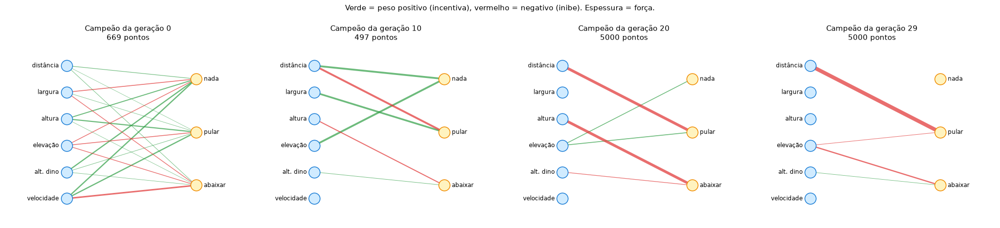

# 🦖 Dino IA — aprendendo redes neurais passo a passo

Um curso prático e em português: do primeiro neurônio escrito à mão até uma população de dinossauros que aprende sozinha a jogar o jogo do dinossauro do Chrome.

Cada lição é uma pasta com um **README explicando os conceitos**, um **script curto e comentado** e os **gráficos gerados** pelo próprio script, para você ver o aprendizado acontecendo.



---

## Roteiro

| # | Lição | O que você aprende | Tempo para rodar |
|---|---|---|---|
| 1 | [Neurônio e gradiente](licoes/01-neuronio-e-gradiente/README.md) | Peso, viés, ativação, perda, **gradiente**, retropropagação, hiperparâmetros, overfitting — tudo do zero com numpy | ~5 s |
| 2 | [O ambiente](licoes/02-o-ambiente/README.md) | O jogo em pygame, o que a IA "vê" (sensores), ações e recompensa | você joga |
| 3 | [Neuroevolução (NEAT)](licoes/03-neuroevolucao/README.md) | Treinar **sem gradiente**, por seleção e mutação. Registro de cada geração, gráficos dos pesos e relatório automático | ~10 s sem janela |
| 4 | Aprendizado por reforço (PPO) | O mesmo jogo, agora com gradiente e recompensa — a técnica mais próxima do pós-treinamento de LLMs | *em breve* |

---

## Instalação

Precisa de **Python 3.9+**.

Copie e rode um comando de cada vez:

```bash
git clone https://github.com/concriz-sistemas/dino-ia-estudo.git
```

```bash
cd dino-ia-estudo
```

```bash
python3 -m venv .venv
```

Ative o ambiente. No Mac ou Linux:

```bash
source .venv/bin/activate
```

No Windows: `.venv\Scripts\activate`

```bash
pip install -r requirements.txt
```

**Todos os comandos rodam a partir da raiz do repositório**, por exemplo:

```bash
python licoes/01-neuronio-e-gradiente/treinar_do_zero.py --ao-vivo
```

Toda vez que abrir um terminal novo, rode `source .venv/bin/activate` antes, ou o Python não vai achar as bibliotecas.

## Para ver o aprendizado acontecendo

| Lição | Comando | O que aparece |
|---|---|---|
| 1 | `python licoes/01-neuronio-e-gradiente/treinar_do_zero.py --ao-vivo` | Janela com a fronteira da rede, a perda, os pesos e o gradiente mudando a cada época |
| 2 | `python licoes/02-o-ambiente/jogar.py` | Você joga e vê os sensores que a IA recebe |
| 3 | `python licoes/03-neuroevolucao/treinar.py` | 50 dinos jogando ao mesmo tempo, geração após geração (sem `--rapido`!) |
| 3 | `python licoes/03-neuroevolucao/assistir.py` | O campeão jogando com a rede desenhada ao lado. ← → troca de geração |

Os scripts sem janela (`--rapido`, `relatorio.py` e a lição 1 sem `--ao-vivo`) só gravam arquivos em `resultados/`. Para ver os gráficos, abra os PNGs ou o README da lição.

---

## Estrutura

```
dino-ia-estudo/
├── dino/jogo.py                      # o jogo (usado nas lições 2, 3 e 4)
└── licoes/
    ├── 01-neuronio-e-gradiente/
    │   ├── README.md                 # a teoria, com os gráficos
    │   ├── treinar_do_zero.py        # rede neural só com numpy
    │   └── resultados/               # gráficos + CSV com os pesos de cada época
    ├── 02-o-ambiente/
    │   ├── README.md
    │   └── jogar.py                  # você joga e vê os sensores da IA
    └── 03-neuroevolucao/
        ├── README.md
        ├── config-neat.txt           # os parâmetros da evolução, comentados
        ├── treinar.py                # treina e registra cada geração
        ├── relatorio.py              # gera gráficos + RELATORIO.md
        ├── assistir.py               # vê o campeão de qualquer geração jogando
        └── resultados/               # historico.json, gráficos, RELATORIO.md
```

---

## Glossário rápido

| Termo | Em uma frase |
|---|---|
| **Peso** | Número que diz o quanto uma entrada importa para um neurônio. É o que se ajusta no treino. |
| **Viés (bias)** | Número somado ao neurônio, que desloca o ponto em que ele "liga". |
| **Ativação** | Curva aplicada ao neurônio (tanh, sigmoide...). Sem ela, a rede só faria retas. |
| **Perda (loss)** | Número que mede o quanto a rede erra. O treino tenta diminuí-lo. |
| **Gradiente** | Para cada peso: para que lado e quanto mexer para diminuir a perda. |
| **Retropropagação** | O jeito eficiente de calcular o gradiente, da saída para a entrada. |
| **Taxa de aprendizado** | Tamanho do passo dado na direção do gradiente. |
| **Época** | Uma passada por todos os exemplos de treino. |
| **Hiperparâmetro** | Regulagem escolhida por você, não aprendida (taxa, tamanho da rede...). |
| **Overfitting** | Decorar os exemplos de treino em vez de aprender o padrão geral. |
| **Fitness / recompensa** | A nota de quão bem a IA foi no ambiente. |
| **Geração** | Uma rodada da evolução: todos jogam, os melhores se reproduzem. |
| **Mutação** | Mudança aleatória num peso ou na estrutura da rede. |
| **Espécie** | Grupo de redes parecidas que competem entre si no NEAT. |

---

## E os LLMs (ChatGPT, Claude...)?

Usam os mesmos blocos destas lições, em escala gigantesca:

1. **Pré-treinamento** — o ciclo da **Lição 1** (forward, perda, gradiente, passo), com bilhões de pesos aprendendo a prever a próxima palavra em trilhões de textos.
2. **Pós-treinamento** — o ciclo da **Lição 4** (agir, receber recompensa, ajustar por gradiente): o modelo gera respostas, recebe uma nota (de pessoas ou de testes automáticos) e é ajustado para tirar notas melhores.

A neuroevolução da **Lição 3** não é usada para treinar LLMs (seria lenta demais com bilhões de pesos), mas é a forma mais visual de entender que **"aprender" é ajustar números até uma nota melhorar**.

---

## Bibliotecas usadas

- [numpy](https://numpy.org/) — contas com matrizes
- [matplotlib](https://matplotlib.org/) — gráficos
- [pygame](https://www.pygame.org/) — o jogo (janela, desenho, teclado)
- [neat-python](https://github.com/CodeReclaimers/neat-python) — o algoritmo NEAT
