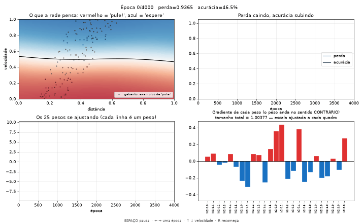
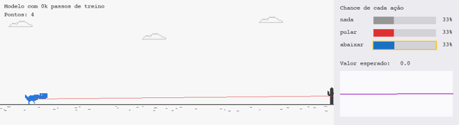

# 🦖 Dino IA — aprendendo redes neurais passo a passo

Um curso prático e em português: do primeiro neurônio escrito à mão até uma população de dinossauros que aprende sozinha a jogar o jogo do dinossauro do Chrome.

Cada lição é uma pasta com um **README explicando os conceitos**, um **script curto e comentado** e os **gráficos gerados** pelo próprio script, para você ver o aprendizado acontecendo.


---

## Roteiro

| # | Lição | O que você aprende | Tempo para rodar |
|---|---|---|---|
| 1 | [Neurônio e gradiente](licoes/01-neuronio-e-gradiente/README.md) | Peso, viés, ativação, perda, **gradiente**, retropropagação, hiperparâmetros, overfitting — tudo do zero com numpy | ~5 s |
| 2 | [O ambiente](licoes/02-o-ambiente/README.md) | O jogo em pygame, o que a IA "vê" (sensores), ações e recompensa | você joga |
| 3 | [Neuroevolução (NEAT)](licoes/03-neuroevolucao/README.md) | Treinar **sem gradiente**, por seleção e mutação. Registro de cada geração, gráficos dos pesos e relatório automático | ~10 s sem janela |
| 4 | [Aprendizado por reforço (PPO)](licoes/04-reforco/README.md) | Um dino aprende por gradiente a partir de recompensas: ator, crítico, vantagem, clip. Onde fica guardado o aprendizado e a ligação com o ajuste de LLMs | ~2 min sem janela |

Dúvidas comuns, como "alguém ensina a regra?" e "onde fica guardado o aprendizado?", estão em [Perguntas que aparecem pelo caminho](#perguntas-que-aparecem-pelo-caminho).

---

## Instalação

Precisa de **Python 3.9+**.

Copie e rode um comando de cada vez:

```bash
git clone https://github.com/concriz-sistemas/dino-ia-estudo.git
```

```bash
cd dino-ia-estudo
```

```bash
python3 -m venv .venv
```

Ative o ambiente. No Mac ou Linux:

```bash
source .venv/bin/activate
```

No Windows: `.venv\Scripts\activate`

```bash
pip install -r requirements.txt
```

**Todos os comandos rodam a partir da raiz do repositório**, por exemplo:

```bash
python licoes/01-neuronio-e-gradiente/treinar_do_zero.py --ao-vivo
```

Toda vez que abrir um terminal novo, rode `source .venv/bin/activate` antes, ou o Python não vai achar as bibliotecas.

## Passo a passo

Faça as lições na ordem. Cada passo tem um comando, o que você vai ver e o que aprende com ele. Antes de tudo, em cada terminal novo:

```bash
source .venv/bin/activate
```

### Passo 1: uma rede neural aprendendo com gradiente

```bash
python licoes/01-neuronio-e-gradiente/treinar_do_zero.py --ao-vivo
```

O terminal mostra as primeiras contas do gradiente, peso por peso. Depois abre o replay do treino:



Teclas: **ESPAÇO** pausa, **← →** anda uma época, **↑ ↓** muda a velocidade, **R** recomeça.

Repare que a faixa vermelha surge rápido e depois só fica mais nítida, enquanto as barras do gradiente encolhem. A explicação está em [Por que a forma aparece rápido e depois "para"?](licoes/01-neuronio-e-gradiente/README.md#por-que-a-forma-aparece-rápido-e-depois-para).

### Passo 2: o jogo que a IA vai jogar

```bash
python licoes/02-o-ambiente/jogar.py
```

Você joga (ESPAÇO pula, ↓ abaixa) e vê no canto os 6 números que a IA recebe no lugar dos olhos. [Lição 2](licoes/02-o-ambiente/README.md).

### Passo 3: 50 dinos evoluindo

```bash
python licoes/03-neuroevolucao/treinar.py
```

Cada geração, 50 dinos com redes diferentes jogam juntos; os melhores têm filhos com mutações. A tecla V acelera. Depois, gere os gráficos e o relatório:

```bash
python licoes/03-neuroevolucao/relatorio.py
```

E veja o campeão de cada geração jogando, com a rede desenhada ao lado (← → troca de geração):

```bash
python licoes/03-neuroevolucao/assistir.py
```


[Lição 3](licoes/03-neuroevolucao/README.md).

### Passo 4: aprendizado por reforço

```bash
python licoes/04-reforco/treinar.py
```

Um único dino joga milhares de partidas e ajusta os pesos por gradiente para ganhar mais recompensa (`+0.1` por quadro vivo, `−1` ao bater). Junta o gradiente do passo 1 com a nota do passo 3. Leva uns 2 minutos, sem janela. Depois, gere os gráficos:

```bash
python licoes/04-reforco/relatorio.py
```

E veja o dino jogando, com a chance de cada ação e o valor esperado ao lado (← → troca de modelo salvo):

```bash
python licoes/04-reforco/assistir.py
```



A lição também responde onde fica guardado o aprendizado (num arquivo de pesos, como um LLM) e mostra a ligação com o ajuste de LLMs. [Lição 4](licoes/04-reforco/README.md).

### Gravando as animações

Os GIFs desta página são gerados pelos próprios scripts:

```bash
python licoes/01-neuronio-e-gradiente/treinar_do_zero.py --gif
```

```bash
python licoes/03-neuroevolucao/assistir.py --gif
```

```bash
python licoes/04-reforco/assistir.py --gif
```

---

## Estrutura

```
dino-ia-estudo/
├── dino/jogo.py                      # o jogo (usado nas lições 2, 3 e 4)
├── dino/sprites.py                   # as figuras em pixel art, editáveis como texto
└── licoes/
    ├── 01-neuronio-e-gradiente/
    │   ├── README.md                 # a teoria, com os gráficos
    │   ├── treinar_do_zero.py        # rede neural só com numpy
    │   └── resultados/               # gráficos + CSV com os pesos de cada época
    ├── 02-o-ambiente/
    │   ├── README.md
    │   └── jogar.py                  # você joga e vê os sensores da IA
    ├── 03-neuroevolucao/
    │   ├── README.md
    │   ├── config-neat.txt           # os parâmetros da evolução, comentados
    │   ├── treinar.py                # treina e registra cada geração
    │   ├── relatorio.py              # gera gráficos + RELATORIO.md
    │   ├── assistir.py               # vê o campeão de qualquer geração jogando
    │   └── resultados/               # historico.json, gráficos, RELATORIO.md
    └── 04-reforco/
        ├── README.md
        ├── ambiente.py               # o jogo no formato Gymnasium (observação, ação, recompensa)
        ├── treinar.py                # treina com PPO e salva o modelo em vários momentos
        ├── relatorio.py              # gráficos, mapa de decisão + RELATORIO.md
        ├── assistir.py               # o dino jogando, com a cabeça dele ao lado
        └── resultados/modelos/       # o aprendizado: arquivos com os pesos da rede
```

---

## Glossário rápido

| Termo | Em uma frase |
|---|---|
| **Peso** | Número que diz o quanto uma entrada importa para um neurônio. É o que se ajusta no treino. |
| **Viés (bias)** | Número somado ao neurônio, que desloca o ponto em que ele "liga". |
| **Ativação** | Curva aplicada ao neurônio (tanh, sigmoide...). Sem ela, a rede só faria retas. |
| **Perda (loss)** | Número que mede o quanto a rede erra. O treino tenta diminuí-lo. |
| **Gradiente** | Para cada peso: para que lado e quanto mexer para diminuir a perda. |
| **Retropropagação** | O jeito eficiente de calcular o gradiente, da saída para a entrada. |
| **Taxa de aprendizado** | Tamanho do passo dado na direção do gradiente. |
| **Época** | Uma passada por todos os exemplos de treino. |
| **Hiperparâmetro** | Regulagem escolhida por você, não aprendida (taxa, tamanho da rede...). |
| **Overfitting** | Decorar os exemplos de treino em vez de aprender o padrão geral. |
| **Fitness / recompensa** | A nota de quão bem a IA foi no ambiente. |
| **Geração** | Uma rodada da evolução: todos jogam, os melhores se reproduzem. |
| **Mutação** | Mudança aleatória num peso ou na estrutura da rede. |
| **Espécie** | Grupo de redes parecidas que competem entre si no NEAT. |

---

## Perguntas que aparecem pelo caminho

**Alguém ensina a regra para a IA?**
Não. Em nenhuma lição a IA recebe a regra "pule quando o cacto estiver perto". Na lição 1, a regra existe no código só para gerar 600 exemplos já respondidos, e a rede aprende com os exemplos sem nunca ver a regra. Nas lições 3 e 4 nem isso: a IA só recebe uma nota ou uma recompensa, que diz se deu certo, nunca como fazer.

**Então o aprendizado é aleatório?**
Só em parte. Os pesos começam sorteados em todas as lições. Na lição 1 e na 4, daí em diante o gradiente calcula para que lado mexer cada peso, sem sorteio. Na lição 3, as mutações são sorteadas, mas a seleção não: os dinos que vão mais longe têm filhos. O acaso propõe e a nota escolhe. Por isso cada treino dá números diferentes, mas a regra principal ("longe = não pule") sempre aparece.

**Por que no replay a forma aparece rápido e depois quase não muda?**
No começo a rede erra muito, o gradiente é grande e cada passo mexe bastante nos pesos. Perto do fundo do "vale" da perda, o gradiente fica minúsculo (de ~1 para ~0,002 na lição 1) e os pesos quase param. Isso se chama convergência. [Explicação completa na lição 1](licoes/01-neuronio-e-gradiente/README.md#por-que-a-forma-aparece-rápido-e-depois-para), incluindo a ligação com regressão linear.

**Por que o treino da lição 4 fica parado e depois dá um salto?**
Por uns 600 mil passos, o dino fica preso em "pular sem parar", que rende uns 150 pontos e é difícil de largar (um *ótimo local*). Quando descobre que esperar o cacto chegar perto rende muito mais, a média dispara para perto de 5000. Nos primeiros testes, sem ajustes, ele não saiu do platô em 500 mil passos e, com 2 milhões, só saiu perto do fim. O que adiantou o salto foi fazer cada ação valer 2 quadros e dar mais bônus para explorar.

**A IA faz o que um humano faria?**
Nem sempre. Diante de um pássaro na altura da cabeça, o dino da lição 4 fica abaixado enquanto o pássaro está longe e pula por cima quando ele chega perto. Ninguém ensinou isso, e funciona. A recompensa premia o resultado, não o jeito.

**Por que o dino joga melhor no teste do que no treino?**
No treino, o agente da lição 4 ainda sorteia ações para explorar, então às vezes erra de propósito. No teste ele sempre escolhe a ação mais provável. Por isso a média no treino fica em ~4.300, enquanto o modelo final fez 5000 em todas as 10 partidas novas.

**Depois de treinado, o aprendizado fica guardado?**
Fica, num arquivo de pesos. O dino da lição 4 é o arquivo `licoes/04-reforco/resultados/modelos/ppo_02000k.zip`: 64 KB com 2.692 números. Carregar esse arquivo é ter o dino que sabe jogar, sem treinar de novo. Na lição 1, a última linha de `historico_pesos.csv` tem os pesos finais; na lição 3, o `campeoes.pkl` guarda o campeão de cada geração.

**Isso é parecido com um LLM?**
É a mesma ideia em escala gigante. Um LLM também é um arquivo de pesos, só que com bilhões de números e de alguns a centenas de gigabytes. E, como aqui, usar não muda o arquivo: rodar o `assistir.py` mil vezes não ensina nada ao dino, e um LLM não aprende enquanto conversa com você. Ele só muda quando um novo treino gera um novo arquivo, ou seja, uma nova versão do modelo.

---

## E os LLMs (ChatGPT, Claude...)?

Usam os mesmos blocos destas lições, em escala gigantesca:

1. **Pré-treinamento** — o ciclo da **Lição 1** (forward, perda, gradiente, passo), com bilhões de pesos aprendendo a prever a próxima palavra em trilhões de textos.
2. **Pós-treinamento** — o ciclo da **Lição 4** (agir, receber recompensa, ajustar por gradiente): o modelo gera respostas, recebe uma nota (de pessoas ou de testes automáticos) e é ajustado para tirar notas melhores.

A neuroevolução da **Lição 3** não é usada para treinar LLMs (seria lenta demais com bilhões de pesos), mas é a forma mais visual de entender que **"aprender" é ajustar números até uma nota melhorar**.

---

## Bibliotecas usadas

- [numpy](https://numpy.org/) — contas com matrizes
- [matplotlib](https://matplotlib.org/) — gráficos
- [pygame](https://www.pygame.org/) — o jogo (janela, desenho, teclado)
- [neat-python](https://github.com/CodeReclaimers/neat-python) — o algoritmo NEAT
- [Gymnasium](https://gymnasium.farama.org/) — o formato padrão de ambientes de reforço
- [Stable-Baselines3](https://stable-baselines3.readthedocs.io/) — o algoritmo PPO (usa o [PyTorch](https://pytorch.org/), que é um download grande)
