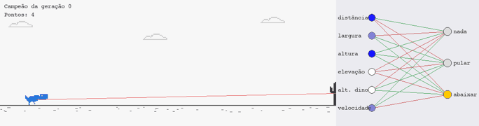
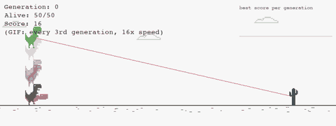
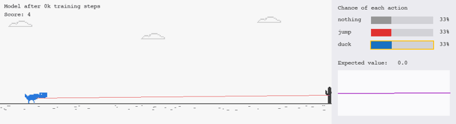
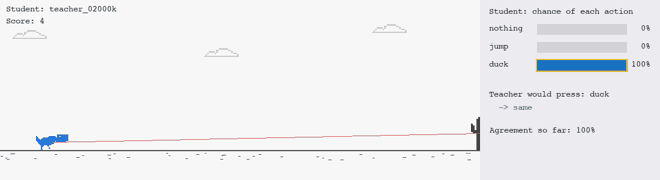
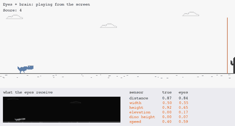
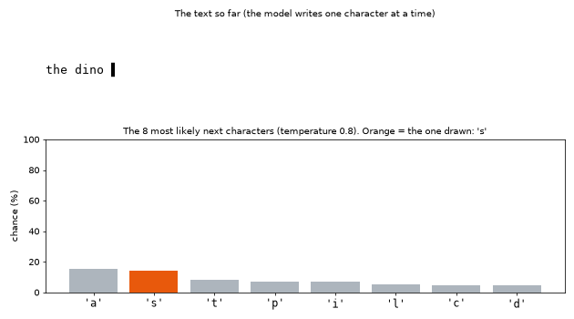
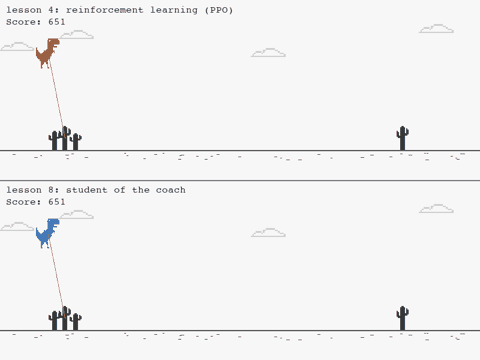

[English](README.md) · **Português** · [Español](README.es.md)

# 🦖 Dino AI — aprendendo redes neurais passo a passo

Um estudo prático: do primeiro neurônio escrito à mão até uma população de dinossauros que aprende sozinha a jogar o jogo do dinossauro do Chrome.

Cada lição é uma pasta com um **README explicando os conceitos**, um **script curto e comentado** e os **gráficos gerados** pelo próprio script, para você ver o aprendizado acontecendo. O código, os gráficos e as mensagens do terminal estão em inglês; os READMEs existem em inglês, português e espanhol.



---

## Roteiro

| # | Lição | O que você aprende | Tempo para rodar |
|---|---|---|---|
| 1 | [Neurônio e gradiente](lessons/01-neuron-and-gradient/README.pt-BR.md) | Peso, viés, ativação, perda, **gradiente**, retropropagação, hiperparâmetros, overfitting — tudo do zero com numpy | ~5 s |
| 2 | [O ambiente](lessons/02-the-environment/README.pt-BR.md) | O jogo em pygame, o que a IA "vê" (sensores), ações e recompensa | você joga |
| 3 | [Neuroevolução (NEAT)](lessons/03-neuroevolution/README.pt-BR.md) | Treinar **sem gradiente**, por seleção e mutação. Registro de cada geração, gráficos dos pesos e relatório automático | ~3 s sem janela |
| 4 | [Aprendizado por reforço (PPO)](lessons/04-reinforcement/README.pt-BR.md) | Um dino aprende por gradiente a partir de recompensas: ator, crítico, vantagem, clip. Onde fica guardado o aprendizado e a ligação com o ajuste de LLMs | ~2 min sem janela |
| 5 | [Imitação](lessons/05-imitation/README.pt-BR.md) | Você joga e uma rede aprende a copiar você, ou copia o agente da lição 4. Aprendizado supervisionado a partir de demonstrações, e por que os LLMs imitam antes de usar reforço | ~2 s para treinar |
| 6 | [Aprender a enxergar](lessons/06-vision/README.pt-BR.md) | Uma rede convolucional (CNN) lê a tela em vez dos 6 números: filtros, camadas, e por que uma rede falha em cenas que nunca viu (o DAgger corrige) | ~20 min para treinar; olhos treinados incluídos |
| 7 | [Um mini modelo de linguagem](lessons/07-language-model/README.pt-BR.md) | Um *transformer* minúsculo, a arquitetura de um LLM, aprende a escrever prevendo o próximo caractere: tokens, atenção, temperatura, *embeddings* e similaridade de cosseno de verdade, e decorar × aprender | ~30 s para treinar |
| 8 | [Modo difícil: quando o mundo muda](lessons/08-hard-mode/README.pt-BR.md) | Um jogo mais difícil, com formações de pássaros. Os agentes antigos falham, só o reforço não aprende, um planejador resolve, e um aluno que imita um treinador aprende (e quase esquece o jogo antigo) | ~1 min para assistir; experimentos de 5 a 20 min |

Dúvidas comuns, como "alguém ensina a regra?" e "onde fica guardado o aprendizado?", estão em [Perguntas que aparecem pelo caminho](#perguntas-que-aparecem-pelo-caminho).

---

## Instalação

Precisa de **Python 3.9+**.

Copie e rode um comando de cada vez:

```bash
git clone https://github.com/remofurlanetto/dino-ai-study.git
```

```bash
cd dino-ai-study
```

```bash
python3 -m venv .venv
```

Ative o ambiente. No Mac ou Linux:

```bash
source .venv/bin/activate
```

No Windows: `.venv\Scripts\activate`

```bash
pip install -r requirements.txt
```

**Todos os comandos rodam a partir da raiz do repositório**, por exemplo:

```bash
python lessons/01-neuron-and-gradient/train_from_scratch.py --live
```

Toda vez que abrir um terminal novo, rode `source .venv/bin/activate` antes, ou o Python não vai achar as bibliotecas.

## Passo a passo

Faça as lições na ordem. Cada passo tem um comando, o que você vai ver e o que aprende com ele. Antes de tudo, em cada terminal novo:

```bash
source .venv/bin/activate
```

### Passo 1: uma rede neural aprendendo com gradiente

```bash
python lessons/01-neuron-and-gradient/train_from_scratch.py --live
```

O terminal mostra as primeiras contas do gradiente, peso por peso. Depois abre o replay do treino:


Teclas: **ESPAÇO** pausa, **← →** anda uma época, **↑ ↓** muda a velocidade, **R** recomeça.

Repare que a faixa vermelha surge rápido e depois só fica mais nítida, enquanto as barras do gradiente encolhem. A [lição 1](lessons/01-neuron-and-gradient/README.pt-BR.md) explica por quê.

### Passo 2: o jogo que a IA vai jogar

```bash
python lessons/02-the-environment/play.py
```

Você joga (ESPAÇO pula, ↓ abaixa) e vê no canto os 6 números que a IA recebe no lugar dos olhos. [Lição 2](lessons/02-the-environment/README.pt-BR.md).

### Passo 3: 50 dinos evoluindo

```bash
python lessons/03-neuroevolution/train.py
```

Cada geração, 50 dinos com redes diferentes jogam juntos; os melhores têm filhos com mutações. As setas ↑ ↓ mudam a velocidade (de 1x a 64x) e V pula para a velocidade máxima:



Depois, gere os gráficos e o relatório:

```bash
python lessons/03-neuroevolution/report.py
```

E veja o campeão de cada geração jogando, com a rede desenhada ao lado (← → troca de geração):

```bash
python lessons/03-neuroevolution/watch.py
```


[Lição 3](lessons/03-neuroevolution/README.pt-BR.md).

### Passo 4: aprendizado por reforço

```bash
python lessons/04-reinforcement/train.py
```

Um único dino joga milhares de partidas e ajusta os pesos por gradiente para ganhar mais recompensa (`+0.1` por quadro vivo, `−1` ao bater). Junta o gradiente do passo 1 com a nota do passo 3. Leva uns 2 minutos, sem janela. Depois, gere os gráficos:

```bash
python lessons/04-reinforcement/report.py
```

E veja o dino jogando, com a chance de cada ação e o valor esperado ao lado (← → troca de modelo salvo):

```bash
python lessons/04-reinforcement/watch.py
```



A lição também responde onde fica guardado o aprendizado (num arquivo de pesos, como um LLM) e mostra a ligação com o ajuste de LLMs. [Lição 4](lessons/04-reinforcement/README.pt-BR.md).

### Passo 5: imitação

```bash
python lessons/05-imitation/train.py
```

Uma rede aluna aprende a jogar copiando um professor: aqui, 10 partidas gravadas do agente da lição 4. Uma única partida gravada e 2 segundos de treino bastam para um jogador perfeito. Depois, veja o aluno jogando ao lado das escolhas do professor:

```bash
python lessons/05-imitation/watch.py
```



E ensine você mesmo: jogue algumas partidas e cada quadro é gravado.

```bash
python lessons/05-imitation/record.py
```

[Lição 5](lessons/05-imitation/README.pt-BR.md).

### Passo 6: aprender a enxergar

```bash
python lessons/06-vision/watch.py
```

O dino joga só a partir da tela. Uma rede convolucional (os olhos) lê a imagem e estima os 6 números; o agente da lição 4 (o cérebro) decide a partir deles. Os olhos treinados já estão no repositório; treinar você mesmo leva uns 20 a 25 minutos:

```bash
python lessons/06-vision/train_eyes.py
```



[Lição 6](lessons/06-vision/README.pt-BR.md).

### Passo 7: um mini modelo de linguagem

```bash
python lessons/07-language-model/train.py
```

Um *transformer* minúsculo, a mesma arquitetura de um LLM, lê os READMEs deste estudo e aprende a prever o próximo caractere. Em uns 30 segundos, ele passa de letras aleatórias a um texto que soa como inglês. Depois, faça ele escrever:

```bash
python lessons/07-language-model/generate.py
```



[Lição 7](lessons/07-language-model/README.pt-BR.md).

### Passo 8: modo difícil, quando o mundo muda

```bash
python lessons/08-hard-mode/watch.py
```

Um jogo mais difícil, com túneis e escadinhas de pássaros que só se passam abaixando. Todos os agentes treinados no jogo original falham. Só o reforço não consegue aprender o jogo novo, nem com currículo nem com mais exploração; um planejador que faz buscas resolve, mas é lento; e um aluno que imita um treinador aprende, com 5000 nos dois jogos.



[Lição 8](lessons/08-hard-mode/README.pt-BR.md).

### Gravando as animações

Os GIFs desta página são gerados pelos próprios scripts:

```bash
python lessons/01-neuron-and-gradient/train_from_scratch.py --gif
```

```bash
python lessons/03-neuroevolution/train.py --gif
```

```bash
python lessons/03-neuroevolution/watch.py --gif
```

```bash
python lessons/04-reinforcement/watch.py --gif
```

```bash
python lessons/06-vision/watch.py --gif
```

---

## Estrutura

```
dino-ai-study/
├── dino/game.py                      # o jogo (usado nas lições 2, 3 e 4)
├── dino/sprites.py                   # as figuras em pixel art, editáveis como texto
└── lessons/
    ├── 01-neuron-and-gradient/
    │   ├── README.md                 # a teoria, com os gráficos
    │   ├── train_from_scratch.py     # rede neural só com numpy
    │   └── results/                  # gráficos + CSV com os pesos de cada época
    ├── 02-the-environment/
    │   ├── README.md
    │   └── play.py                   # você joga e vê os sensores da IA
    ├── 03-neuroevolution/
    │   ├── README.md
    │   ├── neat-config.txt           # os parâmetros da evolução, comentados
    │   ├── train.py                  # treina e registra cada geração
    │   ├── report.py                 # gera gráficos + REPORT.md
    │   ├── watch.py                  # vê o campeão de qualquer geração jogando
    │   └── results/                  # history.json, gráficos, REPORT.md
    ├── 04-reinforcement/
    │   ├── README.md
    │   ├── environment.py            # o jogo no formato Gymnasium (observação, ação, recompensa)
    │   ├── train.py                  # treina com PPO e salva o modelo em vários momentos
    │   ├── report.py                 # gráficos, mapa de decisão + REPORT.md
    │   ├── watch.py                  # o dino jogando, com a cabeça dele ao lado
    │   └── results/models/           # o aprendizado: arquivos com os pesos da rede
    ├── 05-imitation/
    │   ├── README.md
    │   ├── record.py                 # você joga (ou o agente da lição 4 joga) e cada quadro é gravado
    │   ├── train.py                  # uma rede aluna aprende a imitar as gravações
    │   ├── experiments.py            # professores forte, fraco e lento: o aluno fica tão bom?
    │   ├── watch.py                  # o aluno jogando, ao lado das escolhas do professor
    │   └── results/demos/            # as demonstrações gravadas (CSV)
    ├── 06-vision/
    │   ├── README.md
    │   ├── vision.py                 # a câmera, os olhos (CNN) e o agente da lição 4 como cérebro
    │   ├── train_eyes.py             # treina os olhos, com rodadas de DAgger
    │   ├── pixels_to_keys.py         # a outra abordagem: dos pixels direto para as teclas
    │   ├── watch.py                  # olhos + cérebro jogando, com o que os olhos veem
    │   └── results/eyes.pt           # os olhos treinados
    ├── 07-language-model/
    │   ├── README.md
    │   ├── tiny_lm.py                # o texto, o bigrama e o transformer minúsculo
    │   ├── train.py                  # treina e guarda o melhor modelo em texto novo
    │   ├── generate.py               # faz o modelo escrever, com temperatura
    │   ├── inside.py                 # embeddings, similaridade de cosseno e atenção
    │   └── data/study.txt            # o texto de treino: os READMEs deste estudo
    └── 08-hard-mode/
        ├── README.md
        ├── hard_game.py              # o jogo difícil (o original continua igual)
        ├── planner.py                # um planejador que faz buscas, sem aprender
        ├── test_agents.py            # todos os agentes do estudo nos dois jogos
        ├── rl_attempts.py            # quatro tentativas com aprendizado por reforço
        ├── train_student.py          # um aluno que imita um treinador, com DAgger
        └── watch.py                  # o agente da lição 4 e o aluno na mesma partida
```

Cada README existe em três versões: `README.md` (inglês), `README.pt-BR.md` (português) e `README.es.md` (espanhol).

---

## Aprofundamentos

Páginas mais calmas e visuais sobre assuntos que aparecem pelo caminho:

- [Peso, viés, ativação e perda](lessons/01-neuron-and-gradient/concepts/README.pt-BR.md): cada ideia com uma analogia do dia a dia, um gráfico, uma animação e um exemplo pequeno calculado à mão.
- [Por que GPUs?](deep-dives/gpu/README.pt-BR.md): o que uma rede neural calcula de fato, CPU × GPU medidos num Mac, e quanto processamento cada lição (e um LLM grande) precisa.

---

## Glossário rápido

| Termo | Em inglês | Em uma frase |
|---|---|---|
| **Peso** | weight | Número que diz o quanto uma entrada importa para um neurônio. É o que se ajusta no treino. |
| **Viés** | bias | Número somado ao neurônio, que desloca o ponto em que ele "liga". |
| **Ativação** | activation | Curva aplicada ao neurônio (tanh, sigmoide...). Sem ela, a rede só faria retas. |
| **Perda** | loss | Número que mede o quanto a rede erra. O treino tenta diminuí-lo. |
| **Gradiente** | gradient | Para cada peso: para que lado e quanto mexer para diminuir a perda. |
| **Retropropagação** | backpropagation | O jeito eficiente de calcular o gradiente, da saída para a entrada. |
| **Taxa de aprendizado** | learning rate | Tamanho do passo dado na direção do gradiente. |
| **Época** | epoch | Uma passada por todos os exemplos de treino. |
| **Hiperparâmetro** | hyperparameter | Regulagem escolhida por você, não aprendida (taxa, tamanho da rede...). |
| **Overfitting** | overfitting | Decorar os exemplos de treino em vez de aprender o padrão geral. |
| **Fitness / recompensa** | fitness / reward | A nota de quão bem a IA foi no ambiente. |
| **Geração** | generation | Uma rodada da evolução: todos jogam, os melhores se reproduzem. |
| **Mutação** | mutation | Mudança aleatória num peso ou na estrutura da rede. |
| **Espécie** | species | Grupo de redes parecidas que competem entre si no NEAT. |

Os cinco primeiros (peso, viés, ativação, perda e gradiente) são explicados com calma, com analogias, gráficos e uma animação, no [mergulho profundo da lição 1](lessons/01-neuron-and-gradient/concepts/README.pt-BR.md).

---

## Perguntas que aparecem pelo caminho

**Alguém ensina a regra para a IA?**
Não. Em nenhuma lição a IA recebe a regra "pule quando o cacto estiver perto". Na lição 1, a regra existe no código só para gerar 600 exemplos já respondidos, e a rede aprende com os exemplos sem nunca ver a regra. Nas lições 3 e 4 nem isso: a IA só recebe uma nota ou uma recompensa, que diz se deu certo, nunca como fazer.

**O dino aprende sozinho a enxergar onde estão os obstáculos?**
Não, e isso é proposital. Em nenhuma lição o dino vê a tela. O código do jogo mede tudo e entrega 6 números prontos: distância, largura, altura e elevação do próximo obstáculo, a altura do dino e a velocidade. É como dar a ele um sensor de distância em vez de olhos. O que ele aprende sozinho é **o que fazer** com esses números: quando pular, quando abaixar, quando esperar. Aprender a enxergar a partir dos pixels da tela, como a DeepMind fez com jogos de Atari, exige uma rede convolucional e muito mais treino. É a [lição 6](lessons/06-vision/README.pt-BR.md): lá, uma CNN aprende a estimar esses 6 números a partir da tela, e o dino joga só com os pixels.

**E a lição 1, então?**
A lição 1 nem tem dino jogando. É um exercício com exemplos prontos (o *gabarito*, os pontos dos gráficos) para ver o gradiente funcionando de perto. Quem aprende de verdade a jogar, sem ninguém saber a resposta, são os dinos das lições 3 e 4.

**Então o aprendizado é aleatório?**
Só em parte. Os pesos começam sorteados em todas as lições. Na lição 1 e na 4, daí em diante o gradiente calcula para que lado mexer cada peso, sem sorteio. Na lição 3, as mutações são sorteadas, mas a seleção não: os dinos que vão mais longe têm filhos. O acaso propõe e a nota escolhe. Por isso cada semente dá números diferentes, mas a regra principal ("longe = não pule") sempre aparece.

**Por que no replay a forma aparece rápido e depois quase não muda?**
No começo a rede erra muito, o gradiente é grande e cada passo mexe bastante nos pesos. Perto do fundo do "vale" da perda, o gradiente fica minúsculo (de ~1 para ~0,002 na lição 1) e os pesos quase param. Isso se chama convergência. A [lição 1](lessons/01-neuron-and-gradient/README.pt-BR.md) tem a explicação completa, incluindo a ligação com regressão linear.

**Por que o treino da lição 4 fica parado e depois dá um salto?**
Por uns 600 mil passos, o dino fica preso em "pular sem parar", que rende uns 150 pontos e é difícil de largar (um *ótimo local*). Quando descobre que esperar o cacto chegar perto rende muito mais, a média dispara para perto de 5000. Nos primeiros testes, sem ajustes, ele não saiu do platô em 500 mil passos e, com 2 milhões, só saiu perto do fim. O que adiantou o salto foi fazer cada ação valer 2 quadros e dar mais bônus para explorar.

**A IA faz o que um humano faria?**
Nem sempre. Diante de um pássaro na altura da cabeça, o dino da lição 4 fica abaixado enquanto o pássaro está longe e pula por cima quando ele chega perto. Ninguém ensinou isso, e funciona. A recompensa premia o resultado, não o jeito.

**Por que o dino joga melhor no teste do que no treino?**
No treino, o agente da lição 4 ainda sorteia ações para explorar, então às vezes erra de propósito. No teste ele sempre escolhe a ação mais provável. Por isso a média no treino fica em ~4.300, enquanto o modelo final fez 5000 em todas as 10 partidas novas.

**Depois de treinado, o aprendizado fica guardado?**
Fica, num arquivo de pesos. O dino da lição 4 é o arquivo `lessons/04-reinforcement/results/models/ppo_02000k.zip`: uns 62 KB com 2.692 números. Carregar esse arquivo é ter o dino que sabe jogar, sem treinar de novo. Na lição 1, a última linha de `weight_history.csv` tem os pesos finais; na lição 3, o `champions.pkl` guarda o campeão de cada geração.

**Isso é parecido com um LLM?**
É a mesma ideia em escala gigante. Um LLM também é um arquivo de pesos, só que com bilhões de números e de alguns a centenas de gigabytes. E, como aqui, usar não muda o arquivo: rodar o `watch.py` mil vezes não ensina nada ao dino, e um LLM não aprende enquanto conversa com você. Ele só muda quando um novo treino gera um novo arquivo, ou seja, uma nova versão do modelo.

**O que é overfitting?**
É quando um modelo **decora os exemplos do treino em vez de aprender o padrão por trás deles**. Ele vai muito bem no que já viu e mal em qualquer coisa nova, como um aluno que decora as respostas da lista de exercícios e depois vai mal na prova, porque as perguntas mudaram. Aparece duas vezes neste estudo: na lição 1, uma rede treinada com só 20 exemplos acertou 100% deles, mas só uns 91% de situações novas; na lição 7, o modelo de linguagem continuou melhorando no texto de treino enquanto piorava em texto que nunca tinha visto. É por isso que toda lição separa uma parte dos dados: é o único jeito de distinguir aprender de decorar.

**Então um LLM "pensa" de verdade, ou só repete o que decorou?**
Decora um pouco, mas na maior parte não. Um LLM é treinado com muito mais texto do que os pesos dele conseguiriam guardar palavra por palavra; para ir bem, ele precisa guardar **padrões**: gramática, fatos comuns, como uma explicação ou um código costumam ser. O modelo minúsculo da lição 7 fez o mesmo na escala dele: ninguém disse que "3" e "4" são números, mas ele os agrupou porque isso ajudava a prever. E dá para medir a cópia: a [lição 7](lessons/07-language-model/README.pt-BR.md) compara cada caractere que o modelo escreve com o texto de treino e pinta as partes copiadas. No seu melhor momento, o modelo escreve quase só combinações novas; treinado por tempo demais sem *dropout*, metade do que ele escreve é colado. Os LLMs grandes também mostram os dois comportamentos: conseguem repetir alguns textos palavra por palavra, principalmente os que viram muitas vezes, e pioram longe do que viram, como os olhos da lição 6. Se isso conta como "pensar" é uma pergunta em aberto, que depende do que se entende pela palavra. O que dá para medir é que eles generalizam bem além da memorização, com acertos impressionantes e erros estranhos.

---

## Qual a relação com os LLMs?

Usam os mesmos blocos destas lições, em escala gigantesca:

1. **Pré-treinamento** — o ciclo da **Lição 1** (forward, perda, gradiente, passo), com bilhões de pesos aprendendo a prever a próxima palavra em trilhões de textos. De certa forma já é imitação: o modelo copia o jeito como as pessoas escrevem. A [lição 7](lessons/07-language-model/README.pt-BR.md) constrói um modelo assim, em miniatura.
2. **Ajuste supervisionado** (*supervised fine-tuning*) — a **Lição 5**: pessoas escrevem exemplos de boas respostas e o modelo aprende a imitá-los.
3. **Aprendizado por reforço** — o ciclo da **Lição 4** (agir, receber recompensa, ajustar por gradiente): o modelo gera respostas, recebe uma nota (de pessoas ou de testes automáticos) e é ajustado para tirar notas melhores.

A neuroevolução da **Lição 3** não é usada para treinar LLMs (seria lenta demais com bilhões de pesos), mas é a forma mais visual de entender que **"aprender" é ajustar números até uma nota melhorar**.

---

## Bibliotecas usadas

- [numpy](https://numpy.org/) — contas com matrizes
- [matplotlib](https://matplotlib.org/) — gráficos
- [pygame](https://www.pygame.org/) — o jogo (janela, desenho, teclado)
- [neat-python](https://github.com/CodeReclaimers/neat-python) — o algoritmo NEAT
- [Gymnasium](https://gymnasium.farama.org/) — o formato padrão de ambientes de reforço
- [Stable-Baselines3](https://stable-baselines3.readthedocs.io/) — o algoritmo PPO (usa o [PyTorch](https://pytorch.org/), que é um download grande)
