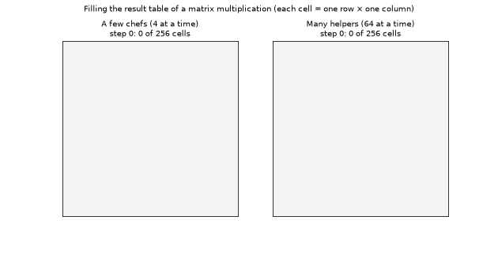
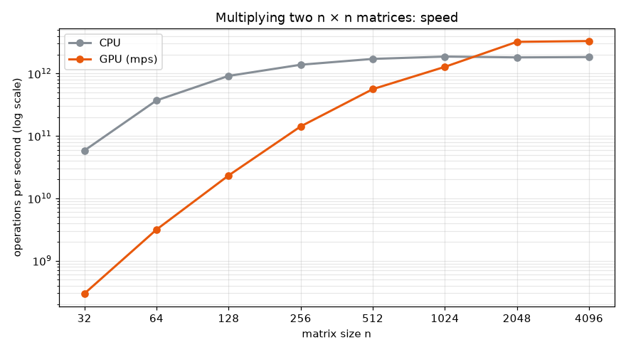
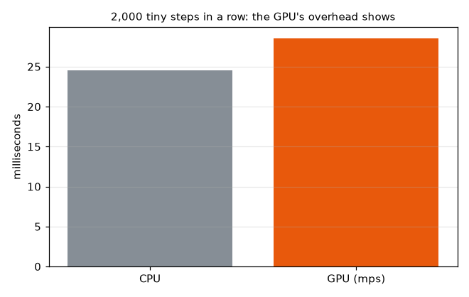
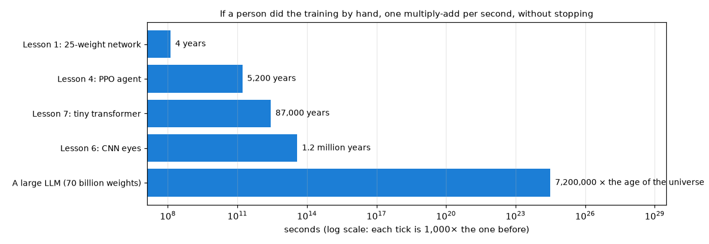
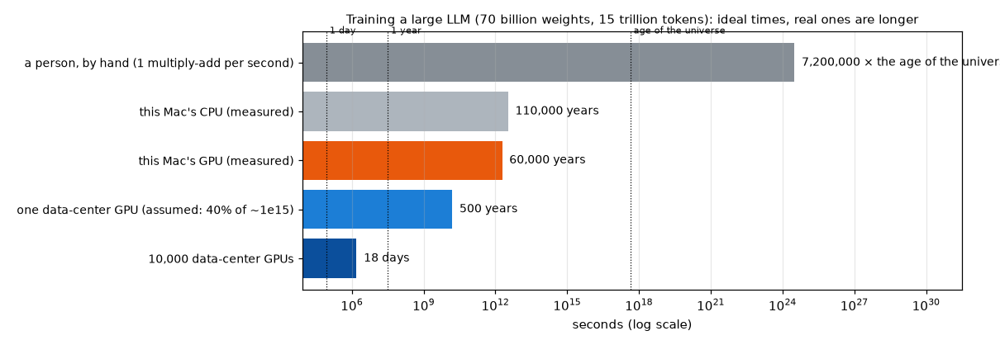

[English](README.md) · [Português](README.pt-BR.md) · **Español**

# Explicación a fondo: ¿por qué GPU?

> ¿Por qué todo el mundo entrena redes neuronales en tarjetas gráficas? ¿Qué cálculos ocurren realmente,
> y por qué necesitan tanta potencia de cómputo? Con una medición real en la Mac usada para este estudio.

Para repetir la medición en tu propia computadora (alrededor de 1 minuto):

```bash
python deep-dives/gpu/benchmark.py
```

Después, para volver a dibujar las gráficas que convierten los números en tiempo (unos segundos):

```bash
python deep-dives/gpu/scale.py
```

---

## 1. Qué calcula realmente una red neuronal

Casi todo es una sola operación, repetida una cantidad enorme de veces: **multiplicar dos números y sumar el resultado a un total acumulado** (un *multiply-add*, o "multiplica y suma").

Toma la primera capa de la [lección 1](../../lessons/01-neuron-and-gradient/README.es.md). Para cada uno de los 600 ejemplos, cada una de las 6 neuronas ocultas calcula `peso₁ × distancia + peso₂ × velocidad + sesgo`. Son 600 × 6 = 3 600 sumas pequeñas, cada una con 2 "multiplica y suma". Escrito como una tabla de números, es una **multiplicación de matrices**:

```
ejemplos (600 × 2)  ×  pesos (2 × 6)  =  sumas (600 × 6)
```

Todas las redes de este estudio funcionan así. Las redes más grandes solo tienen tablas más grandes: una capa de un LLM multiplica tablas con miles de filas y columnas.

Dos cosas importan de estos "multiplica y suma":

- **Son muchísimos.** Multiplicar dos tablas de 4096 × 4096 requiere 4096³ ≈ 69 mil millones de "multiplica y suma".
- **No dependen unos de otros.** La suma del ejemplo 1, neurona 1 no necesita la del ejemplo 2, neurona 5. Todos se pueden hacer **al mismo tiempo**.

Entrenar cuesta unas 3 veces más que solo usar la red, porque el paso hacia atrás (la retropropagación, lección 1) necesita unas dos multiplicaciones de matrices más por cada una del paso hacia adelante.

---

## 2. CPU vs GPU: unos pocos chefs expertos o un ejército de ayudantes

**Analogía.** Una **CPU** es una cocina con unos pocos chefs expertos (en esta medición, PyTorch usó 4 de ellos). Cada uno es muy rápido y puede seguir cualquier receta complicada, paso a paso, decidiendo qué hacer después. Una **GPU** es una cocina con **miles de ayudantes**. Cada uno es más sencillo y más lento, y todos tienen que hacer el mismo tipo de tarea, pero trabajan al mismo tiempo.

Para cocinar un platillo elaborado, ganan los chefs. Para picar 69 mil millones de cebollas, ganan los ayudantes, siempre que haya suficientes cebollas para mantenerlos a todos ocupados.



*Llenando la tabla de resultados de una multiplicación de matrices. Cada celda es una fila por una columna, y ninguna celda necesita que otra esté lista antes. Con 4 trabajadores, 256 celdas toman 64 pasos; con 64 trabajadores, 4 pasos. Un solo ayudante es más lento que un chef, pero son tantos que, con una tabla lo bastante grande, ganan.*

La multiplicación de matrices es picar cebollas: miles de millones de "multiplica y suma" idénticos e independientes. Por eso las GPU, diseñadas para calcular millones de píxeles al mismo tiempo en los videojuegos, resultaron perfectas para las redes neuronales.

---

## 3. Medido en esta Mac

La máquina: una **Mac mini con chip Apple M4** (10 núcleos, 4 de ellos de alto rendimiento) y 24 GB de memoria.



| Tamaño de la matriz | CPU | GPU | Más rápida |
|---|---|---|---|
| 32 × 32 | 0.001 ms | 0.22 ms | CPU, unas 200× |
| 256 × 256 | 0.024 ms | 0.24 ms | CPU, unas 10× |
| 1024 × 1024 | 1.15 ms | 1.68 ms | CPU, un poco |
| 2048 × 2048 | 9.5 ms | 5.3 ms | GPU, 1.8× |
| 4096 × 4096 | 75 ms | 41.5 ms | GPU, 1.8× |

En su mejor momento, la GPU de esta Mac hizo **3.3 billones de operaciones por segundo**, y su CPU **1.8 billones**.

Dos sorpresas:

- **Las multiplicaciones pequeñas son mucho más rápidas en la CPU.** Cada trabajo que se envía a la GPU tiene un costo fijo, unos 0.2 ms aquí, para prepararlo, enviarlo y esperar la respuesta. Para una tabla pequeña, ese costo es mucho mayor que el trabajo mismo. Es como llamar a todo el personal de la cocina para picar una sola cebolla.
- **En esta Mac, la GPU es "solo" 1.8× más rápida, incluso con tablas grandes.** Los chips de Apple tienen una unidad especial para cálculos con matrices junto a la CPU, así que su CPU es inusualmente buena en esto. En una computadora típica, la CPU es mucho más lenta en multiplicación de matrices, y la diferencia con una tarjeta gráfica es mucho mayor.



Esto también explica las decisiones del estudio. Las lecciones 3, 4 y 5 se ejecutan en la CPU: sus redes son diminutas (la de la lección 4 tiene 2 692 pesos), cada paso es una multiplicación pequeña, y el juego mismo se ejecuta en la CPU. En la gráfica de arriba, 2 000 pasos diminutos seguidos tardan más o menos lo mismo en ambas (25 ms en la CPU, 29 ms en la GPU). Las lecciones 6 y 7 usan la GPU, porque los lotes de imágenes y de texto son lo bastante grandes para mantenerla ocupada.

---

## 4. ¿Cuánto cómputo necesitó cada lección?

Contando los "multiplica y suma" de cada entrenamiento (un "multiplica y suma" = 2 operaciones):

| Entrenamiento | Operaciones aproximadas | Cómo se cuenta |
|---|---|---|
| Lección 1: la red de 25 pesos | 260 millones | 36 por ejemplo × 3 (entrenamiento) × 600 ejemplos × 4 000 épocas |
| Lección 4: PPO | unos 0.3 billones | 2 692 pesos, 2 millones de pasos, 10 pasadas por los datos en cada actualización |
| Lección 7: el transformer diminuto | 5.5 billones | 6 × 111 029 pesos × 8.2 millones de tokens leídos |
| Lección 6: los ojos (CNN) | unos 76 billones | 20 millones por imagen × 3 × 1.3 millones de imágenes vistas en el entrenamiento |
| Un LLM grande (ejemplo) | unos 6 billones de billones (6 × 10²⁴) | 6 × 70 mil millones de pesos × 15 billones de tokens |

La regla "6 × pesos × tokens" es una forma común de estimar el costo de entrenar un modelo de lenguaje: 2 operaciones por peso por cada token leído, por 3 para el entrenamiento. La fila del LLM grande usa tamaños parecidos a los publicados para modelos abiertos con 70 mil millones de pesos.

Números tan grandes son difíciles de imaginar, así que aquí están como tiempo. Primero, **si una persona lo hiciera a mano**, un "multiplica y suma" por segundo, sin detenerse nunca:



Incluso los 25 pesos de la lección 1 le tomarían a una persona unos **4 años**. El transformer diminuto de la lección 7, unos **87 000 años**.

Y en máquinas reales, a las mejores velocidades medidas arriba:

| Entrenamiento | CPU de esta Mac | GPU de esta Mac |
|---|---|---|
| Lección 1 | menos de un milisegundo | menos de un milisegundo |
| Lección 4 | 0.18 segundos | 0.1 segundos |
| Lección 7 | 3 segundos | 1.7 segundos |
| Lección 6 | 41 segundos | 23 segundos |

Estos son tiempos *ideales*, a máxima velocidad todo el tiempo. Los entrenamientos reales tardaron más (la lección 7 tardó unos 26 segundos; la lección 6, unos 22 minutos, porque también juega el juego y sus lotes son pequeños). Lo que importa es el orden de magnitud.

Ahora el LLM grande, en una misma escala:



- En la GPU de esta Mac: unos **60 000 años**.
- En una GPU actual de centro de datos: estas hacen del orden de mil billones de operaciones por segundo (10¹⁵) en los formatos numéricos que se usan para entrenar, pero en la práctica funcionan muy por debajo de su máximo; suponiendo un 40 % de él, unos **500 años**.
- En **10 000 de ellas a la vez**: unos **18 días**.

Por eso los modelos grandes se entrenan en **miles de GPU a la vez**, durante semanas o meses, y por eso cuesta tanto: no es un cálculo difícil, sino una cantidad astronómica de cálculos fáciles.

---

## 5. ¿Y cuando el modelo responde?

Usar un LLM entrenado también cuesta unas **2 operaciones por peso por cada token que escribe**. Para un modelo con 70 mil millones de pesos, son unos 140 mil millones de operaciones por token, y por eso escribir una respuesta toma un tiempo notable y los servicios de chat necesitan grandes servidores con GPU. Escribir también es más difícil de repartir entre los ayudantes que entrenar: cada token depende del anterior, así que el modelo tiene que escribirlos uno por uno (el `generate.py` de la lección 7 hace exactamente eso).

---

## Resumen

| | CPU | GPU |
|---|---|---|
| Analogía | unos pocos chefs expertos | miles de ayudantes |
| Buena para | trabajo complicado, paso a paso; tareas pequeñas | la misma tarea sencilla sobre cantidades enormes de datos |
| En este estudio | lecciones 1-5: redes pequeñas, el juego | lecciones 6-7: imágenes y texto en lotes grandes |
| Costo fijo por tarea | casi ninguno | unos 0.2 ms aquí: no vale la pena para tareas diminutas |

**Volver a:** [la página principal del estudio](../../README.es.md)
