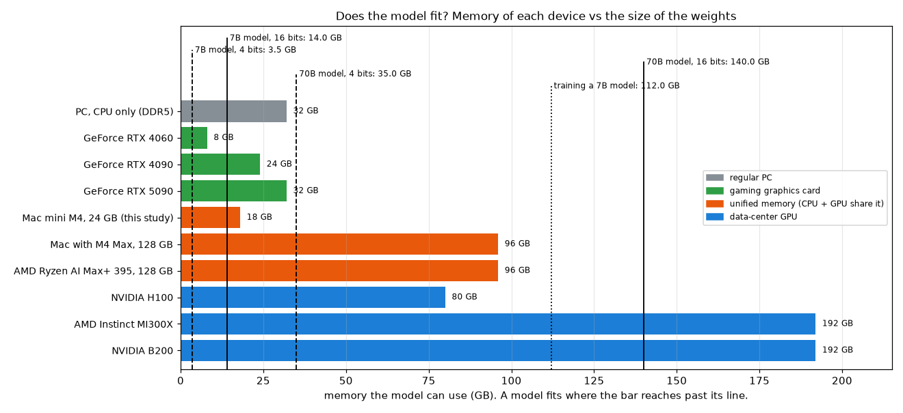
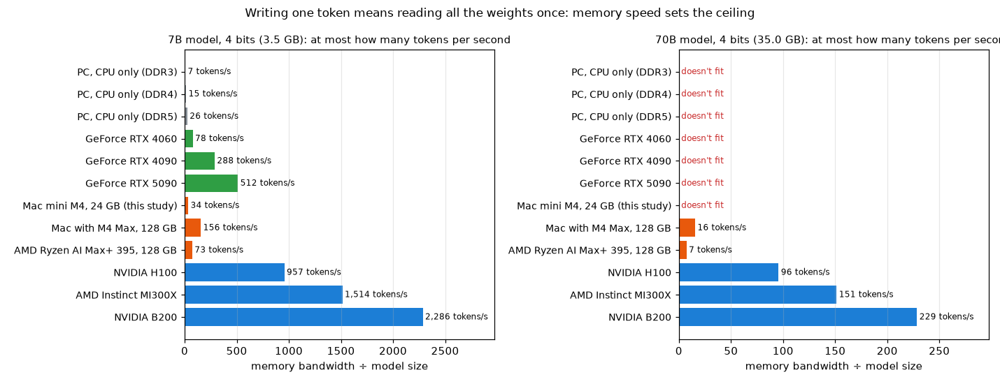
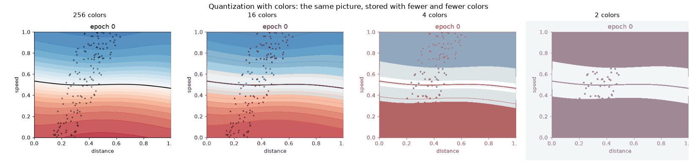
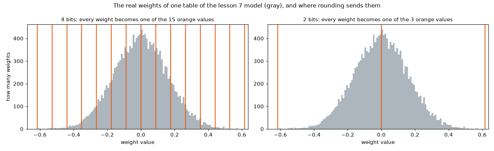
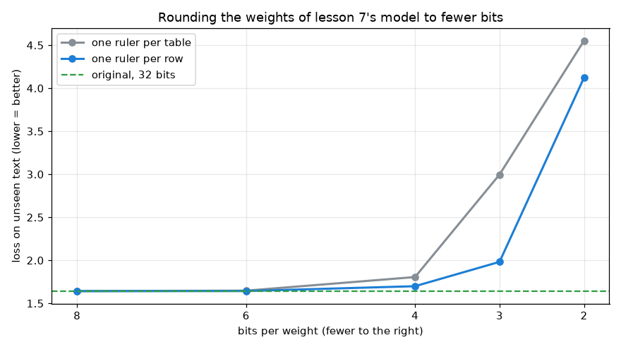

[English](README.md) · **Português** · [Español](README.es.md)

# Mergulho profundo: chips, memória e quantização

> Que tipos de chip rodam redes neurais, de uma placa de vídeo de jogos a um centro de dados? Por que a
> *memória* importa tanto quanto o chip? O que um computador comum consegue rodar ou treinar? E o que é
> quantização, o truque que permite rodar modelos grandes em máquinas pequenas?

Os gráficos vêm de dois scripts. O segundo usa o modelo da lição 7, então treine a lição 7 primeiro, se ainda não treinou:

```bash
python deep-dives/hardware/memory.py
```

```bash
python deep-dives/hardware/quantization.py
```

Esta página parte de [Por que GPUs?](../gpu/README.pt-BR.md). As especificações mudam rápido; os números aqui são especificações publicadas na época em que foi escrita (fontes no final).

---

## 1. Os tipos de chip

| Tipo | Exemplos | Memória que o modelo pode usar | Velocidade da memória | Bom para |
|---|---|---|---|---|
| **PC comum, só CPU** | Intel Core, AMD Ryzen, com RAM DDR5 | a RAM que ele tiver (32 GB é comum) | ~80-100 GB/s | modelos pequenos, e tudo o que não for uma rede grande |
| **Placa de vídeo de jogos** | NVIDIA GeForce RTX 4060 / 4090 / 5090, AMD Radeon | 8 / 24 / 32 GB na placa | 272 / 1.008 / 1.792 GB/s | rápida, desde que o modelo caiba na memória da placa |
| **Memória unificada** (CPU e GPU dividem um único reservatório) | chips Apple da série M, AMD Ryzen AI Max | até ~75% do total num Mac, por padrão; até 96 GB no Ryzen AI Max+ 395 | 120 GB/s (M4) a 546 GB/s (M4 Max); 256 GB/s (Ryzen AI Max+ 395) | modelos grandes numa só máquina, mais devagar do que uma placa de vídeo grande |
| **GPU de centro de dados** | NVIDIA H100 / B200, AMD Instinct MI300X | 80 / 192 / 192 GB | 3.350 / 8.000 / 5.300 GB/s | treinar e servir modelos grandes, em grupos de milhares |

Também existem chips feitos só para redes neurais, como as TPUs do Google, usadas nos próprios centros de dados do Google.

**Analogia.** Pense na cozinha de um restaurante. O chip são os cozinheiros; a memória é a **despensa**. O *tamanho da memória* é o tamanho da despensa: se os ingredientes não cabem, não dá para preparar o prato. A *velocidade da memória* (largura de banda) é a largura da porta da despensa: quantos ingredientes chegam aos cozinheiros por segundo. Milhares de cozinheiros (uma GPU) não adiantam nada se os ingredientes passam por uma porta estreita.

---

## 2. Por que a memória importa tanto

### O modelo precisa caber

O tamanho de um modelo é uma conta simples: **número de pesos × bytes por peso**. Normalmente cada peso é guardado em 16 bits (2 bytes), então um modelo com 7 bilhões de pesos ocupa 14 GB, e um com 70 bilhões ocupa 140 GB.



- Um **modelo de 7B em 4 bits** (3,5 GB) cabe quase em qualquer lugar, até no Mac mini deste estudo.
- Um **modelo de 70B em 16 bits** (140 GB) só cabe nas maiores GPUs de centro de dados. Em qualquer outra coisa, ele precisa ser dividido entre várias GPUs, ou encolhido (seção 4).
- **Treinar** precisa de muito mais do que rodar: além dos pesos, guarda o gradiente de cada peso e a memória do otimizador (o Adam guarda duas médias móveis por peso). Uma estimativa comum é **cerca de 16 bytes por peso**, então treinar até um modelo de 7B precisa de cerca de 112 GB: fora do alcance de uma placa de jogos.

### A velocidade da memória define a rapidez com que ele escreve

Para escrever **um token**, um LLM precisa ler **todos os seus pesos** da memória uma vez (o `generate.py` da lição 7 roda a rede inteira para cada caractere). Então, por mais rápido que o chip seja, existe um teto:

```
tokens por segundo  ≤  velocidade da memória  ÷  tamanho do modelo
```



| Aparelho | Modelo de 7B, 4 bits (3,5 GB) | Modelo de 70B, 4 bits (35 GB) |
|---|---|---|
| PC comum, só CPU | 26 tokens/s no máximo | não cabe em 32 GB |
| GeForce RTX 4090 | 288 | não cabe |
| Mac mini M4 (este estudo) | 34 | não cabe |
| Mac com M4 Max, 128 GB | 156 | 16 |
| AMD Ryzen AI Max+ 395, 128 GB | 73 | 7 |
| NVIDIA H100 | 957 | 96 |
| NVIDIA B200 | 2.286 | 229 |

Esses são tetos; as velocidades reais são menores. Testes publicados de modelos de 70B em 4 bits chegam a cerca de 4 a 6 tokens por segundo no Ryzen AI Max+ 395, abaixo do seu teto de 7, como esperado.

É por isso que o **tipo de memória** importa:

- **DDR5 / LPDDR5** (RAM comum): grande e barata, mas uma porta estreita.
- **GDDR6 / GDDR7** (placas de jogos): soldada bem ao lado do chip gráfico, com uma porta muito mais larga, mas só de 8 a 32 GB.
- **HBM** (GPUs de centro de dados): pilhas de chips de memória colocadas bem ao lado da GPU, ligadas por milhares de fios. A porta mais larga de todas, e muito cara.
- **Memória unificada** (Apple, AMD Ryzen AI Max): um único reservatório grande dividido entre CPU e GPU, então um modelo grande cabe, com uma porta de largura intermediária entre as outras duas.

---

## 3. O que um computador comum consegue e não consegue fazer

| | Um computador comum | Um centro de dados |
|---|---|---|
| **Rodar** um modelo pequeno (até ~8B pesos, em 4 bits) | ✅ com folga | ✅ |
| **Rodar** um modelo de 70B | ⚠️ só com muita memória (uma máquina grande com memória unificada), em 4 bits, devagar | ✅ rápido |
| **Treinar** algo como os modelos deste estudo | ✅ de segundos a minutos | ✅ |
| **Treinar** um LLM grande do zero | ❌ memória e tempo fora do alcance | ✅ milhares de GPUs por semanas ou meses |
| **Ajustar** (fine-tune) um pouco um modelo pequeno | ⚠️ possível com truques que treinam só alguns pesos extras | ✅ |

E além da memória e da velocidade:

- **Energia e calor.** Uma GeForce RTX 5090 é especificada para 575 W, uma H100 para 700 W, e uma B200 para cerca de 1.000 W, cada uma, e os centros de dados rodam milhares delas.
- **Conexões entre GPUs.** Treinar em milhares de GPUs só funciona porque elas são ligadas por conexões muito rápidas (900 GB/s por H100), para poderem compartilhar seus resultados o tempo todo. Computadores comuns não têm isso.

---

## 4. Quantização: guardar os pesos com menos bits

**Analogia.** Pense nos preços de uma loja. R$ 3,4719 é exato, mas R$ 3,47 já serve, e R$ 3 começaria a causar problemas. A **quantização** faz o mesmo com os pesos de uma rede: em vez de guardar cada um com 32 ou 16 bits, ela os arredonda para alguns poucos valores permitidos, guardados com 8, 4 ou até 2 bits.

É o mesmo que guardar uma imagem com menos cores:



Com 16 cores, o gráfico fica quase igual. Com 4, o degradê suave vira faixas. Com 2, só sobra a forma geral.

### O que acontece com os pesos



Estes são os 16.384 pesos de uma tabela do modelo da lição 7. Com 4 bits, cada peso é levado para o mais próximo de 15 valores permitidos (em laranja). Com 2 bits, só existem 3 valores permitidos, e quase todo peso vira 0.

### O experimento: o modelo da lição 7, arredondado

O [`quantization.py`](quantization.py) arredonda cada tabela de pesos do modelo de linguagem minúsculo da lição 7 e o mede de novo no texto que ele nunca viu:



| Bits por peso | Tamanho | Perda no texto nunca visto, uma régua por tabela | Perda, uma régua por linha | O que ele escreve depois de "the dino " (uma régua por linha) |
|---|---|---|---|---|
| 32 (original) | 434 KB | 1,642 | | `only matches teacher's when example find of the 292020000 15` |
| 8 | 114 KB | 1,643 | 1,642 | `only matches teacher's when example find of the 292020000 15` |
| 6 | 87 KB | 1,647 | 1,643 | `only matches teacher's when example find of the 292020000 15` |
| 4 | 61 KB | 1,806 | 1,699 | `only model step for from -1.99. the mird of the 200020000 15` |
| 3 | 47 KB | 2,996 | 1,982 | `only mateat the age appeare enviou + into siticndary; alll 5eps` |
| 2 | 34 KB | 4,552 | 4,122 | `o lh maeeap, led olenas es uess sluteinananho` |

- **8 e 6 bits quase não mudam nada.** O modelo escreve o mesmo texto, com um quarto do tamanho ou menos.
- **4 bits custam um pouco**, principalmente com uma régua por linha.
- **2 bits o destroem**: fica pior do que um modelo que chuta cada caractere ao acaso (perda 3,97).

**Uma régua por tabela vs uma por linha.** Arredondar precisa de uma *escala*, o tamanho dos degraus entre os valores permitidos. Com uma escala para a tabela inteira, as linhas com pesos pequenos desperdiçam a maior parte dos degraus: todos os seus pesos são arredondados para os mesmos poucos valores. Dar a cada linha sua própria escala (ou a cada grupo de algumas dezenas de pesos, como fazem as ferramentas de verdade) preserva muito mais detalhe. Com 3 bits, é a diferença entre um modelo que ainda escreve quase-inglês (1,98) e um que não escreve (3,00).

É assim que as pessoas rodam modelos grandes em casa: os modelos muitas vezes são compartilhados já quantizados em cerca de 4 bits. Um modelo de 70B passa de 140 GB para cerca de 35 GB e pode caber numa máquina grande com memória unificada. O preço é uma pequena perda de qualidade, que, como o experimento mostra, cresce rápido abaixo de 4 bits.

---

## Resumo

| Pergunta | Resposta curta |
|---|---|
| Qual chip? | Para redes neurais: uma GPU, ou um chip parecido. Placas de jogos são rápidas, mas têm pouca memória; máquinas com memória unificada têm muita memória, mas uma porta mais estreita; GPUs de centro de dados têm as duas coisas, a um preço enorme. |
| Por que a memória importa? | O modelo precisa caber (pesos × bytes por peso), e escrever cada token lê todos os pesos, então a velocidade da memória limita a velocidade. |
| Dá para treinar um LLM em casa? | Um minúsculo, como o da lição 7, sim. Um grande, não: memória e tempo estão fora do alcance. |
| O que é quantização? | Arredondar os pesos para menos bits: 8 bits sai quase de graça, 4 bits custam um pouco, 2 bits quebram o modelo. |

---

## Fontes

As especificações dos aparelhos vêm destas páginas (consultadas em 2026):

- NVIDIA H100: [página do chip no InferenceX](https://inferencex.semianalysis.com/chips/h100), [ficha técnica da ML cloud de Tübingen](https://portal.mlcloud.uni-tuebingen.de/user-guide/_specs/gpu/h100/)
- NVIDIA B200: [Jarvislabs](https://jarvislabs.ai/ai-faqs/nvidia-b200-specs), [Spheron](https://www.spheron.network/blog/nvidia-b200-complete-guide/)
- AMD Instinct MI300X: [ficha técnica da AMD](https://www.amd.com/content/dam/amd/en/documents/instinct-tech-docs/data-sheets/amd-instinct-mi300x-data-sheet.pdf), [Lenovo Press](https://lenovopress.lenovo.com/LP1943)
- GeForce RTX 5090: [TechPowerUp](https://www.techpowerup.com/gpu-specs/geforce-rtx-5090.c4216)
- GeForce RTX 4060 e 4090: [comparação no GPUprix](https://gpuprix.com/es/compare/geforce-rtx-4060-vs-geforce-rtx-4090)
- Apple M4 (Mac mini): [especificações do Mac mini na Apple](https://images.apple.com/ie/mac-mini/specs/)
- Apple M4 Max: [MacRumors](https://macrumors.com/2024/10/30/apple-announces-m4-max-chip); limite de memória da GPU no macOS: [APXML](https://apxml.com/hardware/apple-m4-max-128gb)
- AMD Ryzen AI Max+ 395: [página do produto na AMD](https://www.amd.com/en/products/processors/desktops/ryzen/ryzen-ai-halo/ryzen-ai-max-plus-395.html), [testes do ar-go.co](https://ar-go.co/blog/amd-ryzen-ai-max-395-local-llm/)
- Largura de banda da DDR5: [HotHardware](https://hothardware.com/news/ddr5-memory-spec-finalized-2tb-64gbps)

**Voltar para:** [a página inicial do estudo](../../README.pt-BR.md)
