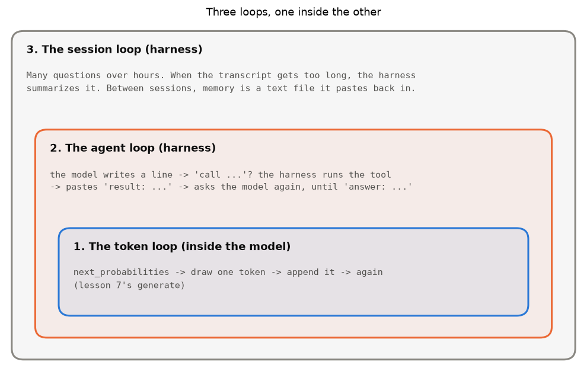
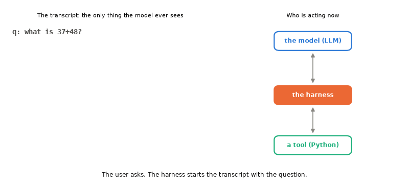
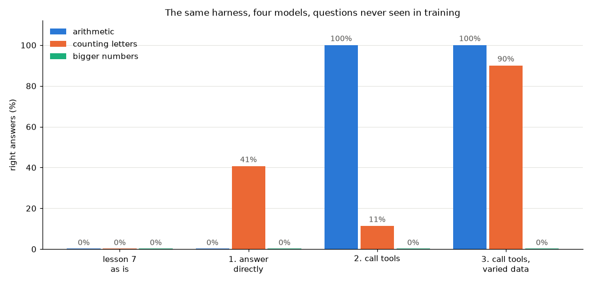
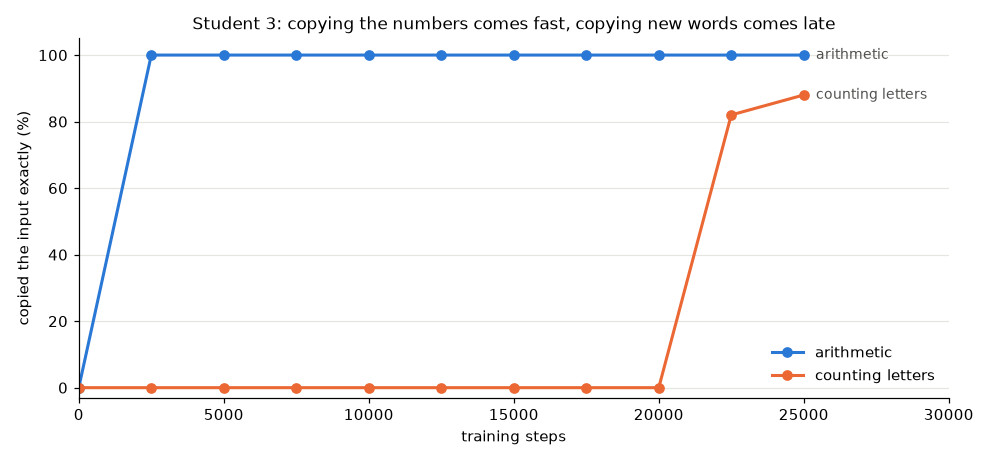

[English](README.md) · **Português** · [Español](README.es.md)

# Mergulho profundo: os LLMs de hoje e o harness em volta deles

> O modelo da lição 7 escreve um caractere de cada vez. O que isso tem a ver com os LLMs que as pessoas usam hoje,
> que leem arquivos, rodam código e corrigem os próprios erros? Na maior parte, é o mesmo ciclo, muito maior,
> com outro programa em volta dele: o **harness** ("arreio", em inglês). Aqui construímos um de brinquedo, e
> ensinamos o modelo da lição 7 a usá-lo.

Os gráficos vêm de dois scripts. Os dois usam o modelo da lição 7, então treine a lição 7 primeiro, se ainda não treinou:

```bash
python deep-dives/llm-and-harness/toy_agent.py      # a few seconds
```

```bash
python deep-dives/llm-and-harness/teach_tools.py    # about 5 minutes on a Mac mini M4
```

Esta página parte da [lição 7](../../lessons/07-language-model/README.pt-BR.md), e reaproveita ideias das lições [4](../../lessons/04-reinforcement/README.pt-BR.md) (reforço) e [5](../../lessons/05-imitation/README.pt-BR.md) (imitação).

---

## 1. O ciclo que você já escreveu

Este é o coração da lição 7 (`tiny_lm.py`, `generate`):

```python
for _ in range(n):
    ids.append(draw(self.next_probabilities(ids, temperature)))
```

O modelo só sabe fazer uma coisa: dado o texto até aqui, dar a chance de cada próximo token possível. Os LLMs de hoje fazem exatamente o mesmo, no mesmo ciclo. Eles não têm um modo separado que "pensa a resposta inteira". A resposta inteira é este ciclo, rodado milhares de vezes.

O que muda é o tamanho:

| | Lição 7 | Um LLM grande de hoje |
|---|---|---|
| Token | 1 caractere (53 diferentes) | pedaços de palavras (de 50.000 a 200.000 diferentes) |
| Contexto | 64 caracteres | de centenas de milhares a cerca de um milhão de tokens |
| Tamanho | 2 camadas, vetores de 64 números, ~110.000 pesos | dezenas de camadas, vetores de milhares de números, centenas de bilhões de pesos (muitas vezes uma "mistura de especialistas": só uma parte da rede trabalha em cada token) |
| Texto de treino | os READMEs do estudo (~47.000 caracteres) | trilhões de tokens |
| Treino | prever o próximo caractere | três etapas, abaixo |

---

## 2. Como um LLM grande é treinado: três etapas que você já viu

1. **Pré-treino.** O que a lição 7 fez: prever o próximo token, numa quantidade enorme de texto. O resultado é um autocompletar que leu muito. Ele continua textos; ainda não segue instruções.
2. **Ajuste fino supervisionado (SFT).** Esta é a [lição 5](../../lessons/05-imitation/README.pt-BR.md), imitação. O modelo é treinado com exemplos de boas conversas, e os copia. É aqui também que ele aprende formatos, como o jeito de pedir uma ferramenta. A seção 5 faz exatamente isso com o modelo da lição 7.
3. **Aprendizado por reforço.** Esta é a [lição 4](../../lessons/04-reinforcement/README.pt-BR.md), PPO. O modelo escreve, algo dá uma nota (pessoas, outro modelo atuando como juiz, ou um teste que passa ou falha), e o modelo é empurrado na direção do que teve nota boa. Os modelos que "pensam antes de responder" vieram em grande parte daqui: com reforço, eles aprenderam que escrever o raciocínio antes da resposta rende mais recompensa.

Lembra do platô de "sempre pular" da lição 4? Os LLMs também acham atalhos que rendem recompensa sem fazer o trabalho (*reward hacking*). Projetar recompensas que não dão para burlar é uma parte grande do trabalho.

---

## 3. O harness: o ciclo em volta do modelo

Mesmo depois de todo esse treino, o modelo continua sendo uma função de texto para texto. Ele não consegue ler um arquivo, rodar um comando, nem lembrar de nada entre uma chamada e outra. O programa que faz essas coisas é o **harness**. O Claude Code é um harness; os aplicativos de chat também são.



1. **O ciclo de tokens**, dentro do modelo: o `generate` da lição 7.
2. **O ciclo do agente**, no harness. O modelo escreve um texto. Se ele pede uma ferramenta, o harness roda a ferramenta, cola o resultado na conversa, e pergunta ao modelo de novo:

   ```python
   transcript = system_prompt + tool_descriptions + question
   while True:
       reply = model(transcript)              # o ciclo de tokens, lá dentro
       transcript += reply
       if reply asks for a tool:
           transcript += run_tool(reply)      # quem roda é o HARNESS, não o modelo
       else:
           break                              # a resposta final
   ```

3. **O ciclo da sessão**, também no harness. O contexto tem um limite (64 caracteres para o modelo da lição 7), então quando a conversa fica longa demais, o harness resume a parte antiga. A memória entre sessões é só um arquivo de texto que o harness cola no começo.

Este próprio mergulho profundo foi escrito por um modelo de IA trabalhando dentro de um harness. Para ler o `tiny_lm.py`, o modelo escreveu um pedido como "rode `grep` neste arquivo"; o harness rodou e colou a saída de volta. O modelo nunca tocou no disco. Ele só escreveu texto num formato combinado.

---

## 4. Um agente de brinquedo

O `harness.py` tem tudo em algumas dezenas de linhas. A conversa é um único texto, a **transcrição**, e cada linha começa com quem a escreveu:

```
q: what is 37+48?          <- the user
call calc: 37+48           <- the model asks for a tool
result: 85                 <- the harness ran the tool and pasted the result
answer: 85                 <- the model answers, and the loop stops
```

(Na ordem: o usuário pergunta; o modelo pede uma ferramenta; o harness roda a ferramenta e cola o resultado; o modelo responde, e o ciclo para.)

- **As ferramentas** são funções Python comuns: `calc` soma ou subtrai dois números, `letters` conta as letras de uma palavra.
- **O modelo** é qualquer coisa que recebe a transcrição e devolve uma linha. O modelo falso é um script com alguns `if`s. Como um LLM de verdade, ele não olha para nada além da transcrição.
- **O harness** é o ciclo: pergunta ao modelo, procura `call <tool>: <input>`, roda a ferramenta, cola `result: ...`, pergunta de novo, até uma linha começar com `answer:`.



Agora a parte interessante: **o mesmo harness**, com o modelo da lição 7 no lugar do falso:

```
q: what is 37+48?
the step and the score the student the s
result: error: write call or answer
the student the script the same and the
result: error: write call or answer
the student the script the same and the
...                                          (gives up after 4 turns)
```

Três coisas para notar:

- **O harness é o mesmo, e o resultado é completamente diferente.** Para o ciclo funcionar, o modelo precisa conhecer o formato `call` / `answer`. O modelo da lição 7 só leu READMEs, então ele escreve "como um README".
- **Ele nem consegue ver a pergunta por muito tempo.** Com um contexto de 64 caracteres, ele vê só os últimos 64. Um harness de verdade coloca as descrições das ferramentas no começo da transcrição, e um LLM de verdade consegue lê-las ali. O nosso nunca as veria.
- **As rodadas 2, 3 e 4 são idênticas.** O modelo não tem memória: o mesmo texto na entrada dá o mesmo texto na saída (aqui o harness escolhe o caractere mais provável toda vez). Tudo o que ele "sabe" sobre a conversa é o texto que o harness monta.

---

## 5. Ensinando o formato ao modelo

Então vamos ensiná-lo, do jeito que a [lição 5](../../lessons/05-imitation/README.pt-BR.md) ensinou o dino: **imitação**. O professor é o modelo falso; as transcrições dele são os exemplos. O `teach_tools.py` começa três alunos a partir dos pesos da lição 7, e treina cada um com o próprio ciclo da lição 7:

| Aluno | Exemplos com que aprende | Passos |
|---|---|---|
| 1. responder direto | `q: what is 37+48?` → `answer: 85`, sem ferramentas | 3.000 |
| 2. chamar ferramentas | as transcrições do modelo falso: números de dois dígitos, palavras do estudo | 3.000 |
| 3. chamar ferramentas, dados variados | o mesmo formato, mas números de 1 a 3 dígitos e palavras inventadas como `qzwkt` | 25.000 |

Depois, os quatro modelos (a lição 7 como está, e os três alunos) rodam no mesmo harness, com perguntas que **nenhum deles viu no treino**: contas com dois dígitos, palavras reais deixadas fora do treino, e números de quatro dígitos, mais longos do que qualquer coisa do treino.



O que aconteceu, com transcrições reais (todas em `charts/samples.md`):

**O aluno 1 não consegue fazer contas: 0%.** Ele responde `46-30` com `-10`. Uma rede pequena assim não aprende a somar com alguns milhares de exemplos. Os LLMs grandes são muito melhores em conta de cabeça, mas ainda erram com números longos, e esse é um dos motivos para receberem uma calculadora ou uma ferramenta de código. (Ele acertou 41% na contagem de letras. Chutar sempre o tamanho mais comum daria 19%, então ele aprendeu algo sobre o tamanho das palavras, mas não a contar.)

**O aluno 2 chama a calculadora perfeitamente: 100%.** O modelo não soma; ele **copia** `46-30` para dentro de `call calc:`, e o Python soma. Mas veja as palavras e os números grandes:

```
q: how many letters in blows?        q: what is 6950+1180?
call letters: block                  call calc: 69+18
result: 5                            result: 87
answer: 5                            answer: 87
```

Ele aprendeu o **formato** dos exemplos, não a regra "copie a entrada". Todo número que ele viu tinha dois dígitos, então ele escreve dois dígitos. Ele tinha visto as palavras do estudo milhares de vezes, então escreve uma que conhece (`block`) no lugar da nova (`blows`). Os 11% dele nas letras são sorte: `block` e `blows` têm as duas 5 letras.

**O aluno 3 aprendeu a copiar: 90% em palavras reais que nunca viu.** Palavras inventadas não dá para decorar, então o único jeito de acertá-las é copiar de verdade, letra por letra. Mas isso levou muito tempo:



Copiar números de dois dígitos veio em menos de 2.500 passos. Copiar palavras ficou em 0% por 20.000 passos, e então pulou para mais de 80% quase de uma vez. Pesquisadores viram o mesmo tipo de salto repentino em transformers de verdade quando eles aprendem a copiar de um trecho anterior do texto (as "induction heads", ou cabeças de indução, estudadas pela Anthropic em 2022).

**Ninguém dá conta de números de quatro dígitos: 0%.** O aluno 3 escreve `695+118` para `6950+1180`. Ele viu números de até 3 dígitos, então escreve até 3 dígitos. A ferramenta calcula `813` corretamente, para a pergunta errada, e o modelo informa o resultado com confiança. Uma ferramenta só é tão boa quanto o pedido que o modelo escreve.

O que isso diz sobre os LLMs de verdade:

- **Chamar ferramentas é uma habilidade aprendida**, ensinada por ajuste fino e reforço, com conjuntos de exemplos enormes e muito variados, para o modelo aprender a regra, e não o formato de alguns poucos exemplos.
- **Ferramentas ganham de decorar**: 0% contra 100% nas mesmas contas, com a mesma rede minúscula.
- **As falhas parecem as reais**: um argumento errado mandado para uma ferramenta certa, e depois informado com confiança. Bons harnesses ajudam conferindo (rodando os testes, mostrando os erros ao modelo, perguntando a uma pessoa antes de ações arriscadas).
- Contar letras é famoso por ser difícil para LLMs grandes, por outro motivo: eles leem pedaços de palavras, não letras, então não "enxergam" as letras. O nosso lê um caractere de cada vez, e é por isso que o aluno 1 pelo menos chegou perto.

---

## 6. Por que o harness importa tanto quanto o modelo

O estudo já viu isso antes, com o dino:

| No estudo | Num agente com LLM |
|---|---|
| A rede de política da [lição 4](../../lessons/04-reinforcement/README.pt-BR.md): 6 números entram, uma ação sai | o modelo: texto entra, texto sai |
| O `game.py` e o ciclo principal: montar a observação, aplicar a ação, devolver o resultado | o harness |
| [Lição 6](../../lessons/06-vision/README.pt-BR.md): os "olhos" da CNN transformam a tela nos 6 números de que o cérebro precisa | o harness transformando arquivos, páginas da web e a saída de comandos em texto para o modelo |
| [Lição 8](../../lessons/08-hard-mode/README.pt-BR.md): a rede sozinha marca cerca de 900; com um planejador ao lado, 5000 | um modelo sozinho vs um modelo que pode rodar código, ler erros e tentar de novo |

Com o **mesmo modelo**, um bom harness (ferramentas úteis, uma transcrição bem montada, jeitos de conferir o próprio trabalho) faz uma grande diferença no que é feito. Um ruim desperdiça um bom modelo. O modelo é o motor; o harness é o resto do carro.

---

## O que simplificamos

- As chamadas de ferramenta de verdade são estruturadas (normalmente JSON com o nome da ferramenta e argumentos com nome), e o harness as confere antes de rodar qualquer coisa. A nossa é uma linha de texto.
- O ajuste fino de verdade normalmente aprende só com as linhas do próprio modelo. O nosso também aprendeu a prever as perguntas e os resultados, o que aqui não custa nada.
- Um harness de verdade manda a lista de ferramentas e as descrições delas em todo pedido, então o modelo consegue usar ferramentas que nunca viu no treino. O nosso modelo tem um contexto de 64 caracteres, então o formato precisa vir embutido pelo treino.

---

## Resumo

| Pergunta | Resposta curta |
|---|---|
| Um LLM grande é diferente do modelo da lição 7? | O mesmo ciclo e o mesmo tipo de rede, milhões de vezes maior, treinado em três etapas: pré-treino (lição 7), imitação (lição 5) e reforço (lição 4). |
| O que é um harness? | O programa em volta do modelo: ele monta a transcrição, roda as ferramentas que o modelo pede, cola os resultados de volta, e cuida do contexto e da memória. |
| O modelo roda as ferramentas? | Não. Ele só escreve texto pedindo por elas. Quem roda é o harness. |
| O modelo da lição 7 consegue usar ferramentas? | Como está, não. Depois de um ajuste fino com exemplos, sim, mas só de forma tão geral quanto os exemplos eram variados. |

**Voltar para:** [a página inicial do estudo](../../README.pt-BR.md)
