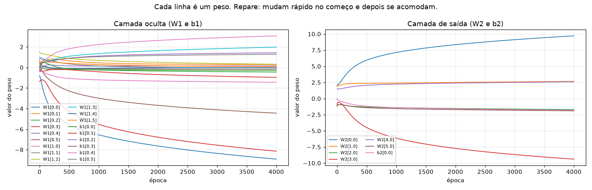
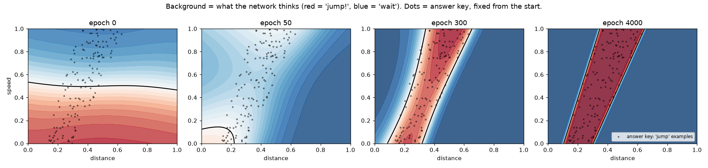
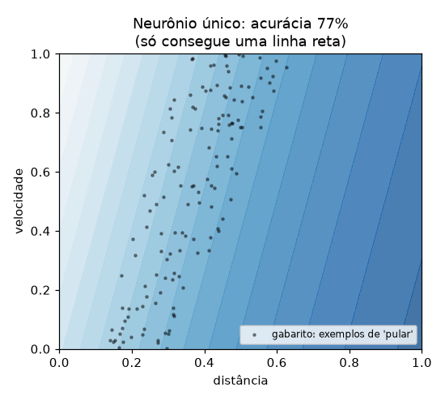

**English** · [Português](README.pt-BR.md) · [Español](README.es.md)

# Lesson 1 — Neuron, loss and gradient (from scratch, numpy only)

> **Goal:** understand what happens *inside* when a neural network "learns".
> No AI libraries: every calculation is written by hand in
> [`train_from_scratch.py`](train_from_scratch.py).

```bash
python lessons/01-neuron-and-gradient/train_from_scratch.py --live
```

The script trains the network (about 5 seconds), records the value of every weight at every epoch and then **plays the training back in a window, like a video**: what the network thinks, the loss going down, each of the 25 weights adjusting and the gradient of each weight at that moment.

| Key | What it does |
|---|---|
| SPACE | pause / resume |
| ← → | back / forward one epoch (to see one gradient step at a time) |
| ↑ ↓ | faster / slower (from 1 to 100 epochs per frame) |
| R | restart from zero |

The bottom of the window reminds you: "SPACE pause · ← → one epoch · ↑ ↓ speed · R restart".


To record this animation again:

```bash
python lessons/01-neuron-and-gradient/train_from_scratch.py --gif
```

Without `--live`, the script trains in about 5 seconds, explains the first calculations in the terminal and saves the charts and the CSV to [`results/`](results/), which are the ones used in the rest of this page.

---

## 1. The problem

Before putting an AI in the game, let's solve one piece of it on its own:

> Given the **distance to the cactus** and the **game speed**, is it time to jump?

The right answer is a **band**: if the cactus is too close, it's already too late; if it's too far, you land before reaching it. And the faster the game, the earlier you need to jump.


The network **never sees this rule**. It only gets 600 examples (the dots above) and has to discover the pattern on its own. The terminal confirms it: "600 examples, 137 of them are 'jump'."

### What the dots in the charts are

They are the **answer key**. Before training, the script draws 600 random situations and uses the true rule to answer each one. From then on, in the network's charts, the black dots are the 137 examples marked as "jump" (the 463 "don't jump" ones are left out so the chart stays clean). The legend calls them "answer key: 'jump' examples".

The dots **never change**. What changes during training is the **colored background**: the network's answer for each spot on the plane. Training means making the background turn red where the dots are and blue everywhere else.

This is called **supervised learning**: the answers to the examples are known from the start, and the network learns by comparing what it answered with the answer key. In lessons 3 and 4 there is no answer key; the dino only gets a score or a reward.

---

## 2. The network

```
 inputs            hidden layer           output
 distance  ──┐   ┌─ neuron 1 ─┐
             ├───┼─ neuron 2 ─┼───  P(jump)
 speed     ──┘   └─ ...     6 ┘
```

Every neuron always does the same thing:

```
output = activation( weight₁·input₁ + weight₂·input₂ + ... + bias )
```

| Term | What it is | In the code |
|---|---|---|
| **Weight** | How much an input matters (can be negative) | `W1`, `W2` |
| **Bias** | A fixed "push" that shifts the neuron's threshold | `b1`, `b2` |
| **Activation** | A curve that bends the sum. Without it, the whole network would be just a straight line | `tanh`, `sigmoid` |
| **Forward** | Passing the inputs through the network to get the prediction | `forward()` |

This network has 2×6 + 6 + 6×1 + 1 = **25 adjustable numbers**. Training = finding good values for these 25 numbers. (A large LLM has **hundreds of billions** of them — but the idea is the same.)

---

## 3. Loss: measuring how wrong the network is

To improve, the network needs a score. The **loss** is a number that gets big when the network is wrong and small when it is right. We use *binary cross-entropy*, which punishes hard whoever is wrong **with confidence** (saying 99% "jump" when the answer was "don't jump").

---

## 4. Gradient: which way should each weight move?

Picture the loss as hilly terrain, where each position is a combination of the 25 weights. We want to reach the valley.

The **gradient** answers, for each weight: *"if I increase this weight a tiny bit, does the loss go up or down? And by how much?"*

- **Positive** gradient → increasing the weight makes it worse → so we **decrease** it.
- **Negative** gradient → increasing the weight makes it better → so we **increase** it.

The whole learning rule is this line:

```python
weight = weight - learning_rate * gradient
```

The script shows this really happening in the first epochs:

```
Epoch 0: loss=0.9365  accuracy=46%
  example with one weight, W2[0,0]:
    current value = +1.93379
    gradient      = -0.12817   (+ sign => increasing the weight would increase the loss)
    new value     = +1.93379 - 0.5 × -0.12817 = +1.99788
```

### How is the gradient calculated? Backpropagation

The `backward()` function applies the **chain rule** from calculus, from back to front: first the error at the output, then how much each hidden neuron contributed to it, then how much each input weight contributed to the neuron. That's why it's called *backpropagation*: the error flows **back** through the network.

### How do we know the math is right? Numerical check

The script compares the formula with a brute-force estimate (it nudges the weight by +0.00001 and −0.00001 and measures the difference in the loss). If they match, backpropagation is correct. In the terminal this appears under "[Checking the gradient]  formula  vs  brute force":

```
  W1[0, 0]:  -0.084432  vs  -0.084432
  W2[3, 0]:  +0.259212  vs  +0.259212
```

---

## 5. Watching the training

### The learning curve


- The **loss** drops sharply in the first few hundred epochs and then goes down slowly.
- The **accuracy** goes up from ~46% (guessing) to 100%.
- The **gradient** keeps shrinking: near the valley, the terrain gets flat and the steps get small.

### The weights changing



Each line is one of the 25 numbers. The CSV [`results/weight_history.csv`](results/weight_history.csv) has the exact value of all of them at **every epoch** — open it in Excel and explore.

### What the network "thinks" during training



The title of this chart sums it up: "Background = what the network thinks (red = 'jump!', blue = 'wait'). Dots = answer key, fixed from the start."

- **`epoch 0`:** random weights, the network guesses.
- **`epoch 50`:** it started to notice that "far = don't jump".
- **`epoch 300`:** it has already found the band, still blurry.
- **`epoch 4000`:** sharp band, practically the same as the true rule.

### Why does the shape appear fast and then "stop"?

In the replay (`--live`) you can see that the band shows up in the first few hundred epochs and then barely changes. There are two phases:

1. **Fast descent (epochs 0 to ~300).** With random weights, the network is very wrong, so the gradient is big. Since the step is `rate × gradient`, the steps are big too, and the shape appears. The loss drops sharply.
2. **Fine-tuning (from ~300 on).** The network is already close to the bottom of the loss valley. The terrain gets flat, the gradient gets small (watch the "total size" in the gradient panel drop from ~1 at epoch 0 to ~0.03 at 300 and ~0.002 at 4000) and each step moves the weights very little. This is called **convergence**.

The shape doesn't stand completely still: the weights keep growing slowly (weights panel), and that makes the edges of the band **sharper**. The network is getting more *confident*. With cross-entropy, you can always lower the loss a little more by betting with more certainty, so the weights grow without stopping, more and more slowly.

**Does this have to do with linear regression?** Yes, a lot. Each neuron computes `w₁·x₁ + w₂·x₂ + b`, exactly the linear regression formula. Put a sigmoid on top and it becomes **logistic regression**: that's the "single neuron" of section 6, which can only draw a straight line. The network in this lesson is 6 of those lines (with `tanh`) combined by the output layer. That's how two edges become a band.

**What about cosine?** It doesn't show up here. The "S" curves are `tanh` and the sigmoid, and the drop in the loss looks like a decay, with nothing periodic. Waves only show up if the learning rate is too big and the loss keeps bouncing (exercise 1). Cosine shows up elsewhere in AI:

- **Cosine similarity:** measures how much two vectors point the same way. It's how LLMs and search engines compare the "meaning" of texts (embeddings).
- **Cosine schedule:** instead of a fixed learning rate like here, the rate starts high and goes down following half a cosine wave. It's common when training LLMs: big steps at the start, small steps in the fine-tuning, the same two phases you see in the replay.

---

## 6. Why do we need a hidden layer?



A **single neuron** can only draw **one straight line**. The band needs two edges, so it gives up and learns "never jump" — which gets 77% right only because most examples are "don't jump". This is a classic trap: **high accuracy doesn't mean it learned**.

With 6 hidden neurons, each one draws a straight line, and the output layer combines those lines into a more complex shape. **Depth = ability to represent complicated patterns.**

---

## 7. Hyperparameters: the training knobs

They are at the top of the script. They are not learned — **you** choose them.

| Parameter | Value | What happens if you change it |
|---|---|---|
| `LEARNING_RATE` | 0.5 | Too small (0.01): after 4000 epochs it still hasn't left "never jump" (78%). Too big (20): huge steps, the loss jumps by up to 10× before settling down. |
| `N_HIDDEN` | 6 | With 1: it can't get the band. With 2 it already can (2 lines = 2 edges). More neurons give room for more complicated patterns. |
| `EPOCHS` | 4000 | Too few: it stops halfway (see epoch 300). |
| `N_EXAMPLES` | 600 | With 20: 100% on training, but only ~91% on new data — the network "memorized" the examples (*overfitting*). |
| `SEED` | 42 | Changes the initial weights and the data. Similar final results, different paths. |

## Exercises

1. Set `LEARNING_RATE = 20` and look at `02_loss.png`. Then try `0.01`. What happened in each case?
2. Try `N_HIDDEN = 1` and then `2`. What is the minimum number of neurons to draw the band? Why? Look at `04_boundaries.png`.
3. Set `N_EXAMPLES = 20`. Compare the accuracy on training with the accuracy on new data.
4. Open the CSV and find the weight that changed the most. Which input is it connected to?

---

## How does this relate to LLMs?

An LLM is trained with **exactly** this cycle — forward, loss, gradient, step — except that:

- the input is a piece of text and the output is the probability of each next word;
- there are hundreds of billions of weights instead of 25;
- the data is trillions of words instead of 600 dots;
- they use smarter variations of gradient descent (like *Adam*), on thousands of GPUs.

**Next lesson:** [the environment — the game the AI will play](../02-the-environment/README.md)
