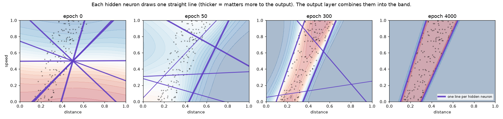
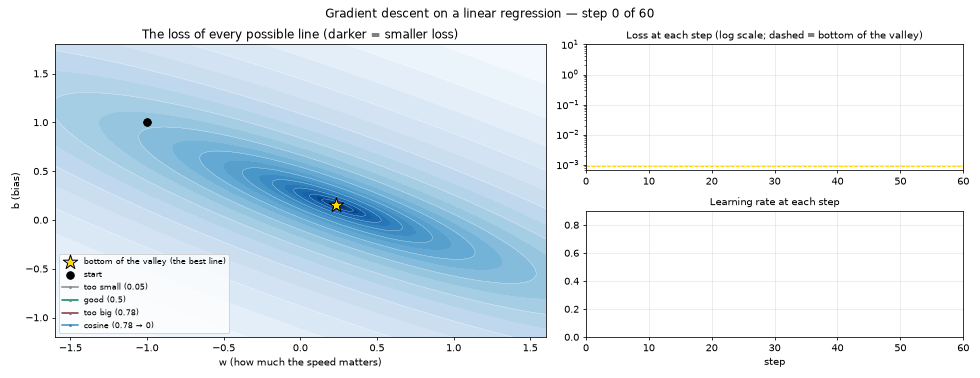

[English](README.md) · **Português** · [Español](README.es.md)

# Lição 1 — Neurônio, perda e gradiente (do zero, só com numpy)

> **Objetivo:** entender o que acontece *por dentro* quando uma rede neural "aprende".
> Sem bibliotecas de IA: cada conta está escrita à mão em
> [`train_from_scratch.py`](train_from_scratch.py).

```bash
python lessons/01-neuron-and-gradient/train_from_scratch.py --live
```

O script treina a rede (uns 5 segundos), grava o valor de cada peso em cada época e depois **toca o treino numa janela, como um vídeo**: o que a rede pensa (com a reta de cada neurônio oculto em roxo), a perda caindo, cada um dos 25 pesos se ajustando e o gradiente de cada peso naquele instante.

| Tecla | O que faz |
|---|---|
| ESPAÇO | pausa / continua |
| ← → | volta / avança uma época (para ver um passo de gradiente de cada vez) |
| ↑ ↓ | mais rápido / mais devagar (de 1 a 100 épocas por quadro) |
| R | recomeça do zero |

O rodapé da janela lembra as teclas, em inglês: "SPACE pause · ← → one epoch · ↑ ↓ speed · R restart".


Para gravar essa animação de novo:

```bash
python lessons/01-neuron-and-gradient/train_from_scratch.py --gif
```

Sem o `--live`, o script treina em uns 5 segundos, explica as primeiras contas no terminal e salva os gráficos e o CSV em [`results/`](results/), que são os usados no resto desta página.

---

## 1. O problema

Antes de colocar uma IA no jogo, vamos resolver um pedaço dele isoladamente:

> Dada a **distância até o cacto** e a **velocidade do jogo**, é hora de pular?

A resposta certa é uma **faixa**: se o cacto estiver perto demais, já é tarde; se estiver longe demais, você aterrissa antes dele. E quanto mais rápido o jogo, mais cedo é preciso pular.


A rede **nunca vê essa regra**. Ela só recebe 600 exemplos (os pontos acima) e precisa descobrir o padrão sozinha. O terminal confirma: "600 examples, 137 of them are 'jump'." (600 exemplos, 137 deles são "pular").

### O que são os pontos nos gráficos

São o **gabarito**. Antes de treinar, o script sorteia 600 situações e usa a regra verdadeira para responder cada uma. Daí em diante, nos gráficos da rede, os pontos pretos são os 137 exemplos marcados como "pular" (os 463 "não pular" ficam de fora para não poluir). Na legenda eles aparecem como "answer key: 'jump' examples" (gabarito: exemplos de "pular").

Os pontos **nunca mudam**. O que muda durante o treino é o **fundo colorido**: a resposta da rede para cada lugar do plano. Treinar é fazer o fundo ficar vermelho onde estão os pontos e azul no resto.

Isso se chama **aprendizado supervisionado**: as respostas dos exemplos são conhecidas desde o início, e a rede aprende comparando o que respondeu com o gabarito. Nas lições 3 e 4 não existe gabarito; o dino só recebe uma nota ou uma recompensa.

---

## 2. A rede

```
 entradas         camada oculta          saída
 distância  ──┐   ┌─ neurônio 1 ─┐
              ├───┼─ neurônio 2 ─┼───  P(pular)
 velocidade ──┘   └─ ...       6 ┘
```

Cada neurônio faz sempre a mesma coisa:

```
saída = ativação( peso₁·entrada₁ + peso₂·entrada₂ + ... + viés )
```

| Termo | O que é | No código |
|---|---|---|
| **Peso** | O quanto uma entrada importa (pode ser negativo) | `W1`, `W2` |
| **Viés (bias)** | Um "empurrão" fixo, desloca o limiar do neurônio | `b1`, `b2` |
| **Ativação** | Uma curva que entorta a soma. Sem ela, a rede inteira seria só uma reta | `tanh`, `sigmoid` |
| **Forward** | Passar as entradas pela rede e obter a previsão | `forward()` |

A soma dentro da ativação, `peso₁·entrada₁ + peso₂·entrada₂ + viés`, é exatamente a fórmula de uma **regressão linear**. A seção 6 mostra o que isso significa na prática.

Esta rede tem 2×6 + 6 + 6×1 + 1 = **25 números ajustáveis**. Treinar = encontrar bons valores para esses 25 números. (Um LLM grande tem **centenas de bilhões** deles — mas a ideia é a mesma.)

---

## 3. Perda: medindo o quanto a rede erra

Para melhorar, a rede precisa de uma nota. A **perda** (*loss*) é um número que fica grande quando a rede erra e pequeno quando acerta. Usamos a *entropia cruzada binária*, que castiga muito quem erra **com convicção** (dizer 99% "pule" quando era "não pule").

---

## 4. Gradiente: para que lado mexer cada peso?

Imagine a perda como um terreno montanhoso, onde cada posição é uma combinação dos 25 pesos. Queremos chegar ao vale.

O **gradiente** responde, para cada peso: *"se eu aumentar este peso um pouquinho, a perda sobe ou desce? E quanto?"*

- Gradiente **positivo** → aumentar o peso piora → então **diminuímos**.
- Gradiente **negativo** → aumentar o peso melhora → então **aumentamos**.

A regra inteira do aprendizado é esta linha (peso = peso − taxa de aprendizado × gradiente):

```python
weight = weight - learning_rate * gradient
```

O script mostra isso acontecendo de verdade nas primeiras épocas. A saída é em inglês: `loss` é a perda, `accuracy` a acurácia, `current value` o valor atual, `new value` o novo valor, e o comentário entre parênteses diz que sinal + significa que aumentar o peso aumentaria a perda:

```
Epoch 0: loss=0.9365  accuracy=46%
  example with one weight, W2[0,0]:
    current value = +1.93379
    gradient      = -0.12817   (+ sign => increasing the weight would increase the loss)
    new value     = +1.93379 - 0.5 × -0.12817 = +1.99788
```

### Como o gradiente é calculado? Retropropagação

A função `backward()` aplica a **regra da cadeia** do cálculo, de trás para frente: primeiro o erro na saída, depois quanto cada neurônio oculto contribuiu para ele, depois quanto cada peso de entrada contribuiu para o neurônio. Por isso o nome *backpropagation*: o erro **volta** pela rede.

### Como saber se a conta está certa? Conferência numérica

O script compara a fórmula com uma estimativa na força bruta (mexe o peso +0,00001 e −0,00001 e mede a diferença na perda). Se baterem, a retropropagação está correta. No terminal isso aparece sob "[Checking the gradient]  formula  vs  brute force" (conferindo o gradiente: fórmula vs força bruta):

```
  W1[0, 0]:  -0.084432  vs  -0.084432
  W2[3, 0]:  +0.259212  vs  +0.259212
```

---

## 5. Assistindo ao treino

### A curva de aprendizado


- A **perda** despenca nas primeiras centenas de épocas e depois desce devagar.
- A **acurácia** sobe de ~46% (chute) para 100%.
- O **gradiente** vai diminuindo: perto do vale, o terreno fica plano e os passos ficam pequenos.

### Os pesos mudando


Cada linha é um dos 25 números. O CSV [`results/weight_history.csv`](results/weight_history.csv) tem o valor exato de todos eles em **cada época** — abra no Excel e explore.

### O que a rede "pensa" ao longo do treino


O título do gráfico resume: "Background = what the network thinks (red = 'jump!', blue = 'wait'). Dots = answer key, fixed from the start." (fundo = o que a rede pensa, vermelho = "pule!", azul = "espere"; pontos = gabarito, fixo desde o início).

- **`epoch 0` (época 0):** pesos aleatórios, a rede chuta.
- **`epoch 50`:** começou a perceber que "longe = não pular".
- **`epoch 300`:** já encontrou a faixa, ainda borrada.
- **`epoch 4000`:** faixa nítida, praticamente igual à regra verdadeira.

### Duas fases: descida rápida, depois ajuste fino

No replay (`--live`) dá para ver que a faixa surge nas primeiras centenas de épocas e depois quase não muda. São duas fases:

1. **Descida rápida (épocas 0 a ~300).** Com pesos aleatórios, a rede erra muito, então o gradiente é grande. Como o passo é `taxa × gradiente`, os passos também são grandes, e a forma aparece. A perda despenca.
2. **Ajuste fino (de ~300 em diante).** A rede já está perto do fundo do vale da perda. O terreno fica plano, o gradiente fica pequeno (veja o "total size", o tamanho total, no painel de gradiente cair de ~1 na época 0 para ~0,03 na 300 e ~0,002 na 4000) e cada passo mexe muito pouco nos pesos. Isso se chama **convergência**.

A forma não fica totalmente parada: os pesos continuam crescendo devagar (painel de pesos), e isso deixa as bordas da faixa mais **nítidas**. A rede está ficando mais *confiante*. Com a entropia cruzada, sempre dá para baixar a perda mais um pouquinho apostando com mais certeza, então os pesos crescem sem parar, cada vez mais devagar.

A seção 8 mostra essas duas fases vistas de cima, num mapa da perda.

---

## 6. Cada neurônio é uma regressão linear

Cada neurônio calcula `w₁·distância + w₂·velocidade + b`, a fórmula de uma **regressão linear**. Onde essa soma é zero, o neurônio vira de "não" para "sim", e esses pontos formam uma **linha reta** no gráfico. A ativação (`tanh` ou `sigmoid`) só entorta a resposta perto da reta; ela não muda onde a reta está.

### Um neurônio sozinho: uma reta não basta


Um neurônio com sigmoide e sem camada oculta é uma **regressão logística**: ele só consegue traçar **uma linha reta**. A faixa precisa de duas bordas, então ele desiste e aprende "nunca pule" — o que acerta 77% só porque a maioria dos exemplos é "não pular". Essa é uma armadilha clássica: **acurácia alta não significa que aprendeu**.

### Seis neurônios: seis retas, combinadas numa faixa



Cada reta roxa é onde um neurônio oculto vira. Quanto mais grossa a reta, mais aquele neurônio importa para a saída.

- **`epoch 0` (época 0):** as seis retas se cruzam no meio do gráfico. Os vieses começam em zero, então todas as retas passam pelo ponto central; só os ângulos são aleatórios.
- **`epoch 50` e `epoch 300`:** as retas se espalham e giram em direção aos pontos.
- **`epoch 4000`:** dois neurônios ficam exatamente nas duas bordas da faixa, com pesos de saída fortes e de sinais opostos (+9,7 e −9,4): um diz "o cacto está perto o bastante", o outro diz "mas não perto demais". Os outros quatro levaram suas retas para fora da área de jogo (para distâncias acima de 2) e quase não importam mais.

Ou seja, a rede só precisou de 2 dos seus 6 neurônios, o que bate com o que `N_HIDDEN = 2` mostra nos exercícios. A camada de saída combina as duas retas na faixa. **Mais neurônios = mais retas para combinar = formas mais complicadas.**

Dá para ver essas retas se mexendo no replay (`--live`).

---

## 7. Hiperparâmetros: as regulagens do treino

Ficam no topo do script. Não são aprendidos — **você** escolhe.

| Parâmetro | Valor | O que acontece se mudar |
|---|---|---|
| `LEARNING_RATE` | 0.5 | Muito pequena (0.01): em 4000 épocas ainda não saiu do "nunca pule" (78%). Muito grande (20): passos enormes, a perda dá saltos de até 10× antes de se acertar. |
| `N_HIDDEN` | 6 | Com 1: não consegue a faixa. Com 2 já consegue (2 retas = 2 bordas). Mais neurônios dão folga para padrões mais complicados. |
| `EPOCHS` | 4000 | Poucas: para no meio do caminho (veja a época 300). |
| `N_EXAMPLES` | 600 | Com 20: 100% no treino, mas só ~91% em dados novos — a rede "decorou" os exemplos (*overfitting*). |
| `SEED` | 42 | Muda os pesos iniciais e os dados. Resultados finais parecidos, caminhos diferentes. |

---

## 8. O vale da perda: taxa de aprendizado e agenda de cosseno

Os 25 pesos formam um "terreno" de perda com 25 dimensões, impossível de desenhar. Para ver a descida de gradiente de cima, o [`loss_valley.py`](loss_valley.py) encolhe o problema para o neurônio mais simples que existe: **sem ativação nenhuma**, uma regressão linear pura com só dois pesos:

```
jump distance = w · speed + b
```

(distância do pulo = w · velocidade + b.) A tarefa continua vindo do jogo: quanto mais rápido o jogo, mais cedo é preciso pular. O script gera 200 exemplos com ruído e desce o morro quatro vezes a partir do mesmo ponto de partida, mudando só a taxa de aprendizado.

```bash
python lessons/01-neuron-and-gradient/loss_valley.py
```



Cada ponto do mapa é uma reta possível `(w, b)`; mais escuro significa perda menor. A estrela dourada é o fundo do vale, a melhor reta. Depois de 60 passos:

| Caminhada | Taxa de aprendizado | O que acontece | Perda depois de 60 passos |
|---|---|---|---|
| cinza | 0,05, fixa | Segura, mas devagar demais: ainda longe do fundo | 0,069 |
| verde | 0,5, fixa | Desce e se acomoda no fundo | 0,00097 |
| vermelha | 0,78, fixa | Passa do fundo, quica de um lado para o outro, cada vez mais longe, e explode | 4,5 |
| roxa | 0,78 → 0, cosseno | Começa com a mesma taxa "grande demais" e quica, mas a taxa diminui e ela se acalma no fundo | 0,0011 |

O fundo do vale tem perda de 0,00095.

Três coisas para notar:

- **O vale é uma tigela comprida e estreita.** Atravessá-lo é íngreme, ao longo dele é suave. Um passo grande passa do ponto no lado íngreme e quica; esse é o zigue-zague. Redes maiores podem ter vales assim em muitas dimensões ao mesmo tempo.
- **As duas fases da seção 5 aparecem aqui também.** A descida rápida são os primeiros passos, quando os caminhos caem em direção ao vale; o ajuste fino é o avanço longo e lento pelo fundo.
- **A agenda de cosseno** (*cosine schedule*) pega o melhor dos dois: passos grandes no começo, quando a rede está longe do fundo, e passos pequenos no final, quando está perto. A taxa de aprendizado segue meia onda de cosseno, de 0,78 até 0 (gráfico de baixo à direita). Até mais ou menos o passo 50 o caminho roxo tem perda menor que o verde, e termina praticamente empatado com ele. Modelos grandes, incluindo LLMs, costumam ser treinados com uma agenda assim em vez de uma taxa fixa.

Um neurônio com ativação (como os do `train_from_scratch.py`) tem um vale mais curvo que essa tigela perfeita, mas a caminhada é a mesma: `weight = weight - learning_rate * gradient`, de novo e de novo.

---

## Exercícios

1. Coloque `LEARNING_RATE = 20` e olhe o `02_loss.png`. Depois tente `0.01`. O que aconteceu em cada caso?
2. Teste `N_HIDDEN = 1` e depois `2`. Qual o mínimo de neurônios para desenhar a faixa? Por quê? Olhe o `04_boundaries.png`.
3. Coloque `N_EXAMPLES = 20`. Compare a acurácia no treino com a acurácia em dados novos.
4. Abra o CSV e encontre o peso que mais mudou. Ele está ligado a qual entrada?
5. No `loss_valley.py`, mude a taxa "grande demais" de 0,78 para 0,75. Ainda explode? Depois tente 0,8. Por volta de 0,76 fica a fronteira entre "quica mas se acomoda" e "explode".

---

## Qual a relação com os LLMs?

Um LLM é treinado **exatamente** com esse ciclo — forward, perda, gradiente, passo — só que:

- a entrada é um trecho de texto e a saída é a probabilidade de cada próxima palavra;
- são centenas de bilhões de pesos em vez de 25;
- os dados são trilhões de palavras em vez de 600 pontos;
- usam variações mais espertas da descida de gradiente (como o *Adam*), em milhares de GPUs.

---

## Além desta lição: similaridade de cosseno

> **Não é usada nesta lição.** Está aqui como analogia, porque "cosseno" aparece muito quando se fala de LLMs, e não tem nada a ver com a agenda de cosseno da seção 8.

Um **vetor** é só uma lista de números. Cada neurônio oculto desta lição tem um: seus dois pesos de entrada, `(peso da distância, peso da velocidade)`. Esse vetor define a direção da reta do neurônio.

A **similaridade de cosseno** mede o quanto dois vetores apontam para o mesmo lado, ignorando o tamanho deles: 1 = mesma direção, 0 = sem relação, −1 = direções opostas.

Na rede treinada:

- Os dois neurônios das bordas da faixa têm os vetores (−8,91; 3,07) e (−8,15; 1,97). A similaridade de cosseno entre eles é **0,996**: apontam quase para o mesmo lado, e é por isso que as duas bordas da faixa são quase paralelas.
- Outro neurônio, com pesos minúsculos (−0,17; 0,08), também marca **0,995** em relação ao primeiro. Ele aponta para o mesmo lado, mas é 50 vezes mais fraco. A similaridade de cosseno só olha a direção, não o tamanho.

Os LLMs usam a mesma ferramenta numa escala muito maior. Eles transformam cada palavra ou texto num vetor com centenas ou milhares de números (um *embedding*). Textos com significado parecido acabam apontando em direções parecidas, então "cachorro" e "filhote" têm similaridade de cosseno alta, e "cachorro" e "planilha", baixa. É assim que buscadores e assistentes encontram textos com significado parecido, mesmo quando as palavras são diferentes. A [lição 7](../07-language-model/README.pt-BR.md) faz isso de verdade, com um mini modelo de linguagem.

---

**Próxima lição:** [o ambiente — o jogo que a IA vai jogar](../02-the-environment/README.pt-BR.md)
