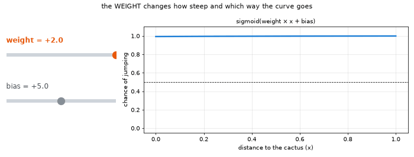
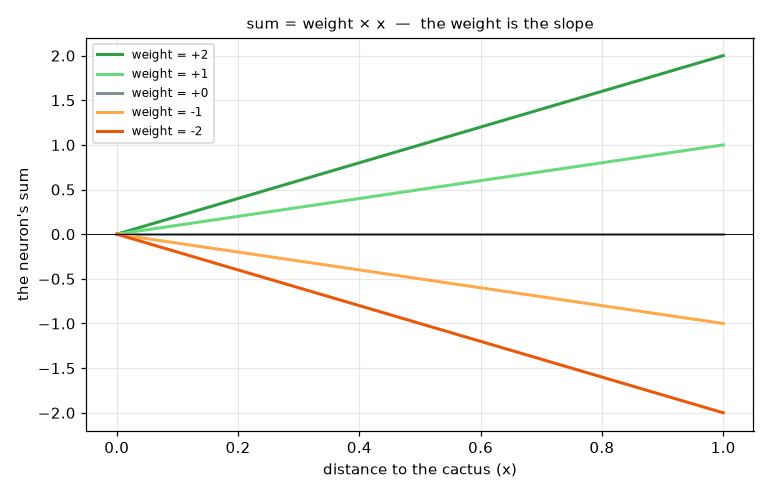
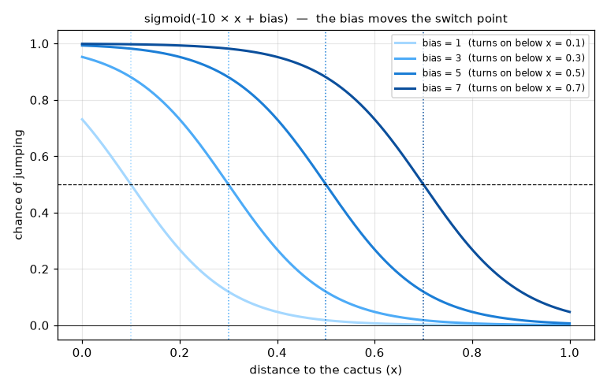
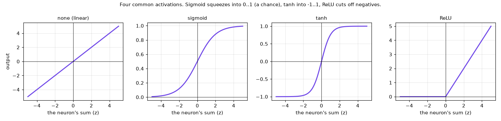
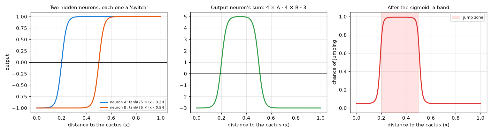
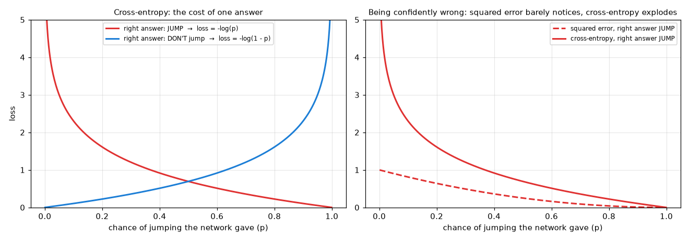
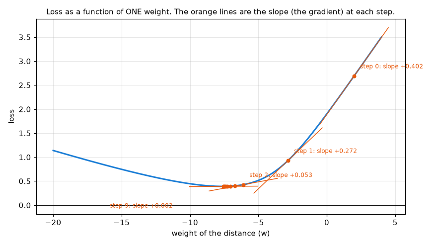

[English](README.md) · [Português](README.pt-BR.md) · **Español**

# Explicación a fondo: peso, sesgo, activación y pérdida

> Un complemento más pausado y más visual de la [lección 1](../README.es.md). Cada idea viene con una analogía de la vida cotidiana,
> una gráfica, un pequeño ejemplo resuelto a mano y el lugar donde aparece en el código.



*Una neurona es una pequeña máquina llena de perillas. Aquí las perillas se giran una a la vez: primero el peso, después el sesgo. Observa lo que cada una le hace a la curva.*

Todas las gráficas de esta página usan la neurona más simple posible: **una entrada**, la distancia hasta el cactus (`x`, de 0 = tocándolo a 1 = muy lejos), y una salida, cuántas "ganas de saltar" tiene. Para dibujar las gráficas tú mismo:

```bash
python lessons/01-neuron-and-gradient/concepts/concepts.py
```

---

## 1. Peso: una perilla de volumen

**Analogía.** Imagina una consola de sonido, con una perilla de volumen para cada instrumento. Un **peso** es una de esas perillas, una por entrada: dice qué tan fuerte suena esa entrada en la mezcla final. Si la subes, esa entrada importa más. Si la bajas a cero, la entrada queda en silencio. Un peso *negativo* es una perilla que funciona al revés: cuanto más fuerte la entrada, más empuja hacia el otro lado.

**Fórmula.** Una neurona multiplica cada entrada por su peso y suma todo:

```
suma = peso × entrada
```



Con una sola entrada, el peso es simplemente la **pendiente** de la recta. Positivo: cuanto más lejos el cactus, mayor la suma. Negativo: cuanto más lejos el cactus, *menor* la suma. Cero: la neurona ignora la distancia por completo.

**Ejemplo resuelto, dos entradas.** Una neurona con peso −3 para la distancia y +1 para la velocidad:

| Distancia | Velocidad | Suma |
|---|---|---|
| 0.2 (cerca) | 0.5 | −3 × 0.2 + 1 × 0.5 = **−0.1** |
| 0.8 (lejos) | 0.5 | −3 × 0.8 + 1 × 0.5 = **−1.9** |

El peso −3 dice "la distancia importa mucho, y cuanto más lejos, menos ganas tengo de saltar". El peso +1 dice "la velocidad importa un poco, y cuanto más rápido, más ganas tengo de saltar".

**En el código:** `W1` (de las 2 entradas a las 6 neuronas ocultas) y `W2` (de las neuronas ocultas a la salida). Son 18 de los 25 números de la red.

---

## 2. Sesgo: un termostato

**Analogía.** Un termostato no cambia *cómo* funciona la calefacción; cambia *cuándo* se enciende. El **sesgo** es lo mismo: un número que se agrega a la suma y mueve el punto en el que la neurona cambia de "no" a "sí".

**Fórmula.**

```
suma = peso × entrada + sesgo
```



Aquí el peso queda fijo en −10 y solo cambia el sesgo. La neurona dice "salta" (probabilidad mayor al 50%) donde la suma es positiva, así que cambia en `x = sesgo / 10`: con sesgo 3 empieza a querer saltar cuando el cactus está a menos de 0.3; con sesgo 7, ya desde 0.7.

Sin sesgo, todas las neuronas estarían obligadas a cambiar exactamente en `x = 0`. El sesgo le da a cada neurona su propio punto de cambio.

**En el código:** `b1` (uno por neurona oculta) y `b2` (uno para la salida): los otros 7 de los 25 números. Empiezan en cero, y por eso, en la época 0 de la lección 1, todas las rectas de [`06_hidden_lines.png`](../results/06_hidden_lines.png) se cruzan en el mismo punto.

---

## 3. Activación: un regulador de intensidad

**Analogía.** Un interruptor común está apagado o encendido. Un **regulador de intensidad** (*dimmer*) va suavemente de apagado a la máxima luz. Una función de activación es un regulador de intensidad aplicado a la suma de la neurona: dobla la recta y la convierte en una curva.



- **sigmoid** comprime cualquier suma en 0..1, lo que funciona como una **probabilidad**. La lección 1 la usa en la salida: "probabilidad de saltar".
- **tanh** comprime en −1..1. La lección 1 la usa en las neuronas ocultas.
- **ReLU** conserva las sumas positivas y corta las negativas a cero. Ella y sus primas más suaves (como GELU, que usa el modelo de lenguaje de la [lección 7](../../07-language-model/README.es.md)) son las más comunes en las redes grandes de hoy.

**Por qué importa.** Sin activación, apilar neuronas no sirve de nada: una recta de una recta sigue siendo una recta. Dos neuronas lineales seguidas, la primera `2x + 1` y la segunda `−3 × (primera) + 0.5`, dan:

```
−3 × (2x + 1) + 0.5 = −6x − 2.5        (solo otra línea recta)
```

No importa cuántas apiles, obtienes una sola recta. La curva es lo que le permite a una red dibujar formas.

---

## 4. Dos reguladores forman una franja

**Analogía.** Piensa en una sala de espera con un letrero: "pase a partir de las 2 p. m., pero no después de las 5 p. m.". Hacen falta dos reglas, "por lo menos las 2 p. m." y "todavía no son las 5 p. m.", y solo pasas cuando las dos están de acuerdo. La franja de "saltar" de la lección 1 es exactamente eso: "el cactus está por lo menos así de cerca, pero no demasiado cerca".



- La **neurona A** se enciende cuando la distancia pasa de 0.2. La **neurona B** se enciende cuando pasa de 0.5.
- La neurona de salida las suma con pesos opuestos, `4 × A − 4 × B − 3`: solo entre 0.2 y 0.5 está A encendida mientras B sigue apagada.
- La sigmoide convierte ese bulto en una **probabilidad de saltar**.

| Distancia | A | B | Suma 4A − 4B − 3 | Probabilidad de saltar |
|---|---|---|---|---|
| 0.1 | −0.99 | −1.00 | −2.95 | 5% |
| 0.35 | +1.00 | −1.00 | +4.99 | **99%** |
| 0.8 | +1.00 | +1.00 | −3.00 | 5% |

Eso es lo que hace la red entrenada de la lección 1, con 2 entradas en lugar de 1: dos de sus neuronas ocultas terminan en los dos bordes de la franja ([`06_hidden_lines.png`](../results/06_hidden_lines.png)). Nadie fijó esos números a mano. El entrenamiento los encontró.

---

## 5. Pérdida: una apuesta

**Analogía.** Piensa en cada predicción como una **apuesta**. Cuando la red dice "90% saltar", está apostando 90% a saltar. La **pérdida** es cuánto cuesta la apuesta una vez que se revela la respuesta correcta: una apuesta segura y acertada casi no cuesta nada, una apuesta tímida cuesta un poco, y una apuesta segura pero *equivocada* cuesta mucho.

**Fórmula** (entropía cruzada, la pérdida de la lección 1), con `p` = la probabilidad de saltar que dio la red:

```
si la respuesta correcta es SALTAR:     loss = −log(p)
si la respuesta correcta es NO saltar:  loss = −log(1 − p)
```



**Ejemplo resuelto, tres apuestas:**

| Respuesta correcta | La red dijo | Pérdida |
|---|---|---|
| saltar | 90% saltar | 0.11 (segura y acertada: casi gratis) |
| no saltar | 20% saltar | 0.22 (bastante segura y acertada) |
| saltar | 5% saltar | **3.00** (segura y equivocada: cara) |
| | **promedio** | **1.11** |

La pérdida de la red es el **promedio** sobre todos los ejemplos. Entrenar significa hacer ese promedio lo más pequeño posible.

**¿Por qué no simplemente contar los errores?** "Acierto o error" no distingue una apuesta del 51% de una del 99%, así que no puede decir *cómo* mejorar. La pérdida cambia suavemente con cada peso, y eso es exactamente lo que necesita el gradiente.

**¿Por qué no el error cuadrático?** La gráfica de la derecha muestra que el error cuadrático casi no castiga una respuesta segura pero equivocada (nunca pasa de 1). La entropía cruzada se dispara, así que esos son los errores que la red corrige primero.

---

## 6. Gradiente: bajar una colina entre la niebla

**Analogía.** Estás en una colina, en medio de una niebla espesa, y quieres llegar abajo. No puedes ver el valle, pero tus pies sienten hacia qué lado se inclina el suelo. Entonces das un paso cuesta abajo, vuelves a sentir, das otro paso. El **gradiente** es esa inclinación, sentida en el lugar donde estás parado. La **tasa de aprendizaje** es el tamaño de tu paso.



Aquí la pérdida se dibuja como función de un solo peso (el peso de la distancia), con el sesgo fijo. Las líneas naranjas son la pendiente en cada paso:

| Paso | Peso | Pérdida | Pendiente | Nuevo peso = peso − 12 × pendiente |
|---|---|---|---|---|
| 0 | +2.00 | 2.690 | +0.4025 | −2.83 |
| 1 | −2.83 | 0.930 | +0.2721 | −6.10 |
| 2 | −6.10 | 0.427 | +0.0527 | −6.73 |
| 9 | −7.54 | 0.390 | +0.0021 | −7.57 |

- Una **pendiente positiva** significa "aumentar el peso aumenta la pérdida", así que el peso baja. Una pendiente negativa lo empujaría hacia arriba.
- Lejos del fondo, la pendiente es empinada y los pasos son grandes. Cerca del fondo se aplana y los pasos se vuelven diminutos: las dos fases de la repetición de la lección 1.

La lección 1 hace esto con los 25 pesos a la vez, y la retropropagación calcula las 25 pendientes de una sola vez. La sección 8 de la lección 1 muestra el mismo recorrido en un mapa con 2 pesos, y qué pasa cuando los pasos son demasiado pequeños o demasiado grandes.

---

## Resumen

| Idea | Analogía | Qué hace | En el código de la lección 1 |
|---|---|---|---|
| Peso | una perilla de volumen | cuánto importa una entrada, y en qué dirección | `W1`, `W2` |
| Sesgo | un termostato | dónde se enciende la neurona | `b1`, `b2` |
| Activación | un regulador de intensidad | dobla la suma en una curva, para que la red pueda dibujar formas | `np.tanh`, `sigmoid` |
| Pérdida | una apuesta | cuánto cuestan, en promedio, las respuestas de la red | `loss()` |
| Gradiente | la pendiente bajo tus pies entre la niebla | hacia qué lado, y cuánto, mover cada peso | `backward()` |

**Volver a:** [lección 1](../README.es.md)
