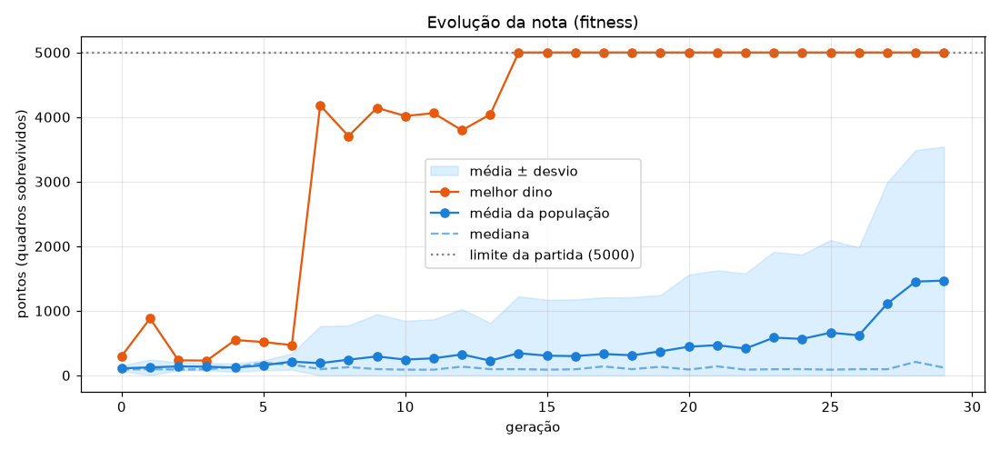

# Relatório do treino — neuroevolução

> Gerado automaticamente por `relatorio.py` a partir de `historico.json`.
> Rode o treino de novo e este relatório muda — cada execução é uma evolução diferente.

## Resumo

| | |
|---|---|
| Gerações | 30 |
| Dinos por geração | 50 |
| Primeira geração a atingir 5000 pontos | 14 |
| Média da população: geração 0 → última | 109 → 1467 |
| Campeão final: conexões / neurônios ocultos | 14 / 4 |

## 1. A nota ao longo das gerações

O **melhor** sobe rápido (basta um dino com sorte). A **média** sobe mais devagar: é a população inteira herdando o que funciona.

## 2. Espécies

O NEAT separa as redes em espécies, e cada uma compete principalmente dentro do próprio grupo. Isso protege inovações (uma conexão nova, que no início costuma piorar a rede) de serem eliminadas antes de terem chance de amadurecer.

## 3. Tamanho da rede

O NEAT começa com a rede mínima e só adiciona neurônios e conexões quando isso ajuda. Também remove o que não serve.

## 4. Os pesos se ajustando

Cada linha é uma conexão do campeão final, e mostra quanto ela valia no campeão de cada geração. Os campeões são indivíduos diferentes, mas parentes: genes (conexões) são herdados e vão sofrendo pequenas mutações. Note que **não existe gradiente aqui** — os pesos mudam por mutação aleatória + seleção dos melhores.

Todos os pesos de todos os dinos, por geração. Na geração 0 são aleatórios em torno de zero; com o tempo a distribuição muda de forma conforme a seleção favorece certos valores.

## 5. As redes dos campeões

## 6. O campeão final, peso por peso

Ordenado pela força (valor absoluto) do peso:

| De | Para | Peso |
|---|---|---|
| oculto 144 | pular | -5.102 |
| distância | oculto 144 | +4.451 |
| largura | pular | +2.739 |
| distância | abaixar | -2.425 |
| velocidade | abaixar | +1.736 |
| altura | oculto 47 | +1.421 |
| distância | nada | +1.408 |
| altura | nada | -1.250 |
| largura | abaixar | -1.044 |
| largura | oculto 177 | -0.779 |
| oculto 194 | pular | +0.706 |
| elevação | oculto 194 | +0.607 |
| velocidade | pular | +0.133 |
| oculto 47 | abaixar | +0.102 |

## 7. Parâmetros usados neste treino

| Seção | Parâmetro | Valor | O que faz |
|---|---|---|---|
| `NEAT` | `pop_size` | 50 | Quantos dinos (redes) existem em cada geração. |
| `NEAT` | `fitness_threshold` | 5000 | Nota considerada 'meta atingida'. |
| `NEAT` | `no_fitness_termination` | True | Se True, roda todas as gerações pedidas mesmo após bater a meta. |
| `DefaultGenome` | `num_inputs` | 6 | Quantos sensores a rede recebe. |
| `DefaultGenome` | `num_outputs` | 3 | Quantas ações a rede pode escolher. |
| `DefaultGenome` | `num_hidden` | 0 | Neurônios ocultos no início (o NEAT cria mais se precisar). |
| `DefaultGenome` | `initial_connection` | full | 'full' = toda entrada começa ligada a toda saída. |
| `DefaultGenome` | `activation_default` | tanh | Função de ativação dos neurônios. |
| `DefaultGenome` | `weight_init_stdev` | 1.0 | Quão espalhados são os pesos aleatórios iniciais. |
| `DefaultGenome` | `weight_mutate_rate` | 0.8 | Chance de cada peso sofrer mutação a cada geração. |
| `DefaultGenome` | `weight_mutate_power` | 0.5 | Tamanho típico da mutação (um 'empurrão' aleatório no peso). |
| `DefaultGenome` | `weight_replace_rate` | 0.1 | Chance de um peso ser trocado por um valor totalmente novo. |
| `DefaultGenome` | `bias_mutate_rate` | 0.7 | Chance de cada viés sofrer mutação. |
| `DefaultGenome` | `conn_add_prob` | 0.5 | Chance de nascer uma conexão nova. |
| `DefaultGenome` | `conn_delete_prob` | 0.5 | Chance de uma conexão ser removida. |
| `DefaultGenome` | `node_add_prob` | 0.2 | Chance de nascer um neurônio novo (no meio de uma conexão). |
| `DefaultGenome` | `node_delete_prob` | 0.2 | Chance de um neurônio ser removido. |
| `DefaultSpeciesSet` | `compatibility_threshold` | 3.0 | Quão diferentes duas redes precisam ser para virarem espécies distintas. |
| `DefaultStagnation` | `max_stagnation` | 20 | Gerações sem melhorar até uma espécie ser extinta. |
| `DefaultReproduction` | `elitism` | 2 | Quantos melhores de cada espécie passam intactos para a próxima geração. |
| `DefaultReproduction` | `survival_threshold` | 0.2 | Fração de cada espécie que pode ter 'filhos'. |

O arquivo completo está em [`config-neat.txt`](../config-neat.txt).

## 8. Geração por geração

| Geração | Melhor | Média | Mediana | Espécies | Conexões do campeão |
|---|---|---|---|---|---|
| 0 | 300 | 109 | 88 | 1 | 18 |
| 1 | 881 | 123 | 96 | 1 | 17 |
| 2 | 232 | 138 | 90 | 1 | 17 |
| 3 | 229 | 134 | 95 | 1 | 16 |
| 4 | 547 | 121 | 130 | 1 | 15 |
| 5 | 516 | 156 | 193 | 1 | 15 |
| 6 | 468 | 212 | 167 | 1 | 15 |
| 7 | 4181 | 189 | 96 | 1 | 17 |
| 8 | 3705 | 243 | 127 | 1 | 17 |
| 9 | 4142 | 293 | 97 | 1 | 17 |
| 10 | 4017 | 244 | 88 | 1 | 17 |
| 11 | 4060 | 264 | 88 | 1 | 17 |
| 12 | 3795 | 324 | 135 | 1 | 17 |
| 13 | 4041 | 228 | 96 | 1 | 17 |
| 14 | 5000 | 343 | 96 | 1 | 9 |
| 15 | 5000 | 304 | 88 | 1 | 9 |
| 16 | 5000 | 298 | 94 | 1 | 9 |
| 17 | 5000 | 331 | 138 | 1 | 9 |
| 18 | 5000 | 311 | 96 | 1 | 9 |
| 19 | 5000 | 371 | 133 | 1 | 9 |
| 20 | 5000 | 443 | 90 | 1 | 9 |
| 21 | 5000 | 468 | 139 | 1 | 15 |
| 22 | 5000 | 414 | 88 | 1 | 13 |
| 23 | 5000 | 584 | 95 | 1 | 15 |
| 24 | 5000 | 564 | 96 | 1 | 12 |
| 25 | 5000 | 660 | 88 | 1 | 12 |
| 26 | 5000 | 620 | 96 | 1 | 14 |
| 27 | 5000 | 1109 | 94 | 1 | 13 |
| 28 | 5000 | 1452 | 208 | 1 | 12 |
| 29 | 5000 | 1467 | 120 | 1 | 14 |
