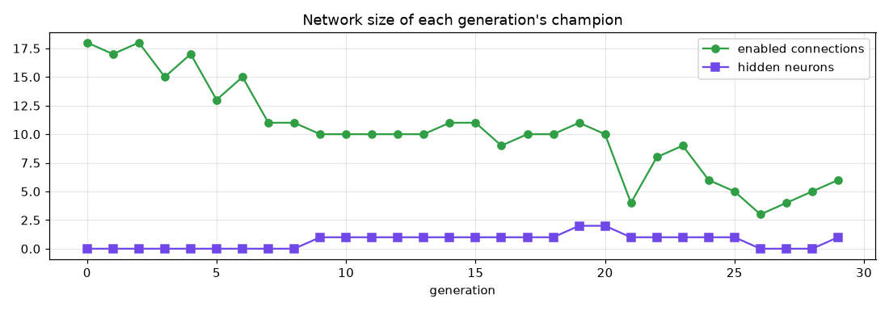
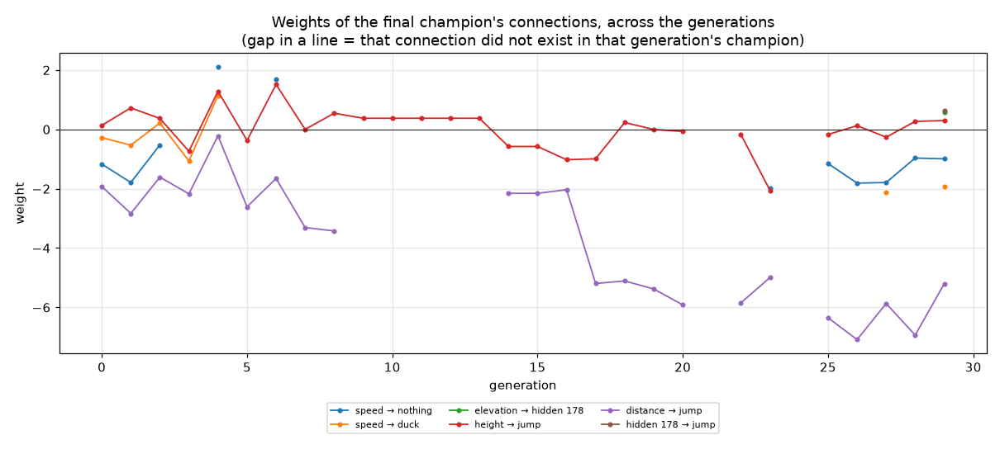
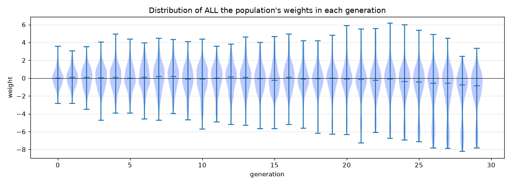
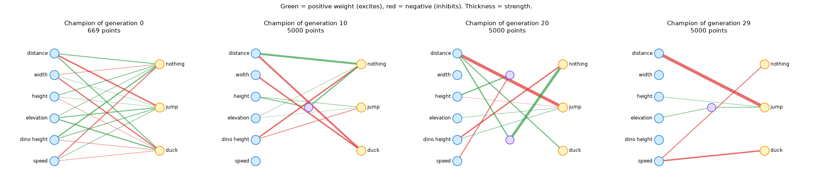

# Training report — neuroevolution

> Generated automatically by `report.py` from `history.json`.
> Run the training again (with a different `SEED`) and this report changes — each seed is a different evolution.

## Summary

| | |
|---|---|
| Generations | 30 |
| Dinos per generation | 50 |
| First generation to reach 5000 points | 6 |
| Population average: generation 0 → last | 121 → 1084 |
| Final champion: connections / hidden neurons | 6 / 1 |

## 1. The score over the generations

The **best** climbs fast (all it takes is one lucky dino). The **average** climbs more slowly: that is the whole population inheriting what works.

## 2. Species

NEAT splits the networks into species, and each one competes mainly within its own group. This protects innovations (a new connection, which at first usually makes the network worse) from being wiped out before they have a chance to mature.

## 3. Network size

NEAT starts with the smallest network and only adds neurons and connections when that helps. It also removes what is not useful.

## 4. The weights adjusting

Each line is a connection of the final champion, and shows how much it was worth in each generation's champion. The champions are different individuals, but related: genes (connections) are inherited and keep undergoing small mutations. Note that **there is no gradient here** — the weights change through random mutation + selection of the best.

All the weights of all the dinos, per generation. In generation 0 they are random around zero; over time the distribution changes shape as selection favors certain values.

## 5. The champions' networks

## 6. The final champion, weight by weight

Sorted by the strength (absolute value) of the weight:

| From | To | Weight |
|---|---|---|
| distance | jump | -5.204 |
| speed | duck | -1.921 |
| speed | nothing | -0.993 |
| hidden 178 | jump | +0.632 |
| elevation | hidden 178 | +0.585 |
| height | jump | +0.299 |

## 7. Parameters used in this training

| Section | Parameter | Value | What it does |
|---|---|---|---|
| `NEAT` | `pop_size` | 50 | How many dinos (networks) exist in each generation. |
| `NEAT` | `fitness_threshold` | 5000 | Score considered 'goal reached'. |
| `NEAT` | `no_fitness_termination` | True | If True, runs every requested generation even after reaching the goal. |
| `DefaultGenome` | `num_inputs` | 6 | How many sensors the network receives. |
| `DefaultGenome` | `num_outputs` | 3 | How many actions the network can choose from. |
| `DefaultGenome` | `num_hidden` | 0 | Hidden neurons at the start (NEAT adds more if needed). |
| `DefaultGenome` | `initial_connection` | full | 'full' = every input starts connected to every output. |
| `DefaultGenome` | `activation_default` | tanh | The neurons' activation function. |
| `DefaultGenome` | `weight_init_stdev` | 1.0 | How spread out the initial random weights are. |
| `DefaultGenome` | `weight_mutate_rate` | 0.8 | Chance of each weight being mutated every generation. |
| `DefaultGenome` | `weight_mutate_power` | 0.5 | Typical size of a mutation (a random 'nudge' to the weight). |
| `DefaultGenome` | `weight_replace_rate` | 0.1 | Chance of a weight being replaced by a brand-new value. |
| `DefaultGenome` | `bias_mutate_rate` | 0.7 | Chance of each bias being mutated. |
| `DefaultGenome` | `conn_add_prob` | 0.5 | Chance of a new connection appearing. |
| `DefaultGenome` | `conn_delete_prob` | 0.5 | Chance of a connection being removed. |
| `DefaultGenome` | `node_add_prob` | 0.2 | Chance of a new neuron appearing (in the middle of a connection). |
| `DefaultGenome` | `node_delete_prob` | 0.2 | Chance of a neuron being removed. |
| `DefaultSpeciesSet` | `compatibility_threshold` | 3.0 | How different two networks must be to count as separate species. |
| `DefaultStagnation` | `max_stagnation` | 20 | Generations without improvement before a species goes extinct. |
| `DefaultReproduction` | `elitism` | 2 | How many of the best in each species pass unchanged to the next generation. |
| `DefaultReproduction` | `survival_threshold` | 0.2 | Fraction of each species allowed to have 'children'. |

The full file is in [`neat-config.txt`](../neat-config.txt).

## 8. Generation by generation

| Generation | Best | Average | Median | Species | Champion's connections |
|---|---|---|---|---|---|
| 0 | 669 | 121 | 88 | 1 | 18 |
| 1 | 316 | 105 | 96 | 1 | 17 |
| 2 | 235 | 154 | 141 | 1 | 18 |
| 3 | 534 | 150 | 95 | 1 | 15 |
| 4 | 263 | 124 | 130 | 1 | 17 |
| 5 | 642 | 138 | 94 | 1 | 13 |
| 6 | 5000 | 297 | 120 | 1 | 15 |
| 7 | 1477 | 176 | 96 | 1 | 11 |
| 8 | 5000 | 307 | 128 | 1 | 11 |
| 9 | 5000 | 309 | 97 | 1 | 10 |
| 10 | 5000 | 355 | 93 | 1 | 10 |
| 11 | 5000 | 335 | 88 | 1 | 10 |
| 12 | 5000 | 398 | 91 | 1 | 10 |
| 13 | 5000 | 550 | 96 | 1 | 10 |
| 14 | 5000 | 316 | 96 | 1 | 11 |
| 15 | 5000 | 498 | 119 | 1 | 11 |
| 16 | 5000 | 530 | 95 | 1 | 9 |
| 17 | 5000 | 569 | 141 | 1 | 10 |
| 18 | 5000 | 671 | 94 | 1 | 10 |
| 19 | 5000 | 831 | 133 | 1 | 11 |
| 20 | 5000 | 1070 | 88 | 1 | 10 |
| 21 | 5000 | 1284 | 142 | 1 | 4 |
| 22 | 5000 | 1284 | 96 | 1 | 8 |
| 23 | 5000 | 906 | 95 | 1 | 9 |
| 24 | 5000 | 1299 | 96 | 1 | 6 |
| 25 | 5000 | 1447 | 174 | 1 | 5 |
| 26 | 5000 | 1652 | 118 | 1 | 3 |
| 27 | 5000 | 1192 | 96 | 1 | 4 |
| 28 | 5000 | 1864 | 824 | 1 | 5 |
| 29 | 5000 | 1084 | 95 | 1 | 6 |
