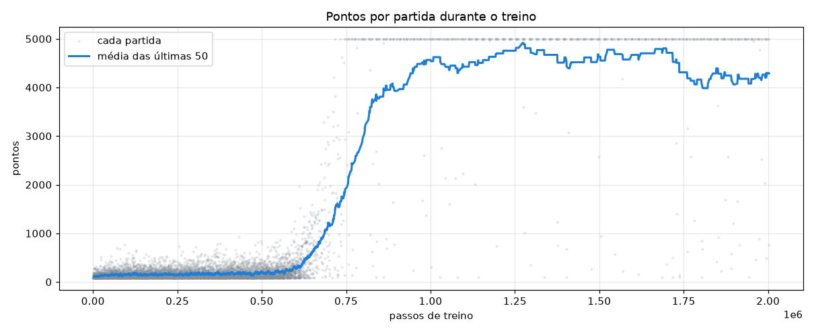
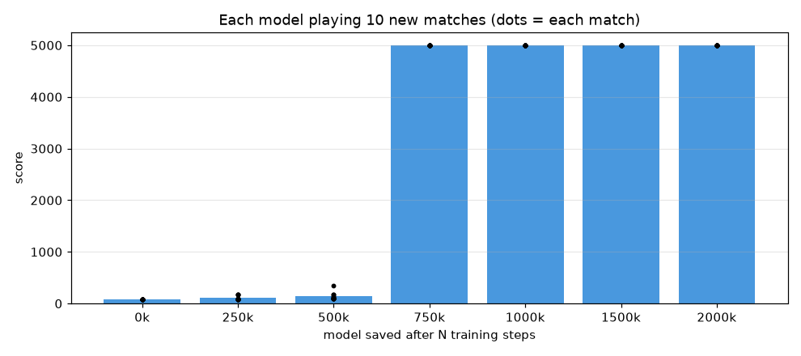
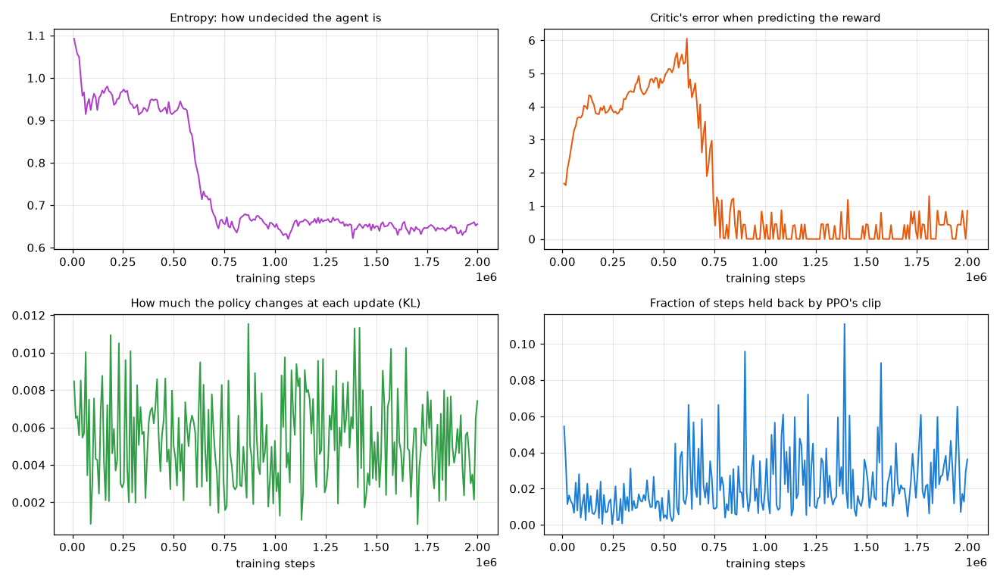
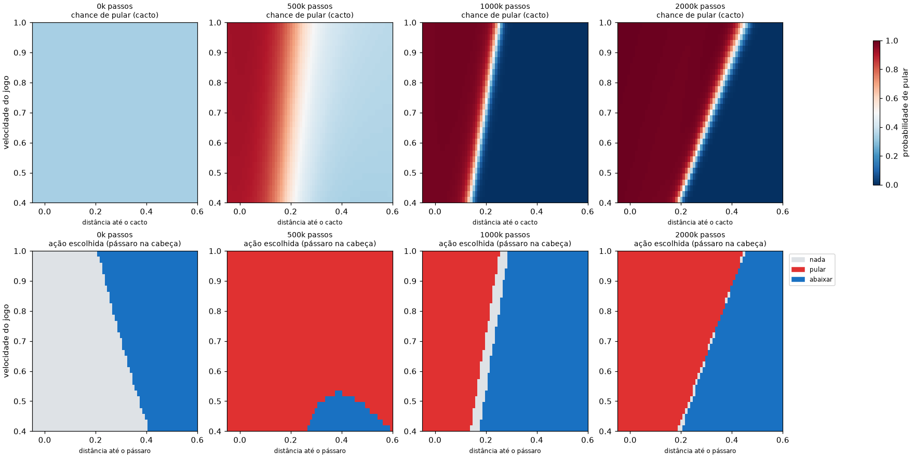

**English** · [Português](README.pt-BR.md) · [Español](README.es.md)

# Lesson 4 — Reinforcement learning (PPO)

> **Goal:** combine the **gradient** from lesson 1 with the **score** from lesson 3. A single dino plays thousands of matches and adjusts the network's weights, by gradient, to earn more reward.
> It is the same family of techniques used to fine-tune LLMs after pre-training.


*The same dino after 0, 500 thousand, 1 million and 2 million training steps, on the same match. The 0k model crashes at 86 points and the 500k model at 129; the other two are still alive when the clip ends (each clip stops at 700 points). On the right, the chance the network gives each action ("Chance of each action") and the value it expects to earn ("Expected value:").*

Run one at a time, in this order.

1. Train (about 80 seconds on the Mac used for the example, no window):

```bash
python lessons/04-reinforcement/train.py
```

2. Generate the charts and `REPORT.md`:

```bash
python lessons/04-reinforcement/report.py
```

3. Watch the final model play. The ← → arrows switch between saved models, and R starts a new match:

```bash
python lessons/04-reinforcement/watch.py
```

4. Compare with the model before training:

```bash
python lessons/04-reinforcement/watch.py --model 0
```

The models from an example training run are already in the repository, so step 3 works even without training.

---

## 1. Three ways to learn

| | [Lesson 1](../01-neuron-and-gradient/README.md) — gradient | [Lesson 3](../03-neuroevolution/README.md) — neuroevolution | Lesson 4 — reinforcement |
|---|---|---|---|
| Who plays | nobody (ready-made examples) | 50 dinos per generation | 1 dino, thousands of matches |
| What the AI receives | the right answer for each example | a score at the end of the match | a reward at **every step** |
| How the weights change | gradient | random mutation + selection | gradient |
| Does someone need to know the answer? | yes | no | no |

Reinforcement sits in the middle: as in lesson 3, nobody says which move is right; as in lesson 1, the weights change by gradient, with no random mutations.

---

## 2. The environment: observation, action, reward

[`environment.py`](environment.py) wraps the game in the standard **Gymnasium** format, which any reinforcement learning algorithm understands:

- **Observation:** the same 6 sensors from the previous lessons.
- **Action:** 0 = nothing, 1 = jump, 2 = duck.
- **Reward:** `+0.1` per frame alive and `−1` on crashing. It is the only "teacher". The agent does not know what a cactus is; it only knows that some numbers in the input come before the bad reward.

Every match has freshly drawn obstacles, so the agent has to **generalize** instead of memorizing a level.

**Action repeat:** each decision lasts 2 game frames (`ACTION_REPEAT = 2`). With fewer decisions per match, it is easier to link an action to its consequence. DeepMind did the same with 4 frames in Atari games.

---

## 3. Actor and critic: two networks

PPO trains **two small networks** at the same time, both with 6 inputs and two layers of 32 neurons:

- **Actor (1,379 weights):** looks at the sensors and gives the chance of each action. It is the one that plays.
- **Critic (1,313 weights):** looks at the sensors and estimates the **value**: how much reward is still to come from there on.

In `watch.py`, the trained model's value ("Expected value:" on the panel) hovers around **19.5**. That is no accident: each step is worth 0.2 (two frames of 0.1) and the discount `GAMMA = 0.99` makes the distant future worth less and less, so the sum of everything ahead comes to 0.2 / (1 − 0.99) = 20. That is the ceiling, and the value shown stays just under it. When a hard obstacle approaches and the critic thinks things may go wrong, the value drops.

---

## 4. How PPO learns

One cycle, repeated about 245 times in a 2-million-step training run:

1. **Play:** 8 matches in parallel, 1,024 steps each. The actor **draws** its actions from the chances it gives (that is how it explores).
2. **Compare with what was expected:** for each step, compute the **advantage**: did it give more or less reward than the critic expected?
3. **Adjust by gradient:** increase the chance of actions with positive advantage and decrease that of actions with negative advantage. The critic is also adjusted to be less wrong next time.
4. **Brake:** the *clip* (the "P" in *Proximal*) keeps the chance of any action from changing more than ~20% in one update. Without this brake, one batch of lucky matches could ruin a policy that already worked.

Step 3 is exactly the gradient descent from lesson 1. The difference is **what** we try to reduce: there it was the error against the right answer; here it is "less reward than there could have been".

---

## 5. What to look for in the example report

The example training run is in [`results/REPORT.md`](results/REPORT.md). Every training run gives slightly different numbers, but the patterns repeat.



- **Plateau, then a jump.** For about 600 thousand steps the agent stays around 100–250 points: jumping nonstop is a "good enough" strategy that is hard to let go of (a *local optimum*). Suddenly it discovers that waiting for the cactus to get close pays off much more, and the average shoots up (the moving average first reaches 300 at ~595k steps, 1,000 at ~686k and 4,000 at ~867k).
- **Training vs. test.** During training the score stays around 4,200–4,900 (the last 200 matches average 4,329), below the maximum, because the actor still draws actions to explore. In the tests, `report.py` and `watch.py` always pick the most likely action.



- **Each saved model on 10 new matches.** The models at 0k, 250k and 500k steps average 86, 116 and 145 points. The first saved model with a mean of 4,000 or more is the 750k one, and from 750k on every model scored 5000 in all 10 new matches (5000 is `SCORE_LIMIT`, where the match ends).



- **Entropy plunges together with the jump in scores:** the agent stops choosing at random and becomes decisive.



- **Top:** the network learned a slanted boundary (jump when the cactus gets close, and earlier the faster the game), similar to the one in lesson 1. Except that here nobody gave it examples.
- **Bottom:** with the bird at head height, the agent stays ducked while it is far away and **jumps over it** when it gets close. It is not what a human would do, but it works. The reward says whether it worked, never how to do it.

---

## 6. Where is the learning stored?

In a **weights file**. Once trained, the model is just that: numbers. Loading the file = having the dino that knows how to play.

| Lesson | File | What is inside |
|---|---|---|
| [1](../01-neuron-and-gradient/README.md) | `results/weight_history.csv` | the 25 weights at each epoch; the last row is the trained network |
| [3](../03-neuroevolution/README.md) | `results/champions.pkl` | the genome of each generation's champion (structure + weights) |
| 4 | `results/models/ppo_02000k.zip` | `policy.pth` with the 2,692 weights of the actor and the critic (about 62 KB) |

An LLM is **the same thing on a giant scale**: a file (usually `.safetensors`) with billions of weights, taking from a few to hundreds of gigabytes. The network's structure is different (a *transformer*), but the idea is the same: training adjusts the numbers, and then the file is loaded to be used.

And, as here, **using it does not change the file**. Running `watch.py` a thousand times teaches the dino nothing; only a new `train.py` run changes the weights. An LLM does not learn while it talks to you either: what it "learns" comes from new rounds of training, which produce a new weights file, that is, a new version of the model.

---

## 7. Hyperparameters (top of `train.py` and `environment.py`)

| Parameter | Value | What it does |
|---|---|---|
| `REWARD_ALIVE` / `REWARD_CRASH` | 0.1 / −1 | What the agent tries to maximize. Changing this changes the behavior. |
| `ACTION_REPEAT` | 2 | Frames per decision. |
| `N_ENVS` | 8 | Matches played in parallel to collect experience. |
| `STEPS_PER_ROLLOUT` | 1024 | Steps per match before each update. |
| `LEARNING_RATE` | 0.0003 | Size of the gradient step, as in lesson 1. |
| `GAMMA` | 0.99 | How much the future is worth. Close to 1 = sees far ahead. |
| `ENTROPY_COEF` | 0.03 | Bonus for continuing to explore. It helped get out of the "always jump" plateau. |
| `CLIP` | 0.2 | How much the policy can change per update. |
| `LAYERS` | [32, 32] | Size of the actor and critic networks. |

---

## Exercises

1. In `environment.py`, set `JUMP_COST = 0.01`. Does the dino jump less? Look at `watch.py`.
2. Set `ACTION_REPEAT = 1` and train again. How long does the plateau last now?
3. Set `ENTROPY_COEF = 0`. Can the agent get out of "always jump"?
4. Change `GAMMA` to 0.9. Around what value will the expected value in `watch.py` sit? (Hint: redo the calculation from section 3.)
5. Remove the speed sensor: in `dino/game.py`, in `sensors()`, replace `speed = self.speed / MAX_SPEED` with `speed = 0`. Is the boundary in `04_decisions.png` still slanted?

---

## How does this relate to LLMs?

When an LLM is fine-tuned with reinforcement (RLHF and similar), the pieces are the same:

| Here | In the LLM |
|---|---|
| observation: 6 sensors | the text so far |
| action: nothing, jump, duck | the next piece of a word (*token*) |
| match | a whole answer |
| reward: surviving | a score from a model trained on people's ratings, or "the code passed the tests" |
| actor | the LLM itself |
| critic | a network that estimates the expected score |
| PPO's clip | a brake so the model does not drift too far from the original |

PPO was the algorithm used in the first versions of RLHF. Today there are variations, but the cycle is still the one from this lesson: **try, get a score, adjust the weights by gradient**.

---

**Previous lesson:** [neuroevolution](../03-neuroevolution/README.md) · **Study home:** [all lessons](../../README.md)
