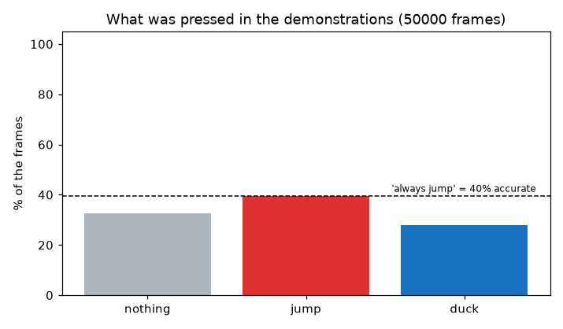
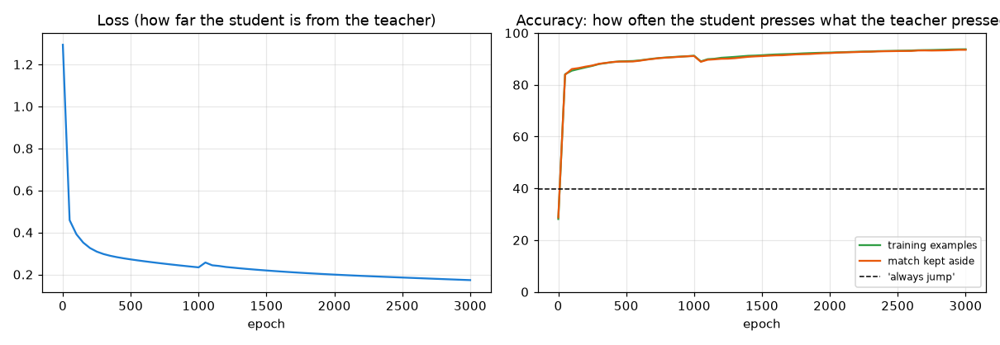
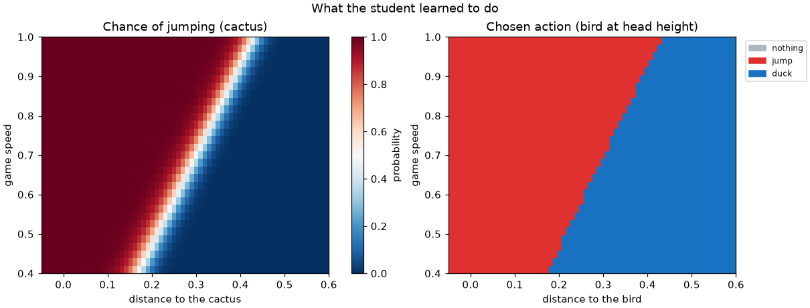
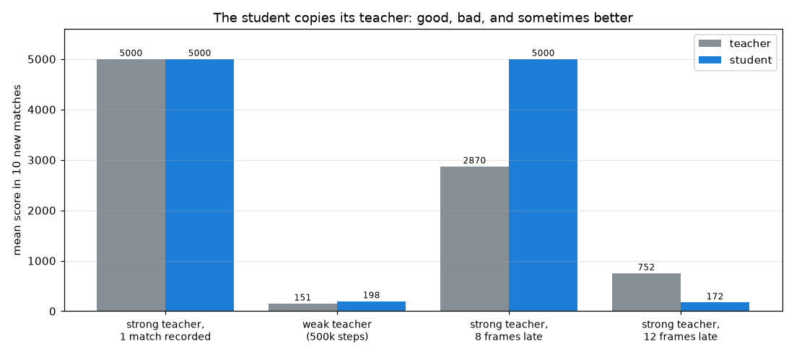

[English](README.md) · **Português** · [Español](README.es.md)

# Lição 5 — Imitação: você ensina o dino jogando

> **Objetivo:** treinar uma rede **copiando um professor** em vez de correr atrás de uma recompensa.
> O professor pode ser você (você joga e cada quadro é gravado) ou o agente da lição 4.
> É aprendizado supervisionado, como na lição 1, com as teclas do professor como gabarito.


*O aluno jogando sozinho. À direita, a chance que ele dá para cada ação, o que o professor apertaria na mesma situação e com que frequência os dois concordam.*

Rode um de cada vez, nesta ordem.

1. Treine o aluno com as demonstrações de exemplo (10 partidas jogadas pelo agente da lição 4, que já estão no repositório):

```bash
python lessons/05-imitation/train.py
```

2. Assista ao aluno jogando. R começa uma partida nova:

```bash
python lessons/05-imitation/watch.py
```

3. Rode os quatro experimentos: o aluno é tão bom quanto o professor?

```bash
python lessons/05-imitation/experiments.py
```

4. Agora ensine você mesmo. Jogue algumas partidas: ESPAÇO ou ↑ pula, ↓ abaixa, R começa a próxima partida e ESC salva e sai:

```bash
python lessons/05-imitation/record.py
```

Depois o terminal mostra o comando para treinar um aluno com as suas próprias demonstrações.

---

## 1. Um professor em vez de uma recompensa

| | Lição 1 — gradiente | Lição 4 — reforço | Lição 5 — imitação |
|---|---|---|---|
| O que a rede recebe | a resposta certa de cada exemplo | uma recompensa a cada passo | o que o professor apertou em cada quadro |
| Quem sabe a resposta? | o código (a regra verdadeira) | ninguém | o professor |
| Como os pesos mudam | gradiente | gradiente | gradiente |
| Custo para aprender a jogar | — | 2 milhões de passos, uns 80 s | 1 partida gravada, uns 2 s |

Imitação é aprendizado supervisionado de novo: o mesmo ciclo da lição 1 (ida, perda, gradiente, passo). A diferença é de onde vem o gabarito. Na lição 1 uma regra o escreveu; aqui quem escreve é um jogador, só jogando.

---

## 2. As demonstrações

[`record.py`](record.py) grava uma linha por quadro do jogo: os 6 sensores que a IA vê e a tecla que foi apertada naquele quadro. O arquivo de exemplo, [`results/demos/teacher_02000k.csv`](results/demos/teacher_02000k.csv), tem 10 partidas jogadas pelo agente final da lição 4: 50.000 linhas.

Para gravar o professor você mesmo (outro professor, um atraso, mais partidas), veja as opções no topo de `record.py`. Por exemplo:

```bash
python lessons/05-imitation/record.py --teacher
```



Aqui o professor apertou "pular" (`jump`) em 40% dos quadros, "nada" (`nothing`) em 33% e "abaixar" (`duck`) em 28%. É de novo a **armadilha da acurácia** da lição 1: um aluno que respondesse sempre "pular" já teria 40% de acurácia, e bateria no primeiro cacto. Com as suas próprias demonstrações a armadilha costuma ser bem maior, porque as pessoas passam a maior parte do tempo sem apertar nada.

---

## 3. Treinando o aluno

O aluno é uma rede pequena escrita só com numpy, como na lição 1: 6 sensores → 16 neurônios ocultos → 3 ações. Com 3 respostas possíveis em vez de 2, a saída usa uma *softmax*, que transforma três notas em três chances que somam 100%.

A última partida das demonstrações fica separada: o aluno nunca treina com ela, então ela mostra como o aluno se sai em situações que nunca viu.



Com as demonstrações de exemplo:

- o aluno aperta a mesma tecla que o professor em **93,7%** dos quadros de treino e em **93,5%** dos quadros da partida separada;
- jogando sozinho, ele faz **5000 em todas as 10 partidas novas**.

O aluno inteiro é um arquivo com 163 números, `results/models/student_teacher_02000k.npz`. Como o agente da lição 4, esse arquivo *é* o aprendizado.

---

## 4. 93% de concordância, jogo perfeito

Se o aluno discorda do professor em 6% dos quadros, como ele nunca bate? Porque a maioria das discordâncias acontece quando a tecla quase não faz diferença:

- **56%** das discordâncias acontecem com o dino no ar, onde apertar "pular" de novo não faz nada;
- outros **24%** são "nada" contra "abaixar" enquanto o obstáculo ainda está longe.

A acurácia mede o quanto o aluno **copia** bem; a pontuação mede o quanto ele **joga** bem. Não são a mesma coisa, e o objetivo é a segunda.

---

## 5. O que o aluno aprendeu



Compare com o [`04_decisions.png`](../04-reinforcement/results/04_decisions.png) da lição 4: é praticamente a mesma imagem. O aluno aprendeu a linha inclinada do professor para o cacto e até a estratégia estranha dele para o pássaro na altura da cabeça (ficar abaixado enquanto ele está longe e pular por cima quando chega perto). O aluno nunca viu uma recompensa; ele só copiou, e copiou tudo, inclusive as manias.

---

## 6. O aluno é tão bom quanto o professor?

[`experiments.py`](experiments.py) grava quatro professores diferentes, treina um aluno com cada um e coloca professor e aluno para jogar as mesmas 10 partidas novas. Os professores "atrasados" são o agente final da lição 4 apertando cada tecla alguns quadros depois de ver a situação, como o tempo de reação de uma pessoa.



| Professor | Exemplos | Pontuação média do professor | Pontuação média do aluno |
|---|---|---|---|
| Forte, só 1 partida gravada | 5.000 | 5000 | **5000** |
| Fraco (lição 4 depois de 500k passos) | 1.803 | 151 | 198 |
| Forte, 8 quadros atrasado | 37.313 | 2870 | **5000** |
| Forte, 12 quadros atrasado | 3.757 | 752 | 172 |

- **Imitar é barato.** Uma partida gravada e 2 segundos de treino deram um jogador perfeito. A lição 4 precisou de 2 milhões de passos para descobrir a mesma coisa sozinha.
- **Professor fraco faz aluno fraco.** O aluno copia o que vê. Ele não tem como saber que o professor é ruim, porque nunca vê uma pontuação.
- **O aluno pode superar um professor desleixado.** O professor 8 quadros atrasado às vezes pula tarde demais e bate; o aluno aprende o comportamento *médio* dele, que é bom, e perde o deslize ocasional. Ele fez 5000 onde o professor fez em média 2870.
- **Mas não um professor ruim.** Com 12 quadros de atraso, o atraso é o comportamento, não um deslize. O aluno copia isso e se sai ainda pior.

---

## 7. Sua vez: ensine você mesmo

Grave algumas partidas com `record.py` e treine um aluno com elas usando o comando que o script mostra. Depois compare o seu aluno com o de exemplo. Algumas coisas que costumam acontecer com demonstrações humanas:

- **A armadilha fica maior.** A maioria dos seus quadros é "nada", então o aluno "sempre nada" parece ter acurácia muito alta e joga muito mal. Olhe o `01_actions.png` e a linha tracejada no `02_training.png`.
- **O seu tempo de reação está nos dados.** Como os professores "atrasados" acima, o aluno aprende quando *você* apertou, não quando deveria ter apertado.
- **Mais partidas ajudam**, principalmente partidas em que você chegou à parte rápida do jogo, com pássaros. O aluno só consegue copiar situações que estão nas demonstrações.

---

## Exercícios

1. Treine só com a primeira partida das demonstrações de exemplo (`train.py --matches 1`). O aluno continua fazendo 5000?
2. Em `experiments.py`, teste atrasos de 4, 10 e 16 quadros. Onde fica a linha entre "o aluno limpa os erros do professor" e "o aluno copia os erros"?
3. Grave as suas próprias demonstrações e treine um aluno. Ele é melhor ou pior que você? Assista com `watch.py --student` e o caminho que o treino mostra.
4. Misture as suas demonstrações com as do professor: `train.py --demos` aceita vários arquivos. O que acontece com o aluno?

---

## Qual a relação com os LLMs?

Os LLMs são treinados na mesma ordem deste estudo:

1. O **pré-treino** é imitação em escala gigante: o modelo aprende a prever a próxima palavra de trilhões de palavras escritas por pessoas. Ele copia texto humano, bom e ruim.
2. O ***supervised fine-tuning*** (ajuste fino supervisionado) é esta lição: pessoas escrevem exemplos de boas respostas, e o modelo aprende a imitá-los. É barato e rápido, como o aluno de 1 partida, mas o modelo só consegue ser tão bom quanto os exemplos, como o aluno do professor fraco.
3. O **aprendizado por reforço** (lição 4) vem por último: o modelo tenta, recebe uma pontuação e é ajustado para pontuar mais. É assim que ele consegue ir além dos exemplos.

Imitar primeiro e depois usar reforço junta o melhor dos dois: a imitação dá um bom ponto de partida a baixo custo, e o reforço melhora onde os exemplos não bastam.

**Lição anterior:** [aprendizado por reforço](../04-reinforcement/README.pt-BR.md) · **Início do estudo:** [todas as lições](../../README.pt-BR.md) · **Próxima lição:** [aprender a enxergar](../06-vision/README.pt-BR.md)
