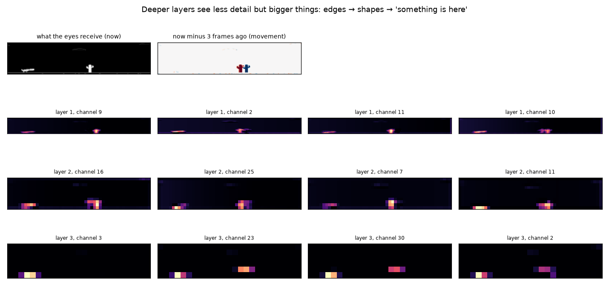
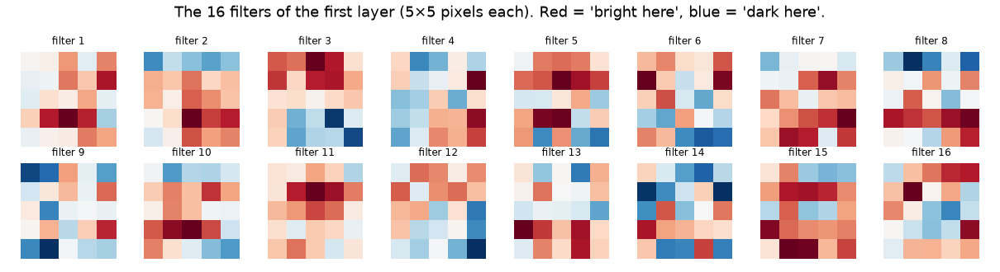
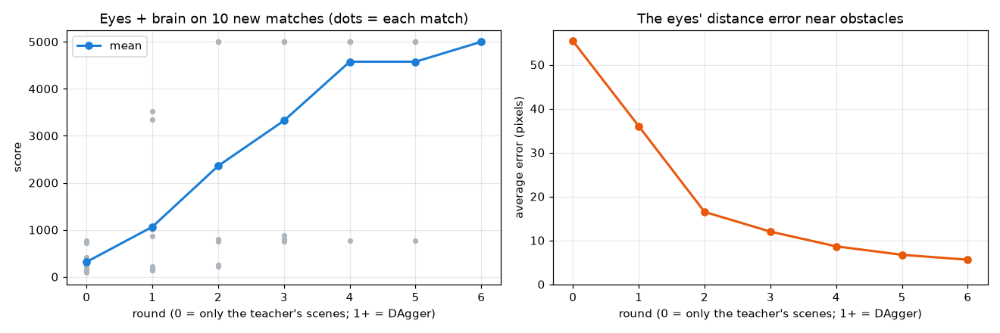
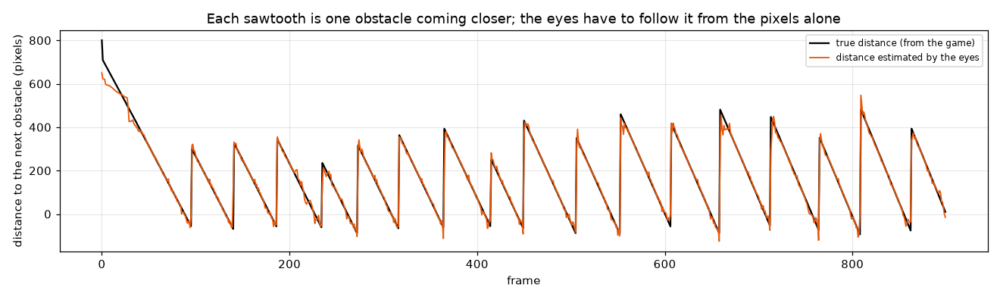

[English](README.md) · **Português** · [Español](README.es.md)

# Lição 6 — Aprendendo a ver: o dino joga pela tela

> **Objetivo:** até agora o dino recebia 6 números prontos do jogo. Aqui ele recebe só **a tela**,
> e uma rede convolucional (CNN) aprende a ler essa tela.
> É o mesmo tipo de treino que "gato ou cachorro" em fotos, com rótulos que o jogo dá de graça.


*Jogando só pela tela. A linha laranja é onde os olhos acham que começa o próximo obstáculo. Embaixo: a imagem pequena que os olhos recebem e os 6 números, os verdadeiros (do jogo) e os estimados (pelos olhos).*

Rode um de cada vez, nesta ordem.

1. Assista aos olhos + cérebro jogando. Os olhos treinados já estão no repositório. R começa uma partida nova:

```bash
python lessons/06-vision/watch.py
```

2. Treine os olhos você mesmo. Leva uns 20-25 minutos num Mac recente e mais tempo num computador sem uma placa de vídeo que o PyTorch consiga usar:

```bash
python lessons/06-vision/train_eyes.py
```

3. Teste a outra abordagem, dos pixels direto para as teclas (alguns minutos):

```bash
python lessons/06-vision/pixels_to_keys.py
```

Esta lição usa o PyTorch, que já foi instalado na lição 4.

---

## 1. De 6 números para pixels

A tela tem 800 × 300 pixels, mas a maior parte não importa. [`vision.py`](vision.py) recorta a área que vai do alto de um pulo até um pouco abaixo do chão, e até 600 pixels à frente do dino, junta cada bloco de 3 × 5 pixels em um só e passa para tons de cinza. A rede recebe uma **imagem de 200 × 44**, com as coisas escuras (dino, cactos, pássaros) viradas em claras.

Uma imagem não basta. Numa foto não dá para saber a velocidade de alguma coisa, e é a velocidade que decide quando pular. Por isso a rede recebe **duas imagens: a atual e a de 3 quadros atrás**. A diferença entre elas é o movimento.



A linha de cima mostra o que a rede recebe: a cena agora e "agora menos 3 quadros atrás", em que o cacto aparece duas vezes (vermelho onde ele está agora, azul onde ele estava).

---

## 2. Uma rede convolucional

Uma **convolução** desliza um filtro pequeno (aqui de 5 × 5 pixels) pela imagem inteira e, em cada posição, mede o quanto aquele pedaço da imagem se parece com o filtro. O mesmo filtro é usado em todo lugar, então um cacto à esquerda e um cacto à direita são detectados do mesmo jeito. É isso que faz as CNNs serem boas com imagens.

Os olhos têm 3 camadas convolucionais e depois uma camada densa que transforma o que elas encontraram nos 6 números dos sensores: 630.406 pesos no total.

- A **camada 1** (a segunda linha da imagem acima) reage a detalhes pequenos: o contorno do dino e do cacto.
- A **camada 2** junta esses detalhes em formas pequenas.
- A **camada 3** vê bem menos detalhe, mas coisas maiores: uma mancha para o dino, uma para o cacto. Ela diz "tem alguma coisa aqui".

Estes são os 16 filtros da primeira camada, do jeito que foram aprendidos:



Nos livros, os filtros da primeira camada parecem detectores de bordas bem arrumados. Estes parecem mais ruidosos: as imagens são minúsculas e o treino é curto. Alguns ainda mostram faixas horizontais ou verticais de claro e escuro.

Um truque a mais: as convoluções são boas em dizer **o que** tem na imagem, mas não **onde**. Os olhos recebem um canal de entrada extra que só diz "o quanto este pixel está para a direita" (uma técnica chamada *CoordConv*), o que ajuda a medir a distância.

---

## 3. Duas formas de jogar pelos pixels

**De ponta a ponta** ([`pixels_to_keys.py`](pixels_to_keys.py)): uma rede só, das duas imagens direto para "nada / pular / abaixar", copiando o agente da lição 4, como o aluno da lição 5.

**Olhos + cérebro** ([`train_eyes.py`](train_eyes.py)): a CNN só estima os 6 números dos sensores (os **olhos**). O agente da lição 4, sem nenhuma mudança, decide a partir desses números (o **cérebro**). O cérebro não sabe se os números vieram do jogo ou dos olhos.

| Abordagem | Concordância com o professor | Pontuação média em 10 partidas novas | Partidas com 5000 |
|---|---|---|---|
| De ponta a ponta, pixels → teclas | 94,5% dos quadros | 3013 | 4 |
| Olhos + cérebro, rodada 0 (só as cenas do professor) | — | 316 | 0 |
| Olhos + cérebro, depois de 6 rodadas de DAgger | — | **5000** | **10** |

Sem nenhum truque extra, a rede de ponta a ponta se saiu melhor que olhos + cérebro. Mas quando a rede de ponta a ponta bate, não tem como saber por quê: ela é um bloco só, dos pixels às teclas. Com olhos + cérebro dá para comparar, cena por cena, o que os olhos estimaram com a verdade. Foi isso que mostrou o problema, e o que levou à solução.

---

## 4. Por que os primeiros olhos falharam

Na rodada 0 os olhos aprendem só com cenas gravadas enquanto o cérebro joga com os sensores **verdadeiros**. O erro médio deles perto dos obstáculos é de 55 pixels, e olhos + cérebro batem cedo em todas as partidas (média 316).

Acompanhar uma batida quadro a quadro, numa versão anterior destes olhos, mostrou a causa. Enquanto o cacto está longe, o agente da lição 4 gosta de **abaixar**. Quando o cacto chega perto, normalmente ele já está pulando, então as cenas gravadas quase nunca mostram **um dino abaixado bem do lado de um cacto**. Com os olhos no comando, o pulo vem um tiquinho atrasado, o dino ainda está abaixado nessa posição, e os olhos, diante de uma cena que nunca viram, erram: a distância estimada *aumenta* enquanto o cacto se aproxima. O cérebro acha que o cacto está longe e não pula.

É a armadilha da lição 5 de novo, agora na percepção: uma rede treinada só com as cenas do professor não sabe o que fazer nas cenas a que os próprios erros dela levam.

---

## 5. A solução: DAgger

O **DAgger** (*Dataset Aggregation*, ou agregação de dados) fecha essa lacuna:

1. Olhos + cérebro jogam **juntos**, com erros e tudo.
2. Cada cena em que eles entram é gravada com os números **verdadeiros** dos sensores como gabarito (o jogo sempre sabe esses números).
3. Os olhos continuam treinando com tudo o que foi gravado até agora.
4. Repita.

Cada rodada acrescenta exatamente as cenas em que o sistema estava errando.



| Rodada | Cenas gravadas | Pontuação média | Partidas com 5000 | Erro de distância perto dos obstáculos |
|---|---|---|---|---|
| 0 | 20.000 | 316 | 0 | 55 pixels |
| 1 | 20.962 | 1063 | 0 | 36 pixels |
| 2 | 26.969 | 2359 | 4 | 16 pixels |
| 3 | 37.442 | 3322 | 6 | 12 pixels |
| 4 | 50.349 | 4576 | 9 | 9 pixels |
| 5 | 65.349 | 4576 | 9 | 7 pixels |
| 6 | 80.349 | **5000** | **10** | 6 pixels |

As primeiras rodadas acrescentam poucas cenas, porque olhos + cérebro ainda batem cedo. Conforme os olhos melhoram, as partidas ficam mais longas, cada rodada traz mais cenas e os erros que sobram vão sumindo.



Depois da rodada 6, a distância que os olhos estimam (laranja) acompanha a verdadeira (preto) em todos os obstáculos de uma partida.

---

## 6. Os rótulos vieram de graça

Para treinar "gato ou cachorro" em fotos, alguém precisa rotular milhares de imagens à mão. Aqui, cada imagem já vem com os seus rótulos de graça: o jogo sabe a distância, o tamanho e a altura exatos de cada obstáculo. Também foi por isso que o DAgger foi fácil: qualquer cena nova podia ser rotulada na hora.

Carros autônomos e robôs usam a mesma ideia. Boa parte do treino deles acontece em simuladores, onde cada pixel vem com a sua resposta. A parte difícil é a mesma daqui: o mundo real mostra para eles cenas que o simulador nunca mostrou.

---

## Exercícios

1. Em `vision.py`, coloque `FRAME_GAP = 1` e treine de novo. Os olhos ainda conseguem estimar a velocidade?
2. Tire o canal do CoordConv (o buffer `columns`) dos olhos. Como muda o erro de distância?
3. Rode `train_eyes.py --rounds 0` (sem DAgger) e depois `--rounds 2`. Compare com a tabela acima.
4. Aplique a ideia do DAgger ao `pixels_to_keys.py`: deixe ele jogar, rotule as cenas que ele visita com as teclas do professor e treine de novo. Ele chega a 5000 em todas as partidas?
5. Use o aluno da lição 5 como cérebro no lugar do agente da lição 4. Ele lê os mesmos 6 números.

---

## Qual a relação com os LLMs?

- **Modelos que veem imagens** funcionam de um jeito parecido: uma rede de visão transforma a imagem em listas de números, e o modelo de linguagem lê esses números como se fossem palavras. São olhos + cérebro de novo, com um cérebro muito maior.
- **Cenas nunca vistas no treino** também são um problema para os LLMs. Quando uma pergunta é muito diferente de tudo o que havia nos dados de treino, um modelo pode responder com confiança e mesmo assim errar, como os olhos que "viram" um cacto longe quando ele estava bem na frente do dino.
- **Os rótulos são a parte cara.** Aqui o jogo deu os rótulos de graça. Para os LLMs, bons exemplos escritos por pessoas custam caro, e esse é um dos motivos de eles serem pré-treinados primeiro com texto bruto: a próxima palavra é um rótulo que vem de graça.

**Lição anterior:** [imitação](../05-imitation/README.pt-BR.md) · **Início do estudo:** [todas as lições](../../README.pt-BR.md)
