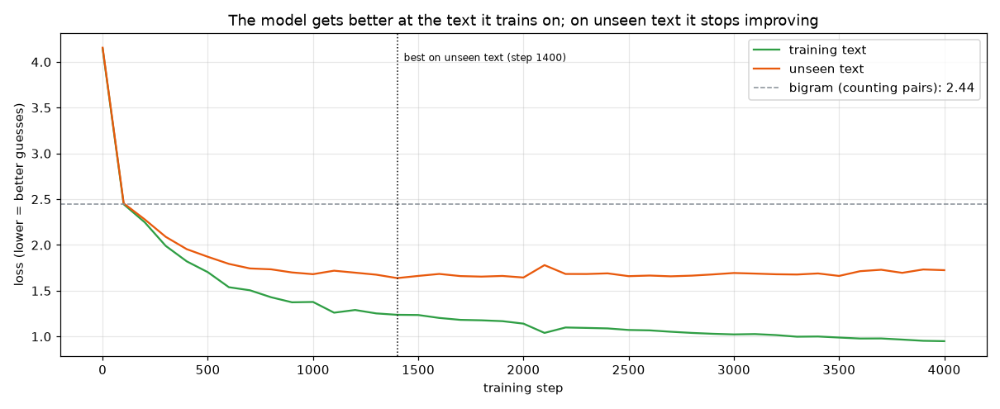
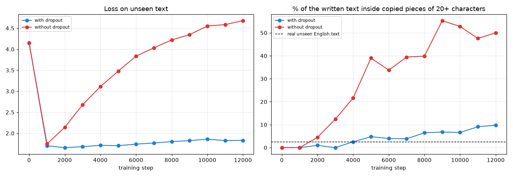
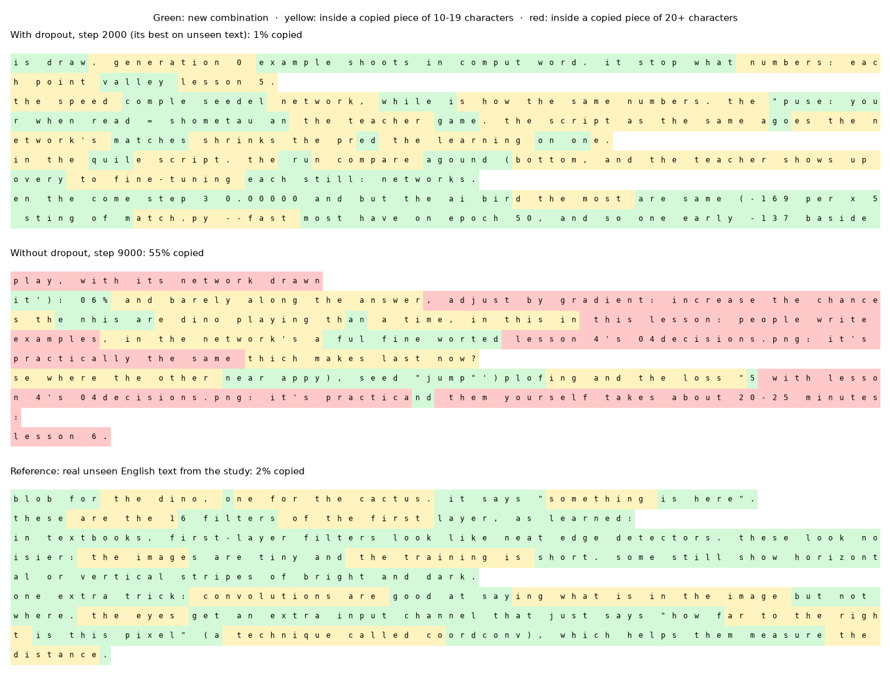
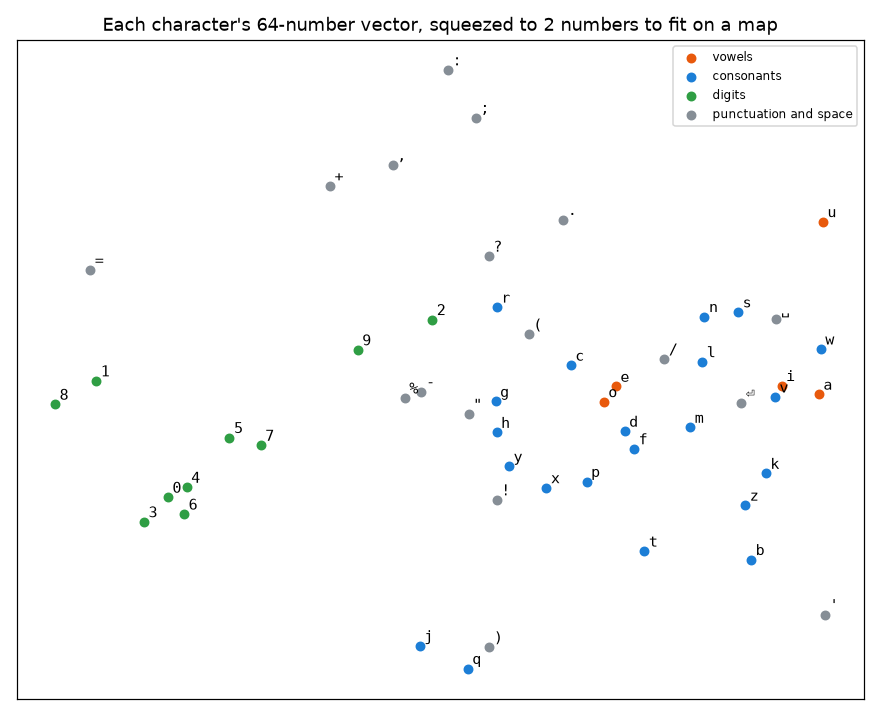
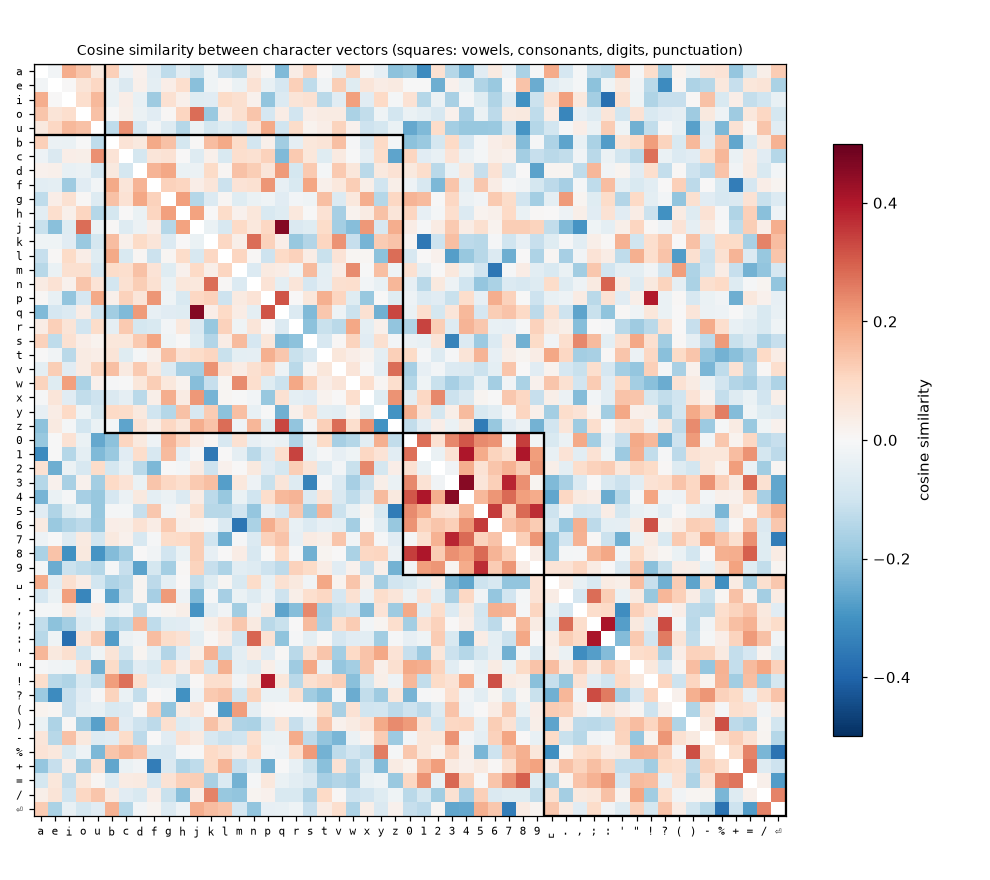
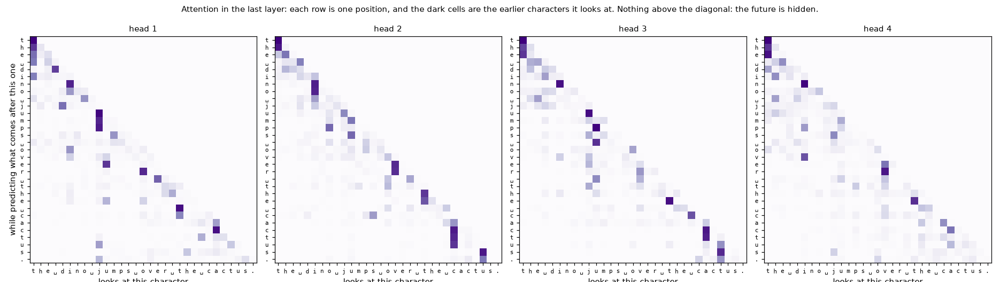

[English](README.md) · [Português](README.pt-BR.md) · **Español**

# Lección 7 — Un modelo de lenguaje diminuto

> **Objetivo:** construir la versión más pequeña posible de un LLM y mirar por dentro.
> Lee texto y aprende a predecir el siguiente carácter, con el mismo diseño que los grandes
> (un *transformer*), solo que diminuto. Se entrena con los README de este estudio, en unos 30 segundos.


*El modelo escribe un carácter a la vez. Abajo, la probabilidad que les da a los 8 siguientes caracteres más probables; el naranja es el carácter sorteado.*

El modelo se entrenó con texto en inglés, así que escribe en inglés.

Ejecuta uno a la vez, en este orden.

1. Entrena el modelo (unos 30 segundos en una Mac reciente y más en una computadora sin una tarjeta gráfica que PyTorch pueda usar):

```bash
python lessons/07-language-model/train.py
```

2. Hazlo escribir:

```bash
python lessons/07-language-model/generate.py
```

3. Mira cómo elige cada carácter:

```bash
python lessons/07-language-model/generate.py --explain
```

4. Mira por dentro: *embeddings*, similitud coseno y atención:

```bash
python lessons/07-language-model/inside.py
```

El modelo entrenado ya está en el repositorio, así que los pasos 2 a 4 funcionan sin entrenar.

---

## 1. Todo el trabajo: adivinar el siguiente carácter

Un modelo de lenguaje hace una sola cosa: dado el texto hasta ahora, le da una **probabilidad a cada pedazo de texto que puede venir después**. Para escribir, sortea un pedazo según esas probabilidades, lo agrega al texto y vuelve a preguntar.

Aquí cada pedazo (cada **token**) es un solo carácter: 53 distintos, entre letras, dígitos, puntuación, espacio y salto de línea. Los LLM de verdad usan pedazos de palabras en su lugar ("dino", "saur", "jump", "ing"), con vocabularios de decenas de miles a unos doscientos mil tokens.

El texto de entrenamiento es el README en inglés del inicio del estudio y de las lecciones 1 a 6, limpio (sin tablas, sin código, sin enlaces), en minúsculas: **46 605 caracteres**. Está congelado en [`data/study.txt`](data/study.txt). El primer 90% se usa para entrenar; el último 10% es **texto no visto**, para comprobar cómo le va al modelo con un texto con el que nunca entrenó.

La **pérdida** es la misma idea que en la lección 1: cuánto se sorprende el modelo con el siguiente carácter real. Un modelo que adivina al azar tiene una pérdida de 3.97. Cuanto más baja, mejor.

---

## 2. Modelo 1: contar pares

El modelo más simple posible, el **bigrama**, solo cuenta qué carácter sigue a cuál en el texto de entrenamiento: después de "q", casi siempre "u"; después de un espacio, a menudo "t". Sin red, sin entrenamiento.

Su pérdida en el texto no visto es **2.44**, mucho mejor que al azar. Pero solo mira el carácter anterior, así que escribe así:

```
the dino ond, mpenche me fond ps, --oen. one min torith, 3v/7;qoomat5'sschinletchtsth
```

---

## 3. Modelo 2: un *transformer* diminuto

[`tiny_lm.py`](tiny_lm.py) arma el mismo tipo de red que un LLM, solo que diminuta:

1. ***Embeddings*.** Cada carácter se convierte en un vector de 64 números (su *embedding*), más un vector para su posición (1.º, 2.º, 3.º... carácter). Estos números se aprenden.
2. **Atención.** Cada posición mira hacia atrás a los caracteres anteriores (hasta 64) y decide cuáles importan para lo que viene después. Las posiciones nunca pueden mirar el futuro: eso sería espiar la respuesta.
3. **Una red pequeña** (como la de la lección 1) procesa lo que reunió la atención.
4. Los pasos 2 y 3 forman un **bloque**; el modelo apila 2. Al final, un puntaje para cada uno de los 53 caracteres, convertido en probabilidades.

En total, **111 029 pesos**, entrenados por descenso de gradiente como todas las redes de este estudio.



| Paso | Pérdida en el texto de entrenamiento | Pérdida en el texto no visto | Qué escribe después de "the dino " |
|---|---|---|---|
| 0 | 4.15 | 4.16 | `o'9,sqj'/9+r%-62)'m=3%nw(-)zet(o60i` |
| 250 | 2.25 | 2.28 | `on the en mote the ands weiget. the min tory` |
| 500 | 1.70 | 1.87 | `only step. ritep (the screace work + in to it` |
| 1000 | 1.38 | 1.68 | `only much mutes for 300 muches. the minutions` |
| 2000 | 1.14 | 1.64 | `only matches teaches path. in the explore,` |
| 4000 | 0.95 | 1.72 | `only model steps to find -1 expected value` |

Primero aprende qué caracteres son comunes, después palabras cortas ("the", "on"), después más largas ("network", "matches"), y después algo que suena a inglés pero no significa nada. [`results/samples.md`](results/samples.md) tiene las muestras completas.

### ¿Aprende o memoriza?

Mira las dos curvas. La pérdida en el **texto de entrenamiento** sigue bajando hasta el final. La pérdida en el **texto no visto** deja de mejorar alrededor del paso 1400 (la mejor: **1.64**) y después empeora despacio. De ahí en adelante, el modelo está **memorizando** este texto en particular en lugar de aprender inglés: es *overfitting*, la misma trampa que en la lección 1 con 20 ejemplos.

`train.py` guarda el modelo de su mejor momento en el texto no visto. Un *dropout* del 10% (apagar señales al azar durante el entrenamiento) también hace más difícil memorizar.

La cura de verdad es **mucho más texto**. 47 mil caracteres caben en unas pocas páginas; los LLM se entrenan con billones de tokens, así que no pueden memorizarlo todo y tienen que aprender los patrones.

### Medirlo: ¿el texto es nuevo o copiado?

Las curvas de pérdida dicen *cuándo* empieza a memorizar. Para verlo en el propio texto, [`memorization.py`](memorization.py) funciona como un detector de plagio: para cada carácter que escribe el modelo, busca el **fragmento más largo a su alrededor que aparece, exactamente igual, en el texto de entrenamiento**. Los fragmentos cortos ("the ", "ing ") aparecen en cualquier texto en inglés y no significan nada. Un fragmento copiado de **20 caracteres o más** es una señal de memorización.

Como referencia justa, la misma revisión se hace sobre el 10% del texto que quedó afuera: inglés real, escrito por una persona, que el modelo nunca vio. Solo el **2.5%** queda dentro de fragmentos copiados de 20+ caracteres, por pura casualidad (los README repiten algunas frases).

El script entrena dos modelos durante 12 000 pasos, tres veces más que `train.py`: uno con *dropout* y otro sin él.

```bash
python lessons/07-language-model/memorization.py
```



| Paso | Con *dropout*: pérdida en el texto no visto | Con *dropout*: copiado | Sin *dropout*: pérdida en el texto no visto | Sin *dropout*: copiado |
|---|---|---|---|---|
| 1 000 | 1.70 | 0% | 1.75 | 0% |
| 4 000 | 1.71 | 2.5% | 3.11 | 22% |
| 9 000 | 1.82 | 7% | 4.35 | **55%** |
| 12 000 | 1.83 | 10% | 4.68 | 50% |

Sin *dropout*, el modelo empeora en el texto no visto mientras copia cada vez más: en el paso 9 000, más de la mitad de lo que escribe está pegado de los README. Con *dropout* copia mucho menos, pero se desvía despacio en la misma dirección. Por eso `train.py` se detiene en el mejor momento.

Aquí está el texto mismo, coloreado carácter por carácter:



- **Arriba**, con *dropout* en su mejor momento: casi todo verde y amarillo. Palabras conocidas y frases cortas, combinadas de formas nuevas.
- **En el medio**, sin *dropout* en el paso 9 000: largos tramos rojos, como "lesson 4's 04decisions.png: it's practically the same", copiado palabra por palabra del README de la lección 5.
- **Abajo**, la referencia: inglés real que el modelo nunca vio. Casi todo verde, con amarillo en las frases comunes.

Así que sí, se puede comprobar si un modelo está repitiendo lo que leyó, al menos para el texto que tienes: compara lo que escribe con lo que usó para entrenar. Los investigadores hacen lo mismo con LLM grandes y encuentran las dos cosas. Pueden repetir algunos textos palabra por palabra, sobre todo los que aparecen muchas veces en sus datos de entrenamiento, pero la mayor parte de lo que escriben son combinaciones nuevas.

---

## 4. Escribir: azar y temperatura

`generate.py --explain` muestra cada elección. Después de "the dino sco", el modelo le da 97% a "r": aprendió la palabra "score". Después de un espacio, las probabilidades se reparten, porque pueden venir muchas palabras:

```
                       text so far   the 5 most likely next characters         drawn
                       'the dino '   a  15%  s  14%  t   8%  p   7%  i   7%   -> 's'
                      'the dino s'   t  42%  a  22%  c  17%  e   6%  h   4%   -> 'c'
                     'the dino sc'   o  63%  r  30%  a   3%  e   2%  h   1%   -> 'o'
                    'the dino sco'   r  97%  n   1%  v   1%  m   0%  s   0%   -> 'r'
```

La **temperatura** cambia cómo se usan las probabilidades. Una temperatura baja hace que los caracteres probables sean todavía más probables; una temperatura alta les da más oportunidad a los improbables. Pruébalo:

```bash
python lessons/07-language-model/generate.py --compare
```

| Temperatura | Qué escribe después de "the dino " |
|---|---|
| 0.3 | `steps the same a good step of the example step over action 50 and 2000 and the step and the dino and the and the same the same and the` |
| 0.8 | `only matches teacher's when example find of the 292020000 15 is in lotic still it learning:` |
| 1.5 | `only much. rule for 300,5-4zen. the minutoring, 24bunce, at5k scompletes fipt)? helthile togree varixelys` |

Con 0.3 se queda atascado repitiendo las palabras más seguras. Con 1.5 inventa palabras. Los asistentes de chat suelen escribir en algún punto intermedio.

---

## 5. *Embeddings* y similitud coseno, de verdad

En la lección 1, la similitud coseno era solo una analogía. Aquí es real: cada carácter tiene un vector de 64 números, y la similitud coseno dice cuánto apuntan dos de ellos hacia el mismo lado.



*Los 64 números de cada carácter comprimidos en 2, para que quepan en un mapa.*

Los **dígitos** forman su propio grupo, lejos de las letras. Nadie le dijo al modelo que "3" y "4" son números. Notó que aparecen en los mismos tipos de lugares (junto a otros dígitos, antes de la "k" en "500k", después de "lesson "), así que les dio vectores que apuntan hacia el mismo lado.



| Grupo | Similitud coseno promedio entre sí | Con el resto |
|---|---|---|
| dígitos | +0.18 | −0.02 |
| vocales | +0.09 | −0.04 |
| consonantes | +0.03 | −0.02 |
| puntuación y espacio | +0.02 | −0.02 |

Los caracteres más cercanos a "3" son "4" (+0.45), "7" (+0.38) y "0" (+0.24). Entre los más cercanos a "." están ";" y "?", otros signos de puntuación.

Estas señales son débiles para la mayoría de los caracteres: una sola letra lleva poco significado por sí misma. En los LLM, cuyos tokens son palabras y pedazos de palabras, el mismo mecanismo pone "dog" (perro) y "puppy" (cachorro) cerca, porque se usan en los mismos lugares. Es la misma idea, con más significado que capturar.

---

## 6. Atención: qué mira cada posición



Cada panel es una de las 4 cabezas de atención de la última capa, leyendo "the dino jumps over the cactus.". Cada fila es una posición, y las celdas oscuras son los caracteres anteriores que mira al adivinar lo que viene después. Nada aparece por encima de la diagonal: el futuro está oculto.

En esta frase, algunas cabezas miran sobre todo hacia el comienzo de la palabra actual (en la cabeza 1, la "u", la "m" y la "p" de "jumps" miran la "j"); otras miran uno o dos caracteres hacia atrás. Nadie programó estas reglas; salieron del entrenamiento, porque ayudan a adivinar el siguiente carácter.

---

## 7. Este modelo vs un LLM real

| | Esta lección | Un LLM grande |
|---|---|---|
| Token | 1 carácter | un pedazo de palabra |
| Vocabulario | 53 tokens | de decenas de miles a ~200 000 tokens |
| Contexto (hasta dónde puede mirar hacia atrás) | 64 caracteres | de miles a millones de tokens |
| Pesos | 111 029 | de miles de millones a cientos de miles de millones |
| Texto de entrenamiento | 46 605 caracteres | billones de tokens |
| Entrenamiento | unos 30 segundos en una laptop | semanas o meses en miles de GPUs |

El diseño es el mismo: *embeddings*, bloques de atención, un puntaje para cada siguiente token posible, descenso de gradiente sobre la pérdida. La diferencia es la escala, y con la escala llega la capacidad de escribir cosas que tienen sentido.

Y esta lección es solo la primera etapa de un LLM, el **preentrenamiento**. Después, los modelos reales se ajustan imitando buenas respuestas ([lección 5](../05-imitation/README.es.md)) y con aprendizaje por refuerzo ([lección 4](../04-reinforcement/README.es.md)).

---

## Ejercicios

1. Entrénalo con cualquier otro archivo de texto, como un libro en texto plano: `train.py --text book.txt`. ¿Aprende más rápido con más texto? ¿Sigue memorizando?
2. En `tiny_lm.py`, pon `DROPOUT = 0` y entrena de nuevo. ¿Dónde deja de mejorar ahora la pérdida en el texto no visto?
3. Pon `CONTEXT = 8`. ¿Qué pasa con la pérdida y con las palabras que escribe?
4. Pon `LAYERS = 1`. ¿Alcanza con un bloque?
5. Ejecuta `generate.py --prompt "the gradient "` con temperaturas 0.3 y 1.5 (usa `--temperature`). ¿Cuál suena más al estudio?

**Lección anterior:** [aprender a ver](../06-vision/README.es.md) · **Inicio del estudio:** [todas las lecciones](../../README.es.md) · **Siguiente lección:** [modo difícil](../08-hard-mode/README.es.md)
