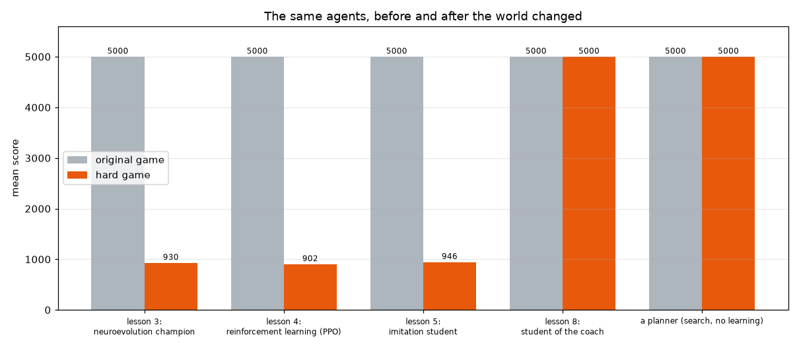
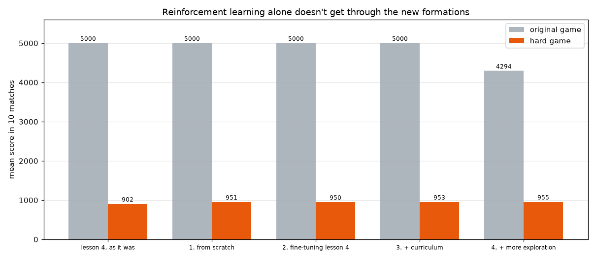
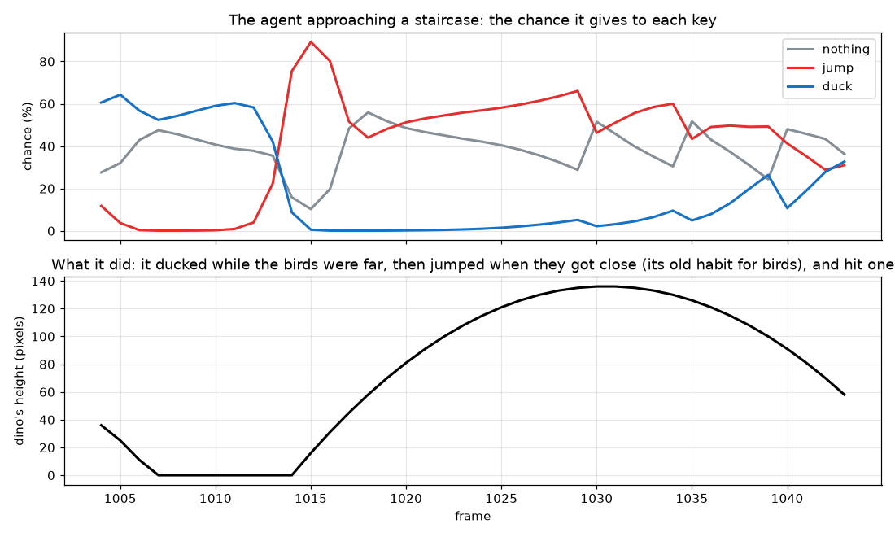
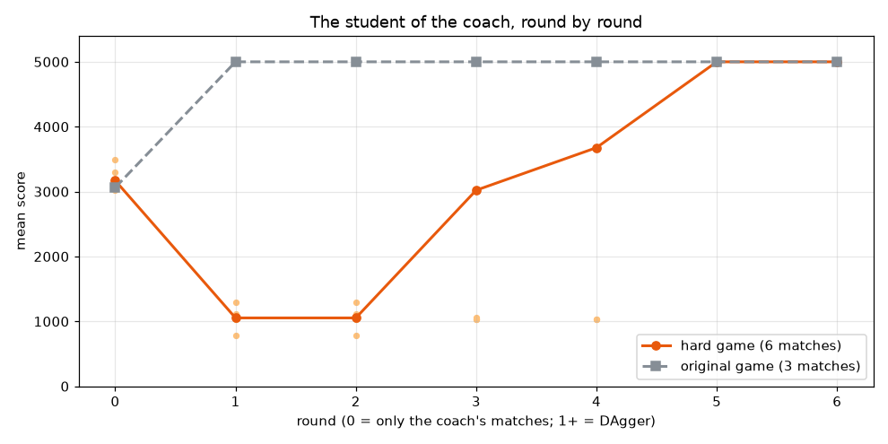

[English](README.md) · **Português** · [Español](README.es.md)

# Lição 8 — Modo difícil: quando o mundo muda

> **Objetivo:** mudar o jogo e ver o que acontece com tudo o que foi treinado no jogo antigo.
> O jogo novo tem formações de pássaros em que pular é fatal. Quem ainda consegue jogar, quem consegue aprender,
> e o que é preciso para isso?


*A mesma partida duas vezes. Em cima: o agente da lição 4 pula numa escadinha de pássaros e bate. Embaixo: o aluno da lição 8 se abaixa por baixo dela e segue em frente.*

O jogo original (`dino/game.py`) não mudou: as lições 1 a 7 continuam usando ele. O jogo difícil é uma versão separada, em [`hard_game.py`](hard_game.py).

Jogue você mesmo:

```bash
python lessons/08-hard-mode/hard_game.py
```

Depois rode os experimentos um de cada vez, nesta ordem. O aluno treinado já está no repositório, então você pode pular o passo 3 e ainda rodar os outros.

1. Quem ainda consegue jogar? Todos os agentes do estudo, nos dois jogos (uns 4 minutos):

```bash
python lessons/08-hard-mode/test_agents.py --student
```

2. O aprendizado por reforço consegue aprender o jogo novo sozinho? Quatro tentativas (uns 10 minutos):

```bash
python lessons/08-hard-mode/rl_attempts.py
```

3. Um aluno que imita um treinador, com DAgger (uns 20 minutos):

```bash
python lessons/08-hard-mode/train_student.py
```

4. Veja o agente da lição 4 e o aluno na mesma partida. R começa uma partida nova:

```bash
python lessons/08-hard-mode/watch.py
```

---

## 1. As formações novas

Quando os pássaros começam a aparecer (por volta de 700 pontos), às vezes surge uma **formação** no lugar de um obstáculo sozinho:

| Formação | O que é | Pular? | Abaixar? |
|---|---|---|---|
| **Túnel** | uma fila longa de pássaros na altura da cabeça, longa demais para pular por cima em qualquer velocidade | ❌ | ✅ o único jeito |
| **Escadinha** | pássaros descendo: alto (75), médio (50), depois três baixos (26) | ❌ um pulo bate em um deles | ✅ o único jeito: fique em pé por baixo dos dois primeiros e se abaixe por baixo do resto |
| **Par** | dois pássaros na altura da cabeça, próximos um do outro | ✅ | ✅ os dois funcionam |

Os cactos e os pássaros sozinhos do jogo original também continuam aparecendo. Um cacto só pode ser pulado, e o pássaro na altura da cabeça pode ser pulado ou o dino pode se abaixar.

Nada disso foi chutado: [`hard_game.py`](hard_game.py) testa todas as sequências de teclas contra todas as formações, em todas as velocidades de 10,5 a 20, e confere que existe um jeito de passar, e quais teclas ele precisa:

```bash
python lessons/08-hard-mode/hard_game.py --verify
```

---

## 2. O mundo mudou: os agentes antigos falham



| Agente | Jogo original | Jogo difícil | Onde ele bateu (10 partidas difíceis) |
|---|---|---|---|
| Lição 3: campeão da neuroevolução | 5000 | 930 | 5 túneis, 4 escadinhas, 1 par |
| Lição 4: aprendizado por reforço | 5000 | 902 | 5 túneis, 3 escadinhas, 2 pares |
| Lição 5: aluno por imitação | 5000 | 946 | 6 túneis, 4 escadinhas |

Os três eram perfeitos no jogo que conheciam, e os três batem nas primeiras formações, logo depois que os pássaros começam a aparecer. Eles aprenderam "pássaro na altura da cabeça: abaixe enquanto ele está longe, pule quando ele estiver perto", que era uma boa regra no jogo antigo. Num túnel ou numa escadinha, esse pulo é fatal.

Não há nada de errado com os agentes. **O mundo mudou** e eles nunca tinham visto esse mundo.

---

## 3. Só o aprendizado por reforço não aprende o jogo novo

A solução óbvia é treinar de novo no jogo novo. [`rl_attempts.py`](rl_attempts.py) tenta quatro vezes, e cada tentativa corrige o que pode ter dado errado na anterior:



| Tentativa | Treino | Jogo original | Jogo difícil |
|---|---|---|---|
| 1. Do zero | 3 milhões de passos, só o jogo difícil | 5000 | 951 |
| 2. Ajuste fino da lição 4 | mais 1 milhão de passos no jogo difícil | 5000 | 950 |
| 3. + currículo | 2 milhões de passos; no treino, as formações aparecem desde o começo, em metade dos obstáculos | 5000 | 953 |
| 4. + mais exploração | como a 3, com um bônus de exploração 3× maior, 3 milhões de passos | 4294 | 955 |

Nenhuma delas consegue passar. Por quê?



Esta é a tentativa 4 chegando perto de uma escadinha. Enquanto os pássaros estão longe, ela dá uns 60% para "abaixar". Quando eles chegam perto, ela troca para "pular" (quase 90%), o seu velho hábito com pássaros, pula na escadinha e bate. Para passar, ela teria que continuar abaixada por muitas decisões seguidas, todas certas, exatamente no momento em que o seu hábito diz "pule". Fazer isso por acaso, com frequência suficiente para perceber que vale a pena, praticamente nunca acontece.

Esse é o **problema da exploração** do aprendizado por reforço: ele só aprende com o que tenta, e algumas soluções são longas demais ou improváveis demais para serem encontradas tentando ao acaso. Mais exploração (tentativa 4) não resolveu, e ainda deixou o agente pior no jogo original.

---

## 4. Um planejador resolve, mas não aprende

[`planner.py`](planner.py) não aprende nada. A cada momento ele olha os obstáculos na tela, imagina os próximos 80 quadros com a própria física do jogo e procura uma sequência de teclas que não bata.

| | Jogo original | Jogo difícil |
|---|---|---|
| O planejador | **5000** | **5000** |

Ele é perfeito, mas:

- ele é **lento**: uns 10 a 20 segundos por partida neste Mac, enquanto uma rede treinada joga uma partida em menos de um segundo;
- ele precisa **conhecer as regras do jogo** (gravidade, força do pulo, velocidade) para imaginar o que vai acontecer;
- ele nunca melhora: cada decisão é calculada de novo do zero.

---

## 5. Um aluno que imita um treinador

Então: quem aprende não consegue achar a solução sozinho, e o planejador acha, mas é lento. A solução é deixar o planejador **ensinar**: a imitação da lição 5, mais o DAgger da lição 6.

**A primeira ideia não funcionou.** Com só o planejador como professor, o aluno quase não aprendeu nada: 463 pontos no jogo difícil depois da rodada 0, e só de 88 a 312 no jogo *original*. Mais duas rodadas de DAgger não o levaram além de 1161. Você pode repetir:

```bash
python lessons/08-hard-mode/train_student.py --teacher planner --rounds 2
```

O planejador apertou "pular" em só **2%** das suas decisões: ele prefere não fazer nada, então pula uma vez, no **último momento possível**, e depois espera. Isso é perfeito para quem calcula, mas um péssimo exemplo para um aluno. Os pulos são tão raros que o aluno mal os aprende (a armadilha da acurácia da lição 5), e um pulo no último momento não deixa margem, então um aluno que atrasa uma decisão bate (como os professores atrasados da lição 5). **Um bom planejador não é necessariamente um bom professor.**

**O que funcionou: um treinador.** [`agents.py`](agents.py) monta um com duas peças:

- **o agente da lição 4** joga como sempre, com os seus pulos confortáveis e antecipados;
- quando uma das formações novas está perto, **o planejador assume**, preferindo se abaixar cedo e continuar abaixado.

[`train_student.py`](train_student.py) então treina um aluno (uma rede pequena que vê os mesmos 6 sensores) para apertar o que o treinador apertaria:

- **rodada 0:** o treinador joga 6 partidas difíceis, e cada decisão é gravada;
- **rodadas 1 a 6 (DAgger):** o *aluno* joga; em cada situação em que ele se mete, o treinador diz o que apertaria; esses exemplos são acrescentados, e um aluno novo é treinado com tudo até ali.



| Rodada | Exemplos | Jogo difícil (6 partidas) | Jogo original (3 partidas) |
|---|---|---|---|
| 0 | 15.000 | 3171 | 3231, 3331, 2624 |
| 1 | 20.676 | 1053 | 5000, 5000, 5000 |
| 2 | 25.764 | 1053 | 5000, 5000, 5000 |
| 3 | 32.773 | 3021 | 5000, 5000, 5000 |
| 4 | 42.773 | 3677 | 5000, 5000, 5000 |
| 5 | 52.773 | **5000** | 5000, 5000, 5000 |
| 6 | 62.773 | **5000** | 5000, 5000, 5000 |

E no teste final, com 10 partidas novas de cada jogo: **5000 em todas, nos dois jogos**, tão bom quanto o planejador e rápido como uma rede.

Duas coisas para notar:

- **Aprender o novo custou o antigo, por um tempo.** Depois da rodada 0, o aluno também estava pior no jogo original (por volta de 3.000 em vez de 5000). As rodadas de DAgger trouxeram isso de volta conforme os exemplos se acumulavam. Os exemplos sempre incluíam os obstáculos antigos também (o jogo difícil ainda tem cactos e pássaros sozinhos), então o aluno continuou praticando eles. Ficar pior em habilidades antigas enquanto aprende novas se chama *esquecimento catastrófico* (*catastrophic forgetting*), e misturar exemplos antigos e novos é um dos remédios de costume.
- **O progresso não foi suave.** As rodadas 1 e 2 ficaram presas em 1053, batendo na mesma escadinha toda vez, até que exemplos suficientes daquela situação se acumulassem.

---

## 6. Dois jeitos de passar: o que cada um escolhe?

O **par** pode ser passado dos dois jeitos. [`pair_choices.py`](pair_choices.py) observa cada par que cada agente consegue passar e confere se o dino estava no ar (pulou) ou abaixado (se abaixou):

```bash
python lessons/08-hard-mode/pair_choices.py
```

Em 12 partidas difíceis:

| Agente | Pares que ele passou | Pulou | Se abaixou |
|---|---|---|---|
| Agente da lição 4 | 9 | **9** | 0 |
| O treinador | 85 | 0 | **85** |
| Aluno da lição 8 | 80 | 0 | **80** |

- **O agente da lição 4 sempre pula.** É o seu velho hábito com pássaros, e num par isso por acaso funciona. (Ele passa tão poucos porque bate no primeiro túnel ou na primeira escadinha.)
- **O treinador sempre se abaixa**, porque o seu planejador foi instruído a preferir se abaixar perto das formações novas.
- **O aluno também sempre se abaixa.** Ele nunca precisou escolher: copiou o *estilo* do treinador, não só os seus resultados.

As duas respostas estão certas. Qual delas um agente escolhe depende de onde ele aprendeu: da própria experiência (lição 4) ou de um professor com uma preferência (o treinador). Um aluno pega as escolhas do seu professor mesmo quando elas eram só uma questão de gosto.

---

## 7. O que isso tem a ver com os LLMs?

Os mesmos problemas, numa escala muito maior:

| No dino | Num LLM |
|---|---|
| Os agentes antigos não conhecem as formações | o modelo não sabe o que aconteceu depois que os seus dados de treino foram coletados (a sua *data de corte*) |
| Os olhos da lição 6 falham numa cena que nunca viram | o modelo se sai pior em assuntos, formatos ou idiomas que eram raros no seu texto de treino |
| O aluno fica pior no jogo original enquanto aprende o difícil | um modelo ajustado com dados novos pode ficar pior em coisas que fazia bem (*esquecimento catastrófico*) |
| Os agentes mantêm um hábito antigo ("pular nos pássaros") que agora é fatal | o modelo aprende atalhos com os seus dados, como "todo número da pergunta é usado na resposta" — e acrescentar uma frase irrelevante com um número pode confundi-lo |
| O aprendizado por reforço não consegue achar uma solução longa tentando ao acaso | o aprendizado por reforço em LLMs também precisa de um ponto de partida que já faça a tarefa razoavelmente bem |

E as soluções também são parecidas:

- **Consultar em vez de lembrar.** O planejador olha a tela *agora*. Os LLMs recebem ferramentas de busca e documentos no momento da pergunta, para não dependerem só do que aprenderam.
- **Mostrar exemplos antes de recompensar.** O aluno precisou de um professor para mostrar como passar; só o reforço não conseguiu achar. Os LLMs são ajustados com bons exemplos (lição 5) antes do aprendizado por reforço (lição 4).
- **Misturar o antigo com o novo.** O aluno recuperou o jogo original porque os exemplos sempre misturavam os dois. Quando os LLMs passam por ajuste fino, dados antigos são misturados pelo mesmo motivo, e as mudanças são mantidas pequenas para o modelo não se afastar demais do que sabia.
- **Treinar nos casos difíceis.** O DAgger acrescentou exatamente as situações em que o aluno errava. Quem constrói LLMs coleta exemplos dos casos em que os modelos falham, incluindo perguntas com detalhes irrelevantes, e treina com eles.
- **Medir tudo, antes e depois.** Cada agente desta lição é testado nos dois jogos. Melhorar uma coisa pode piorar outra, então os LLMs são conferidos em grandes conjuntos de testes antes de cada versão nova ser lançada.

**Lição anterior:** [um mini modelo de linguagem](../07-language-model/README.pt-BR.md) · **Início do estudo:** [todas as lições](../../README.pt-BR.md)
