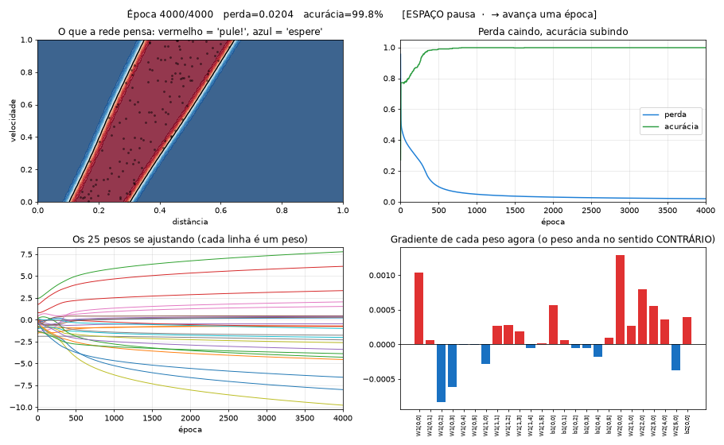
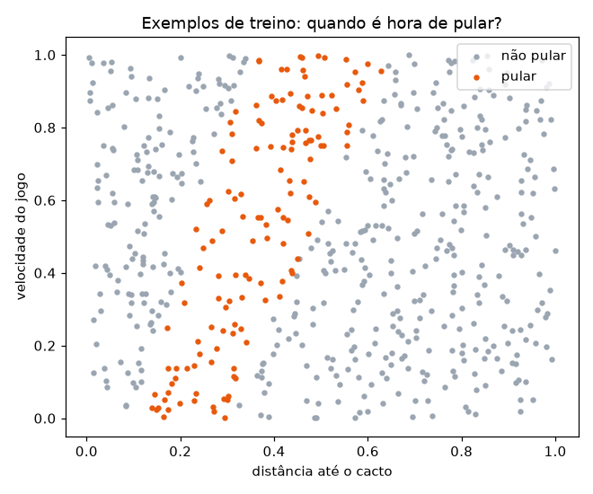
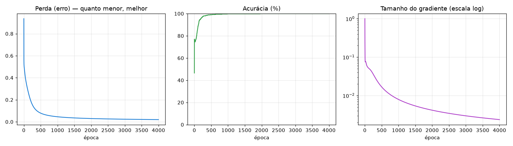
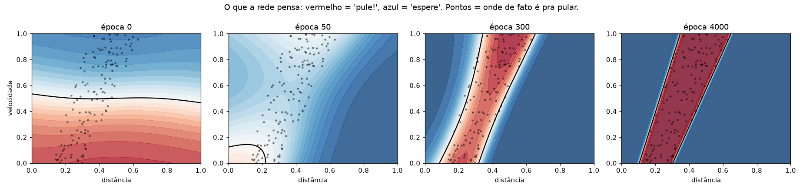
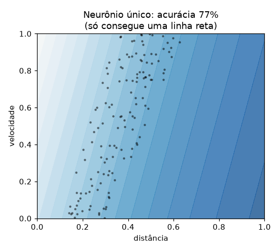

# Lição 1 — Neurônio, perda e gradiente (do zero, só com numpy)

> **Objetivo:** entender o que acontece *por dentro* quando uma rede neural "aprende".
> Sem bibliotecas de IA: cada conta está escrita à mão em
> [`treinar_do_zero.py`](treinar_do_zero.py).

```bash
python licoes/01-neuronio-e-gradiente/treinar_do_zero.py --ao-vivo
```

Abre uma janela e mostra o treino **acontecendo**, época por época: o que a rede pensa, a perda caindo, cada um dos 25 pesos se ajustando e o gradiente de cada peso naquele instante. **ESPAÇO** pausa e, pausado, **→** avança uma única época, para ver um passo de descida de gradiente de cada vez.



Sem o `--ao-vivo`, o script treina em uns 5 segundos, explica as primeiras contas no terminal e salva os gráficos e o CSV em [`resultados/`](resultados/), que são os usados no resto desta página.

---

## 1. O problema

Antes de colocar uma IA no jogo, vamos resolver um pedaço dele isoladamente:

> Dada a **distância até o cacto** e a **velocidade do jogo**, é hora de pular?

A resposta certa é uma **faixa**: se o cacto estiver perto demais, já é tarde; se estiver longe demais, você aterrissa antes dele. E quanto mais rápido o jogo, mais cedo é preciso pular.



A rede **nunca vê essa regra**. Ela só recebe 600 exemplos (os pontos acima) e precisa descobrir o padrão sozinha.

---

## 2. A rede

```
 entradas         camada oculta          saída
 distância  ──┐   ┌─ neurônio 1 ─┐
              ├───┼─ neurônio 2 ─┼───  P(pular)
 velocidade ──┘   └─ ...       6 ┘
```

Cada neurônio faz sempre a mesma coisa:

```
saída = ativação( peso₁·entrada₁ + peso₂·entrada₂ + ... + viés )
```

| Termo | O que é | No código |
|---|---|---|
| **Peso** | O quanto uma entrada importa (pode ser negativo) | `W1`, `W2` |
| **Viés (bias)** | Um "empurrão" fixo, desloca o limiar do neurônio | `b1`, `b2` |
| **Ativação** | Uma curva que entorta a soma. Sem ela, a rede inteira seria só uma reta | `tanh`, `sigmoide` |
| **Forward** | Passar as entradas pela rede e obter a previsão | `forward()` |

Esta rede tem 2×6 + 6 + 6×1 + 1 = **25 números ajustáveis**. Treinar = encontrar bons valores para esses 25 números. (Um LLM grande tem **centenas de bilhões** deles — mas a ideia é a mesma.)

---

## 3. Perda: medindo o quanto a rede erra

Para melhorar, a rede precisa de uma nota. A **perda** (*loss*) é um número que fica grande quando a rede erra e pequeno quando acerta. Usamos a *entropia cruzada binária*, que castiga muito quem erra **com convicção** (dizer 99% "pule" quando era "não pule").

---

## 4. Gradiente: para que lado mexer cada peso?

Imagine a perda como um terreno montanhoso, onde cada posição é uma combinação dos 25 pesos. Queremos chegar ao vale.

O **gradiente** responde, para cada peso: *"se eu aumentar este peso um pouquinho, a perda sobe ou desce? E quanto?"*

- Gradiente **positivo** → aumentar o peso piora → então **diminuímos**.
- Gradiente **negativo** → aumentar o peso melhora → então **aumentamos**.

A regra inteira do aprendizado é esta linha:

```python
peso = peso - taxa_de_aprendizado * gradiente
```

O script mostra isso acontecendo de verdade nas primeiras épocas:

```
Época 0: perda=0.9365  acurácia=46%
  exemplo com um peso, W2[0,0]:
    valor atual = +1.93379
    gradiente   = -0.12817
    novo valor  = +1.93379 - 0.5 × -0.12817 = +1.99788
```

### Como o gradiente é calculado? Retropropagação

A função `backward()` aplica a **regra da cadeia** do cálculo, de trás para frente: primeiro o erro na saída, depois quanto cada neurônio oculto contribuiu para ele, depois quanto cada peso de entrada contribuiu para o neurônio. Por isso o nome *backpropagation*: o erro **volta** pela rede.

### Como saber se a conta está certa? Conferência numérica

O script compara a fórmula com uma estimativa na força bruta (mexe o peso +0,00001 e −0,00001 e mede a diferença na perda). Se baterem, a retropropagação está correta:

```
W1[0, 0]:  -0.084432  vs  -0.084432
W2[3, 0]:  +0.259212  vs  +0.259212
```

---

## 5. Assistindo ao treino

### A curva de aprendizado



- A **perda** despenca nas primeiras centenas de épocas e depois desce devagar.
- A **acurácia** sobe de ~46% (chute) para 100%.
- O **gradiente** vai diminuindo: perto do vale, o terreno fica plano e os passos ficam pequenos.

### Os pesos mudando


Cada linha é um dos 25 números. O CSV [`resultados/historico_pesos.csv`](resultados/historico_pesos.csv) tem o valor exato de todos eles em **cada época** — abra no Excel e explore.

### O que a rede "pensa" ao longo do treino



- **Época 0:** pesos aleatórios, a rede chuta.
- **Época 50:** começou a perceber que "longe = não pular".
- **Época 300:** já encontrou a faixa, ainda borrada.
- **Época 4000:** faixa nítida, praticamente igual à regra verdadeira.

---

## 6. Por que precisamos de uma camada oculta?



Um **neurônio sozinho** só consegue traçar **uma linha reta**. A faixa precisa de duas bordas, então ele desiste e aprende "nunca pule" — o que acerta 77% só porque a maioria dos exemplos é "não pular". Essa é uma armadilha clássica: **acurácia alta não significa que aprendeu**.

Com 6 neurônios ocultos, cada um traça uma reta, e a camada de saída combina essas retas numa forma mais complexa. **Profundidade = capacidade de representar padrões complicados.**

---

## 7. Hiperparâmetros: as regulagens do treino

Ficam no topo do script. Não são aprendidos — **você** escolhe.

| Parâmetro | Valor | O que acontece se mudar |
|---|---|---|
| `TAXA_APRENDIZADO` | 0.5 | Muito pequena (0.01): em 4000 épocas ainda não saiu do "nunca pule" (78%). Muito grande (20): passos enormes, a perda dá saltos de até 10× antes de se acertar. |
| `N_OCULTOS` | 6 | Com 1: não consegue a faixa. Com 2 já consegue (2 retas = 2 bordas). Mais neurônios dão folga para padrões mais complicados. |
| `EPOCAS` | 4000 | Poucas: para no meio do caminho (veja a época 300). |
| `N_EXEMPLOS` | 600 | Com 20: 100% no treino, mas só ~91% em dados novos — a rede "decorou" os exemplos (*overfitting*). |
| `SEMENTE` | 42 | Muda os pesos iniciais e os dados. Resultados finais parecidos, caminhos diferentes. |

## Exercícios

1. Coloque `TAXA_APRENDIZADO = 20` e olhe o `02_perda.png`. Depois tente `0.01`. O que aconteceu em cada caso?
2. Teste `N_OCULTOS = 1` e depois `2`. Qual o mínimo de neurônios para desenhar a faixa? Por quê? Olhe o `04_fronteiras.png`.
3. Coloque `N_EXEMPLOS = 20`. Compare a acurácia no treino com a acurácia em dados novos.
4. Abra o CSV e encontre o peso que mais mudou. Ele está ligado a qual entrada?

---

## E os LLMs?

Um LLM é treinado **exatamente** com esse ciclo — forward, perda, gradiente, passo — só que:

- a entrada é um trecho de texto e a saída é a probabilidade de cada próxima palavra;
- são centenas de bilhões de pesos em vez de 25;
- os dados são trilhões de palavras em vez de 600 pontos;
- usam variações mais espertas da descida de gradiente (como o *Adam*), em milhares de GPUs.

**Próxima lição:** [o ambiente — o jogo que a IA vai jogar](../02-o-ambiente/README.md)
