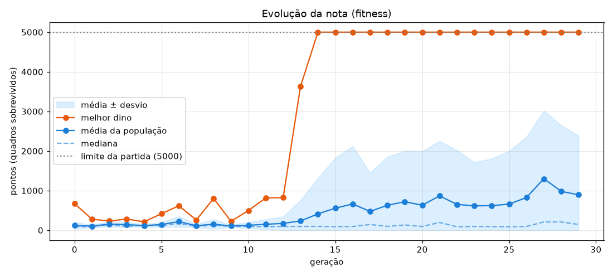
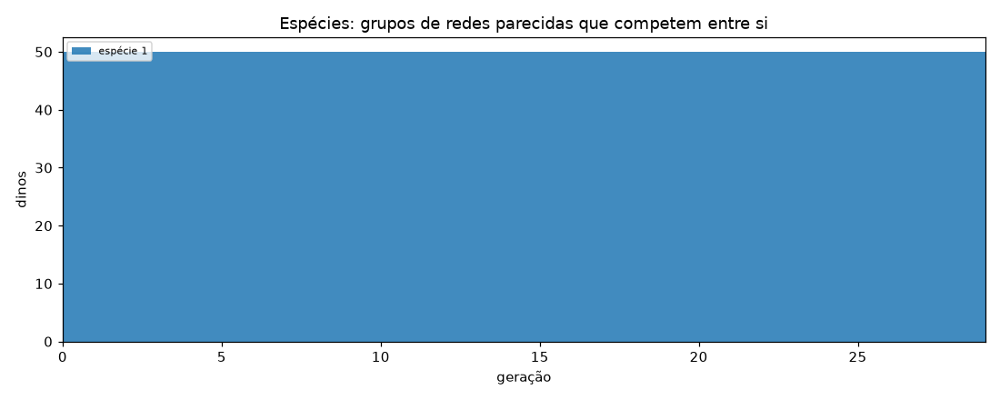
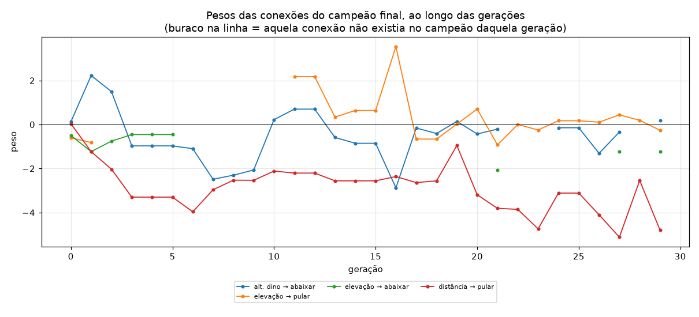

# Relatório do treino — neuroevolução

> Gerado automaticamente por `relatorio.py` a partir de `historico.json`.
> Rode o treino de novo e este relatório muda — cada execução é uma evolução diferente.

## Resumo

| | |
|---|---|
| Gerações | 30 |
| Dinos por geração | 50 |
| Primeira geração a atingir 5000 pontos | 14 |
| Média da população: geração 0 → última | 120 → 893 |
| Campeão final: conexões / neurônios ocultos | 4 / 0 |

## 1. A nota ao longo das gerações

O **melhor** sobe rápido (basta um dino com sorte). A **média** sobe mais devagar: é a população inteira herdando o que funciona.

## 2. Espécies

O NEAT separa as redes em espécies, e cada uma compete principalmente dentro do próprio grupo. Isso protege inovações (uma conexão nova, que no início costuma piorar a rede) de serem eliminadas antes de terem chance de amadurecer.

## 3. Tamanho da rede

O NEAT começa com a rede mínima e só adiciona neurônios e conexões quando isso ajuda. Também remove o que não serve.

## 4. Os pesos se ajustando

Cada linha é uma conexão do campeão final, e mostra quanto ela valia no campeão de cada geração. Os campeões são indivíduos diferentes, mas parentes: genes (conexões) são herdados e vão sofrendo pequenas mutações. Note que **não existe gradiente aqui** — os pesos mudam por mutação aleatória + seleção dos melhores.

Todos os pesos de todos os dinos, por geração. Na geração 0 são aleatórios em torno de zero; com o tempo a distribuição muda de forma conforme a seleção favorece certos valores.

## 5. As redes dos campeões

## 6. O campeão final, peso por peso

Ordenado pela força (valor absoluto) do peso:

| De | Para | Peso |
|---|---|---|
| distância | pular | -4.795 |
| elevação | abaixar | -1.234 |
| elevação | pular | -0.265 |
| alt. dino | abaixar | +0.171 |

## 7. Parâmetros usados neste treino

| Seção | Parâmetro | Valor | O que faz |
|---|---|---|---|
| `NEAT` | `pop_size` | 50 | Quantos dinos (redes) existem em cada geração. |
| `NEAT` | `fitness_threshold` | 5000 | Nota considerada 'meta atingida'. |
| `NEAT` | `no_fitness_termination` | True | Se True, roda todas as gerações pedidas mesmo após bater a meta. |
| `DefaultGenome` | `num_inputs` | 6 | Quantos sensores a rede recebe. |
| `DefaultGenome` | `num_outputs` | 3 | Quantas ações a rede pode escolher. |
| `DefaultGenome` | `num_hidden` | 0 | Neurônios ocultos no início (o NEAT cria mais se precisar). |
| `DefaultGenome` | `initial_connection` | full | 'full' = toda entrada começa ligada a toda saída. |
| `DefaultGenome` | `activation_default` | tanh | Função de ativação dos neurônios. |
| `DefaultGenome` | `weight_init_stdev` | 1.0 | Quão espalhados são os pesos aleatórios iniciais. |
| `DefaultGenome` | `weight_mutate_rate` | 0.8 | Chance de cada peso sofrer mutação a cada geração. |
| `DefaultGenome` | `weight_mutate_power` | 0.5 | Tamanho típico da mutação (um 'empurrão' aleatório no peso). |
| `DefaultGenome` | `weight_replace_rate` | 0.1 | Chance de um peso ser trocado por um valor totalmente novo. |
| `DefaultGenome` | `bias_mutate_rate` | 0.7 | Chance de cada viés sofrer mutação. |
| `DefaultGenome` | `conn_add_prob` | 0.5 | Chance de nascer uma conexão nova. |
| `DefaultGenome` | `conn_delete_prob` | 0.5 | Chance de uma conexão ser removida. |
| `DefaultGenome` | `node_add_prob` | 0.2 | Chance de nascer um neurônio novo (no meio de uma conexão). |
| `DefaultGenome` | `node_delete_prob` | 0.2 | Chance de um neurônio ser removido. |
| `DefaultSpeciesSet` | `compatibility_threshold` | 3.0 | Quão diferentes duas redes precisam ser para virarem espécies distintas. |
| `DefaultStagnation` | `max_stagnation` | 20 | Gerações sem melhorar até uma espécie ser extinta. |
| `DefaultReproduction` | `elitism` | 2 | Quantos melhores de cada espécie passam intactos para a próxima geração. |
| `DefaultReproduction` | `survival_threshold` | 0.2 | Fração de cada espécie que pode ter 'filhos'. |

O arquivo completo está em [`config-neat.txt`](../config-neat.txt).

## 8. Geração por geração

| Geração | Melhor | Média | Mediana | Espécies | Conexões do campeão |
|---|---|---|---|---|---|
| 0 | 669 | 120 | 88 | 1 | 18 |
| 1 | 277 | 103 | 96 | 1 | 19 |
| 2 | 233 | 154 | 141 | 1 | 18 |
| 3 | 281 | 141 | 95 | 1 | 15 |
| 4 | 213 | 116 | 130 | 1 | 15 |
| 5 | 417 | 143 | 116 | 1 | 15 |
| 6 | 618 | 217 | 168 | 1 | 11 |
| 7 | 258 | 114 | 97 | 1 | 13 |
| 8 | 803 | 152 | 127 | 1 | 10 |
| 9 | 224 | 107 | 96 | 1 | 8 |
| 10 | 497 | 125 | 97 | 1 | 6 |
| 11 | 814 | 150 | 92 | 1 | 7 |
| 12 | 823 | 172 | 95 | 1 | 7 |
| 13 | 3635 | 233 | 96 | 1 | 7 |
| 14 | 5000 | 412 | 97 | 1 | 7 |
| 15 | 5000 | 557 | 92 | 1 | 7 |
| 16 | 5000 | 662 | 95 | 1 | 9 |
| 17 | 5000 | 475 | 144 | 1 | 6 |
| 18 | 5000 | 631 | 96 | 1 | 6 |
| 19 | 5000 | 719 | 133 | 1 | 7 |
| 20 | 5000 | 632 | 95 | 1 | 5 |
| 21 | 5000 | 867 | 195 | 1 | 5 |
| 22 | 5000 | 652 | 88 | 1 | 5 |
| 23 | 5000 | 615 | 95 | 1 | 5 |
| 24 | 5000 | 621 | 92 | 1 | 3 |
| 25 | 5000 | 658 | 88 | 1 | 3 |
| 26 | 5000 | 826 | 96 | 1 | 3 |
| 27 | 5000 | 1300 | 210 | 1 | 4 |
| 28 | 5000 | 982 | 208 | 1 | 3 |
| 29 | 5000 | 893 | 145 | 1 | 4 |
